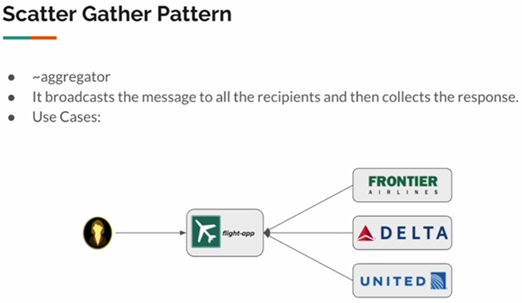
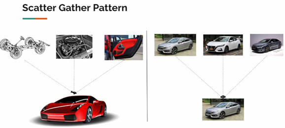

# 📚 Sección 3: Scatter-Gather Pattern: Composición de servicios de alto rendimiento

## 🔎 Scatter-Gather Pattern - Introducción

### 🎯 Planteamiento del problema

El patrón **Scatter-Gather** permite enviar una misma solicitud a varios servicios, recopilar sus respuestas y
procesarlas para generar una respuesta al cliente.

A primera vista, puede parecer similar al **Gateway Aggregator Pattern**, que estudiamos en la sección anterior. Ambos
patrones permiten que un servicio consulte a varios microservicios y reúna sus resultados. Sin embargo, se diferencian
principalmente en el tipo de información que solicitan y en cómo utilizan las respuestas.

### ✈️ Ejemplo: aplicación de reserva de vuelos

Imaginemos una aplicación de búsqueda de vuelos, similar a Google Flights o Kayak. El usuario introduce un origen y un
destino, y la aplicación consulta a varias aerolíneas para encontrar vuelos disponibles.

<text color="secondary" size="sm">Diagrama 1. La aplicación consulta varias aerolíneas.</text>



El flujo funciona de la siguiente manera:

1. El usuario solicita vuelos para una ruta determinada.
2. La aplicación envía la misma solicitud a los servicios de distintas aerolíneas, como Frontier, Delta y United. Esta
   etapa se conoce como **Scatter** (dispersión).
3. Cada servicio devuelve los vuelos que tiene disponibles.
4. La aplicación reúne las respuestas, las procesa y devuelve el resultado al usuario. Esta etapa se conoce como
   **Gather** (recopilación).

Una vez recopilados los resultados, la aplicación puede mostrar todos los vuelos disponibles o aplicar una lógica
adicional para seleccionar los más baratos, los más rápidos o los que mejor se ajusten a las preferencias del usuario.

### 🔄 Diferencia entre Gateway Aggregator y Scatter-Gather

Aunque ambos patrones consultan varios servicios y combinan sus respuestas, su propósito es diferente.



- **Gateway Aggregator Pattern:** consulta distintos servicios para obtener partes complementarias de la información y
  construir una respuesta completa. Por ejemplo, solicita la carrocería, el motor y las puertas para formar la
  representación de un automóvil.

- **Scatter-Gather Pattern:** consulta varios servicios para obtener respuestas del mismo tipo y después las reúne o
  compara. Por ejemplo, solicita a distintas aerolíneas sus vuelos disponibles para una misma ruta y selecciona la mejor
  opción.

En resumen:

- **Gateway Aggregator:** reúne información complementaria para construir una respuesta.
- **Scatter-Gather:** obtiene respuestas alternativas o equivalentes de varios servicios para reunirlas, compararlas o
  seleccionar las más convenientes.

## 🔌 External Services

En esta sección utilizaremos los servicios externos proporcionados por el curso para simular distintas aerolíneas. Estos
servicios tienen diferentes formas de recibir solicitudes y pueden presentar errores ocasionales. Nuestro objetivo será
integrarlos mediante el patrón **Scatter-Gather**.

### 🚀 Iniciando los servicios externos

Ejecutamos el siguiente comando desde la raíz del proyecto:

````bash
D:\programming\spring\01.udemy\03.vinoth_selvaraj\spring-webflux-patterns-resilience (main -> origin)
$ java -jar .\external-services\external-services-v2.jar

  .   ____          _            __ _ _
 /\\ / ___'_ __ _ _(_)_ __  __ _ \ \ \ \
( ( )\___ | '_ | '_| | '_ \/ _` | \ \ \ \
 \\/  ___)| |_)| | | | | || (_| |  ) ) ) )
  '  |____| .__|_| |_|_| |_\__, | / / / /
 =========|_|==============|___/=/_/_/_/
 :: Spring Boot ::                (v2.6.4)

2026-10-23 12:17:16.381  INFO 14568 --- [           main] c.v.e.ExternalServicesApplication        : Starting ExternalServicesApplication v0.0.1-SNAPSHOT using Java 25.0.2 on SysEngJava with PID 14568 (D:\programming\spring\01.udemy\03.vinoth_selvaraj\spring-webflux-patterns-resilience\external-services\external-services-v2.jar started by magadiflo in D:\programming\spring\01.udemy\03.vinoth_selvaraj\spring-webflux-patterns-resilience)
2026-10-23 12:17:16.386  INFO 14568 --- [           main] c.v.e.ExternalServicesApplication        : No active profile set, falling back to 1 default profile: "default"
WARNING: A terminally deprecated method in sun.misc.Unsafe has been called
WARNING: sun.misc.Unsafe::objectFieldOffset has been called by io.netty.util.internal.PlatformDependent0$3 (jar:file:/D:/programming/spring/01.udemy/03.vinoth_selvaraj/spring-webflux-patterns-resilience/external-services/external-services-v2.jar!/BOOT-INF/lib/netty-common-4.1.74.Final.jar!/)
WARNING: Please consider reporting this to the maintainers of class io.netty.util.internal.PlatformDependent0$3
WARNING: sun.misc.Unsafe::objectFieldOffset will be removed in a future release
2026-10-23 12:17:18.669  INFO 14568 --- [           main] o.s.b.web.embedded.netty.NettyWebServer  : Netty started on port 7070
2026-10-23 12:17:19.065  INFO 14568 --- [           main] c.v.e.ExternalServicesApplication        : Started ExternalServicesApplication in 3.103 seconds (JVM running for 3.573)
````

### 📖 Explorando los endpoints

Accedemos a [Swagger UI](http://localhost:7070/swagger-ui/) y desplegamos `sec02-scatter-gather: Flights Controller`.
Allí encontramos tres endpoints:

| Servicio | Método | Endpoint                     |
|----------|--------|------------------------------|
| Delta    | GET    | `/sec02/delta/{from}/{to}`   |
| Frontier | POST   | `/sec02/frontier`            |
| JetBlue  | GET    | `/sec02/jetblue/{from}/{to}` |

- **Delta:** recibe el origen y el destino mediante parámetros de ruta. Puede presentar errores ocasionales y no valida
  estos valores.
- **Frontier:** recibe el origen y el destino en el cuerpo de una solicitud `POST`, con un formato como
  `{ "from": "string", "to": "string" }`. También puede presentar errores ocasionales y no valida los valores.
- **JetBlue:** recibe el origen y el destino mediante parámetros de ruta.

Los tres endpoints devuelven respuestas con el tipo de contenido `text/event-stream`, que permite transmitir los
resultados progresivamente mediante eventos enviados por el servidor (`Server-Sent Events` o `SSE`).

### 🧪 Probando el servicio Delta

Realizamos una petición con `curl` para consultar los vuelos de `Delta` desde `ALT` hasta `LAS`:

````bash
$ curl -v http://localhost:7070/sec02/delta/ALT/LAS
>
< HTTP/1.1 200 OK
< transfer-encoding: chunked
< Content-Type: text/event-stream;charset=UTF-8
<
data:{"airline":"DELTA","from":"ALT","to":"LAS","price":550.33,"date":"2026-10-30"}

data:{"airline":"DELTA","from":"ALT","to":"LAS","price":229.78,"date":"2026-10-28"}

data:{"airline":"DELTA","from":"ALT","to":"LAS","price":177.85,"date":"2026-10-26"}

data:{"airline":"DELTA","from":"ALT","to":"LAS","price":298.75,"date":"2026-11-08"}

data:{"airline":"DELTA","from":"ALT","to":"LAS","price":158.19,"date":"2026-11-06"}

data:{"airline":"DELTA","from":"ALT","to":"LAS","price":481.13,"date":"2026-11-03"}

* Connection #0 to host localhost:7070 left intact 
````

Cada evento contiene los datos de un vuelo: aerolínea, origen, destino, precio y fecha.

### 🧪 Probando el servicio Frontier

Frontier utiliza el método `POST`, por lo que debemos enviar el origen y el destino en el cuerpo de la solicitud,
en formato JSON:

````bash
$ curl -v -X POST -H "Content-Type: application/json" -d "{\"from\": \"ALT\", \"to\": \"LAS\"}" http://localhost:7070/sec02/frontier
>
< HTTP/1.1 200 OK
< transfer-encoding: chunked
< Content-Type: text/event-stream;charset=UTF-8
<
data:{"airline":"FRONTIER","from":"ALT","to":"LAS","price":454.72,"date":"2026-11-14"}

data:{"airline":"FRONTIER","from":"ALT","to":"LAS","price":400.82,"date":"2026-11-10"}

data:{"airline":"FRONTIER","from":"ALT","to":"LAS","price":521.4,"date":"2026-11-17"}

data:{"airline":"FRONTIER","from":"ALT","to":"LAS","price":287.86,"date":"2026-11-16"}

* Connection #0 to host localhost:7070 left intact
````

En este caso, cada evento contiene la aerolínea, el origen, el destino, el precio y la fecha del vuelo.

### 🧪 Probando el servicio JetBlue

JetBlue recibe el origen y el destino mediante parámetros de ruta:

````bash
$ curl -v http://localhost:7070/sec02/jetblue/ALT/LAS
>
< HTTP/1.1 200 OK
< transfer-encoding: chunked
< Content-Type: text/event-stream;charset=UTF-8
<
data:{"price":122.15,"date":"2026-10-31"}

data:{"price":344.06,"date":"2026-11-11"}

data:{"price":403.28,"date":"2026-11-04"}

* Connection #0 to host localhost:7070 left intact
````

A diferencia de los otros dos servicios, los eventos de JetBlue solo contienen el precio y la fecha; no incluyen los
campos de aerolínea, origen ni destino.

> **Nota:** Cada línea `data:` representa un evento que contiene un resultado emitido por el servicio.

> **Nota:** Para observar cómo se emiten los vuelos progresivamente, podemos utilizar `curl` sin `| jq`
> o acceder al endpoint directamente desde el navegador. En cambio, al realizar la petición desde `Swagger UI`,
> veremos un indicador de carga (loading) y, al finalizar la solicitud, se mostrará el resultado completo,
> sin apreciar claramente la emisión progresiva de los datos.

### 💡 Conclusión

Los servicios de las aerolíneas presentan diferencias tanto en sus interfaces como en la estructura de sus respuestas.
Además, pueden producir errores ocasionales. El patrón Scatter-Gather nos permitirá encapsular estas diferencias,
consultar los servicios para una misma búsqueda, reunir los vuelos obtenidos y procesar sus resultados para devolver una
respuesta unificada al cliente.

## 🧱 Creando DTO

Los servicios de las aerolíneas no devuelven necesariamente la misma estructura de datos. Por ejemplo, Delta y Frontier
incluyen la aerolínea, el origen, el destino, el precio y la fecha, mientras que JetBlue solo devuelve el precio y la
fecha.

Para unificar las respuestas, creamos el DTO `FlightResult`, que representa un vuelo con todos los campos que nuestra
aplicación necesita:

````java
public record FlightResult(String airline,
                           String from,
                           String to,
                           Double price,
                           LocalDate date) {
}
````

Este DTO nos permite representar los vuelos de todas las aerolíneas con una estructura común. En el caso de JetBlue, los
campos airline, from y to pueden completarse con información conocida por nuestra aplicación: la aerolínea consultada y
la ruta solicitada.

Así, aunque las respuestas originales tengan estructuras diferentes, podemos transformarlas a un formato uniforme para
procesarlas y reunirlas mediante el patrón `Scatter-Gather`.

