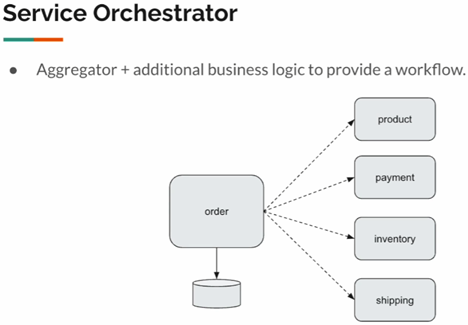
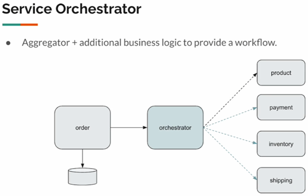
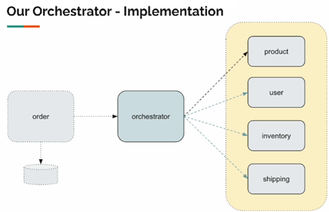

# 📚 Sección 4: Patrón Saga con orquestador: transacciones distribuidas y flujos de trabajo en paralelo

## 🧭 Patrón Orquestador: Introducción

El `patrón Orquestador` permite coordinar la ejecución de varios microservicios para completar un proceso de negocio.
A diferencia de un agregador convencional, que principalmente reúne datos de diferentes servicios, un orquestador
también incorpora lógica de coordinación para controlar el flujo de ejecución y gestionar los posibles fallos.

### ⚠️ El problema: coordinar varios microservicios

Imaginemos un sistema de pedidos compuesto por cuatro microservicios:

- **Product Service:** proporciona información del producto, como su precio.
- **Payment Service:** procesa el pago del cliente.
- **Inventory Service:** comprueba y reserva las existencias.
- **Shipping Service:** gestiona el envío del pedido.

Cada microservicio realiza sus propias operaciones y funciona de manera independiente. Sin embargo, completar un pedido
requiere coordinar las operaciones de varios de ellos.

Por ejemplo, supongamos que un cliente realiza un pedido y el pago se procesa correctamente, pero después el servicio de
inventario informa que el producto no está disponible. No basta con marcar el pedido como fallido: también debemos
**compensar las operaciones que ya se realizaron**, por ejemplo, reembolsar el pago. Asimismo, si se había reservado o
iniciado un envío, podría ser necesario cancelarlo.

Este escenario implica coordinar múltiples servicios, gestionar sus respuestas y decidir qué acciones tomar cuando
alguna operación falla.

### 🧱 Primera alternativa: coordinar desde Order Service

Una solución inicial sería implementar toda la lógica de coordinación dentro de Order Service.

Este servicio recibiría el pedido y realizaría llamadas a Product, Payment, Inventory y Shipping. También tendría que
decidir qué hacer si una operación falla y ejecutar las acciones compensatorias necesarias.



Aunque esta solución podría funcionar, tiene una desventaja: Order Service terminaría acumulando demasiadas
responsabilidades. Además de gestionar los pedidos y su persistencia, tendría que controlar el flujo de ejecución de los
demás microservicios y manejar los fallos de todo el proceso.

Esto aumentaría su complejidad y dificultaría el mantenimiento de la aplicación.

### 🧩 Solución: separar la coordinación en Orchestrator Service

En lugar de concentrar toda esa lógica en Order Service, podemos crear un microservicio independiente llamado
Orchestrator Service, cuya responsabilidad será coordinar las operaciones necesarias para completar el pedido.



El flujo de trabajo sería el siguiente:

1. **Recepción del pedido:** Order Service recibe la solicitud y realiza las validaciones básicas.
2. **Registro inicial:** si las validaciones son correctas, guarda el pedido en su base de datos con el estado CREATED.
   Esto indica que el pedido se ha registrado, pero todavía no se ha completado.
3. **Inicio de la orquestación:** Order Service delega la coordinación del proceso en Orchestrator Service.
4. **Consulta del producto:** el orquestador obtiene la información necesaria del producto, como su precio.
5. **Ejecución de operaciones en paralelo:** después de obtener la información básica del producto, el orquestador
   coordina las llamadas a `Payment Service`, `Inventory Service` y `Shipping Service` **de forma paralela.** De esta
   manera, **las tres operaciones pueden ejecutarse simultáneamente,** en lugar de esperar a que una termine para
   iniciar la siguiente.
6. **Finalización del pedido:** si todas las operaciones requeridas tienen éxito, el pedido se actualiza al estado
   SUCCESSFUL.
7. **Gestión de fallos:** si alguna operación falla, el orquestador determina qué acciones compensatorias son
   necesarias. Por ejemplo, puede solicitar un reembolso si el pago ya se procesó y cancelar un envío que se hubiera
   iniciado.

De esta manera, Order Service se concentra en la gestión del pedido, mientras que Orchestrator Service controla el flujo
de trabajo distribuido.

### 💡 Relación con el patrón Saga

Esta arquitectura es una aplicación del patrón Saga, que permite coordinar una transacción de negocio mediante una
secuencia de operaciones locales ejecutadas en diferentes microservicios.

Como no existe una única transacción de base de datos que abarque todos los servicios, si una operación falla después de
que otras hayan tenido éxito, pueden ejecutarse transacciones compensatorias para deshacer sus efectos de negocio.

En este enfoque, el orquestador mantiene el control del proceso: decide qué operación ejecutar a continuación, cuándo el
pedido puede considerarse exitoso y qué compensaciones deben realizarse ante un fallo.

> **Idea clave:** el patrón Orquestador separa la lógica de coordinación del servicio de pedidos y permite gestionar de
> forma centralizada el flujo de trabajo, los errores y las compensaciones de una transacción distribuida.

## 🎯 Orchestrator Scope

En este apartado implementaremos el `Orchestrator Service`, responsable de coordinar el flujo de trabajo de una
transacción distribuida entre varios microservicios.

Nuestro archivo `external-services-v2.jar` ya incluye los servicios externos que consumiremos, por lo que nuestro
trabajo consistirá en implementar el orquestador y definir cómo debe actuar ante los distintos resultados.

### 🏗️ Arquitectura del Orchestrator

La arquitectura mantiene el flujo iniciado por `Order Service`, que se comunica con `Orchestrator Service`. A partir de
ahí, el orquestador consulta primero a `Product Service` para obtener la información del producto.

Una vez obtenida esa información, **realiza tres llamadas en paralelo** a los siguientes microservicios:

- `User Service`: gestiona las operaciones relacionadas con el usuario, como consultar sus datos, descontar fondos y
  realizar reembolsos.
- `Inventory Service`: gestiona las operaciones relacionadas con el inventario.
- `Shipping Service`: gestiona las operaciones relacionadas con el envío.



En este escenario, `User Service` cumple el papel que desempeñaba `Payment Service` en el ejemplo anterior: sus
endpoints permiten realizar operaciones como descontar fondos y reembolsarlos. Esto no significa necesariamente que
ambos servicios sean idénticos, sino que cumplen una función equivalente dentro del flujo ilustrado.

### ⚙️ Flujo de ejecución

Cuando el orquestador recibe una solicitud, sigue estos pasos:

1. Consulta a Product Service para obtener la información del producto.
2. Si la consulta del producto falla con un 404 Not Found, el proceso no puede continuar y se devuelve ese resultado.
3. Si la consulta tiene éxito, inicia en paralelo las llamadas a User Service, Inventory Service y Shipping Service.
4. Evalúa los resultados de las operaciones para determinar si el pedido puede completarse o si es necesario ejecutar
   acciones compensatorias.
5. Si todas las operaciones requeridas tienen éxito, el pedido termina con estado SUCCESS.
6. Si alguna operación falla, el pedido termina con estado FAILED y el orquestador coordina las compensaciones
   necesarias para revertir los efectos de las operaciones que ya se habían completado.

### 📊 Resultados posibles y acciones del orquestador

La siguiente matriz muestra cómo debe responder el sistema ante diferentes resultados de los microservicios:

| product-service | user-service | inventory-service | shipping-service | Order Status | Orchestrator Actions                |
|-----------------|--------------|-------------------|------------------|--------------|-------------------------------------|
| Success         | Success      | Success           | Success          | Success      | —                                   |
| 404             | —            | —                 | —                | —            | 404                                 |
| Success         | Failed       | Success           | Success          | Failed       | Restore Inventory. Cancel Shipping. |
| Success         | Success      | Failed            | Success          | Failed       | Refund User. Cancel Shipping.       |
| Success         | Success      | Success           | Failed           | Failed       | Refund User. Restore Inventory.     |

#### ¿Por qué son necesarias las compensaciones?

En una transacción distribuida, cada microservicio puede completar su propia operación antes de que otro servicio falle.
Por ejemplo, si el usuario ya realizó el pago y después falla la operación de inventario, no basta con marcar el pedido
como fallido: también hay que devolver el dinero y cancelar las operaciones relacionadas que se hayan completado.

Estas acciones compensatorias permiten mantener la coherencia del proceso de negocio, aunque no equivalen a una única
transacción atómica que abarque todos los microservicios.

## 🔌 Servicios externos

Iniciamos el servicio externo ejecutando el archivo `external-services-v2.jar` desde la terminal:

````bash
D:\programming\spring\01.udemy\03.vinoth_selvaraj\spring-webflux-patterns-resilience (main -> origin)
$ java -jar .\external-services\external-services-v2.jar

  .   ____          _            __ _ _
 /\\ / ___'_ __ _ _(_)_ __  __ _ \ \ \ \
( ( )\___ | '_ | '_| | '_ \/ _` | \ \ \ \
 \\/  ___)| |_)| | | | | || (_| |  ) ) ) )
  '  |____| .__|_| |_|_| |_\__, | / / / /
 =========|_|==============|___/=/_/_/_/
 :: Spring Boot ::                (v2.6.4)

2026-10-28 11:38:34.163  INFO 10264 --- [           main] c.v.e.ExternalServicesApplication        : Starting ExternalServicesApplication v0.0.1-SNAPSHOT using Java 25.0.2 on SysEngJava with PID 10264 (D:\programming\spring\01.udemy\03.vinoth_selvaraj\spring-webflux-patterns-resilience\external-services\external-services-v2.jar started by magadiflo in D:\programming\spring\01.udemy\03.vinoth_selvaraj\spring-webflux-patterns-resilience)
2026-10-28 11:38:34.168  INFO 10264 --- [           main] c.v.e.ExternalServicesApplication        : No active profile set, falling back to 1 default profile: "default"
WARNING: A terminally deprecated method in sun.misc.Unsafe has been called
WARNING: sun.misc.Unsafe::objectFieldOffset has been called by io.netty.util.internal.PlatformDependent0$3 (jar:file:/D:/programming/spring/01.udemy/03.vinoth_selvaraj/spring-webflux-patterns-resilience/external-services/external-services-v2.jar!/BOOT-INF/lib/netty-common-4.1.74.Final.jar!/)
WARNING: Please consider reporting this to the maintainers of class io.netty.util.internal.PlatformDependent0$3
WARNING: sun.misc.Unsafe::objectFieldOffset will be removed in a future release
2026-10-28 11:38:36.325  INFO 10264 --- [           main] o.s.b.web.embedded.netty.NettyWebServer  : Netty started on port 7070
2026-10-28 11:38:36.716  INFO 10264 --- [           main] c.v.e.ExternalServicesApplication        : Started ExternalServicesApplication in 2.947 seconds (JVM running for 3.338)
````

Una vez iniciado el servicio, abrimos Swagger UI en el navegador y buscamos el apartado `sec03-orchestrator`, donde
encontraremos los endpoints que utilizaremos para implementar y probar nuestro Orchestrator Service.

### 🛍️ Product Service

Este servicio proporciona la información de un producto a partir de su identificador.

````bash
$ curl -v http://localhost:7070/sec03/product/1 | jq
>
< HTTP/1.1 200 OK
< Content-Type: application/json
< Content-Length: 77
<
{
  "id": 1,
  "category": "Movies",
  "description": "Practical Iron Gloves",
  "price": 79
}
````

La respuesta contiene el identificador, la categoría, la descripción y el precio del producto. El orquestador utilizará
esta información como parte del proceso de pedido.

### 👤 User Service

Este servicio permite consultar la información de un usuario, descontar fondos de su saldo y realizar reembolsos.

#### 1. Consultar un usuario

````bash
$ curl -v http://localhost:7070/sec03/user/1 | jq
>
< HTTP/1.1 200 OK
< Content-Type: application/json
< Content-Length: 149
<
{
  "userId": 1,
  "name": "Andy Macejkovic",
  "balance": 376,
  "address": {
    "street": "91364 Arnold Key",
    "city": "Bradtkeburgh",
    "state": "Montana",
    "zipCode": "63727"
  }
}
````

La respuesta incluye los datos del usuario, su saldo y su dirección.

#### 2. Descontar fondos

````bash
$ curl -v -X POST -H "Content-Type: application/json" -d "{\"amount\": 100, \"orderId\": \"3fa85f64-5717-4562-b3fc-2c963f66afa6\", \"userId\": 1 }" http://localhost:7070/sec03/user/deduct | jq
>
< HTTP/1.1 200 OK
< Content-Type: application/json
< Content-Length: 73
<
{
  "userId": 1,
  "name": "Novella Turcotte I",
  "balance": 308,
  "status": "SUCCESS"
} 
````

Este endpoint descuenta fondos asociados al pedido. Si la operación se completa correctamente, la respuesta indica
SUCCESS.

#### 3. Reembolsar fondos

````bash
$ curl -v -X POST -H "Content-Type: application/json" -d "{\"amount\": 100, \"orderId\": \"3fa85f64-5717-4562-b3fc-2c963f66afa6\", \"userId\": 1 }" http://localhost:7070/sec03/user/refund | jq
>
< HTTP/1.1 200 OK
< Content-Type: application/json
< Content-Length: 73
<
{
  "userId": 1,
  "name": "Novella Turcotte I",
  "balance": 408,
  "status": "SUCCESS"
}
````

Este endpoint permite devolver los fondos descontados. En el patrón Saga, el reembolso puede utilizarse como acción
compensatoria cuando una operación posterior del proceso falla.

> **Nota:** los valores mostrados corresponden a las respuestas obtenidas durante las pruebas. El saldo puede variar
> según las operaciones realizadas y el estado mantenido por el servicio externo.

### 📦 Inventory Service

Este servicio permite consultar la cantidad disponible de un producto, descontar unidades del inventario y restaurarlas
cuando sea necesario.

#### 1. Consultar el inventario

````bash
$ curl -v http://localhost:7070/sec03/inventory/1 | jq
>
< HTTP/1.1 200 OK
< Content-Type: application/json
< Content-Length: 2
<
10
````

El resultado indica que hay 10 unidades disponibles del producto con identificador 1.

#### 2. Descontar unidades

````bash
$ curl -v -X POST -H "Content-Type: application/json" -d "{\"orderId\": \"3fa85f64-5717-4562-b3fc-2c963f66afa6\", \"productId\": 1, \"quantity\": 3}" http://localhost:7070/sec03/inventory/deduct | jq
>
< HTTP/1.1 200 OK
< Content-Type: application/json
< Content-Length: 69
<
{
  "productId": 1,
  "quantity": 3,
  "remainingQuantity": 2,
  "status": "SUCCESS"
}
````

La respuesta indica que se procesó una solicitud para descontar 3 unidades y que el servicio informa de 2 unidades
restantes.

#### 3. Restaurar unidades

````bash
$ curl -v -X POST -H "Content-Type: application/json" -d "{\"orderId\": \"3fa85f64-5717-4562-b3fc-2c963f66afa6\", \"productId\": 1, \"quantity\": 8}" http://localhost:7070/sec03/inventory/restore | jq
>
< HTTP/1.1 200 OK
< Content-Type: application/json
< Content-Length: 70
<
{
  "productId": 1,
  "quantity": 8,
  "remainingQuantity": 10,
  "status": "SUCCESS"
}
````

Este endpoint permite restaurar unidades al inventario. En una Saga, el orquestador puede invocarlo como acción
compensatoria si otra operación falla después de haber descontado existencias.

### 🚚 Shipping Service

Este servicio permite programar un envío y cancelar una programación existente.

#### 1. Programar un envío

````bash
$ curl -v -X POST -H "Content-Type: application/json" -d "{\"orderId\": \"3fa85f64-5717-4562-b3fc-2c963f66afa6\", \"userId\": 1, \"quantity\": 10}" http://localhost:7070/sec03/shipping/schedule | jq
>
< HTTP/1.1 200 OK
< Content-Type: application/json
< Content-Length: 213
<
{
  "orderId": "3fa85f64-5717-4562-b3fc-2c963f66afa6",
  "quantity": 10,
  "status": "SUCCESS",
  "expectedDelivery": "2026-10-31",
  "address": {
    "street": "467 Senger Isle",
    "city": "Port Cesar",
    "state": "New Jersey",
    "zipCode": "54829"
  }
}
````

La respuesta contiene los datos del envío, su estado y la fecha estimada de entrega.

#### 2. Cancelar un envío

````bash
$ curl -v -X POST -H "Content-Type: application/json" -d "{\"orderId\": \"3fa85f64-5717-4562-b3fc-2c963f66afa6\", \"userId\": 1, \"quantity\": 10}" http://localhost:7070/sec03/shipping/cancel | jq
>
< HTTP/1.1 200 OK
< content-length: 0
<
````

El servidor responde con 200 OK y un cuerpo vacío, lo que indica que la solicitud se procesó correctamente sin devolver
contenido.

La cancelación puede utilizarse como acción compensatoria si el envío ya se programó, pero otra operación del proceso
falla.

### 🧩 Resumen de los servicios

| Servicio            | Operaciones principales                              |
|---------------------|------------------------------------------------------|
| `Product Service`   | Consultar información y precio del producto.         |
| `User Service`      | Consultar usuario, descontar fondos y reembolsarlos. |
| `Inventory Service` | Consultar existencias, descontarlas y restaurarlas.  |
| `Shipping Service`  | Programar y cancelar envíos.                         |

Estos servicios ya están implementados en el archivo JAR proporcionado por el instructor. Nuestro objetivo será consumir
sus endpoints desde el Orchestrator Service y coordinar tanto las operaciones principales como las compensaciones
necesarias cuando el proceso de pedido falle.

## 🧱 Creando DTO - Parte 1

En esta parte crearemos los DTO (Data Transfer Objects) que utilizaremos para representar los datos de entrada y salida
del proceso de pedido coordinado por el Orchestrator Service.

### 📥 OrderRequest

Representa los datos que el cliente envía para solicitar un pedido.

````java
public record OrderRequest(Integer userId,
                           Integer productId,
                           Integer quantity) {
}
````

- **userId:** identificador del usuario que realiza el pedido.
- **productId:** identificador del producto solicitado.
- **quantity:** cantidad de unidades que se desean comprar.

Al utilizar un record, Java genera automáticamente los métodos habituales para almacenar y acceder a estos datos,
evitando escribir código repetitivo.

### 🏠 Address

Representa la dirección de envío asociada al pedido.

````java
public record Address(String street,
                      String city,
                      String state,
                      String zipCode) {
}
````

Sus atributos contienen la calle, la ciudad, el estado o región y el código postal.

Este DTO permite agrupar los datos de la dirección en un solo objeto, en lugar de manejar cada campo por separado.

### 🚦 Status

Define los posibles resultados del proceso de pedido.

````java
public enum Status {
    SUCCESS,
    FAILED
}
````

Al ser un enum, restringe los valores posibles a las constantes declaradas:

- **SUCCESS:** el proceso finalizó correctamente.
- **FAILED:** el proceso falló.

Este estado permite comunicar el resultado del proceso coordinado por el orquestador.

### 📤 OrderResponse

Representa la respuesta que se devuelve al cliente después de procesar el pedido.

````java
public record OrderResponse(Integer userId,
                            Integer productId,
                            UUID orderId,
                            Status status,
                            Address shippingAddress,
                            String expectedDelivery) {
}
````

Sus atributos son:

- **userId:** identificador del usuario asociado al pedido.
- **productId:** identificador del producto solicitado.
- **orderId:** identificador único del pedido, representado mediante UUID.
- **status:** resultado del proceso, expresado mediante el enum Status.
- **shippingAddress:** dirección de envío, representada por el DTO Address.
- **expectedDelivery:** fecha estimada de entrega.

Observa que `OrderResponse` utiliza otros tipos definidos en el proyecto, como Status y Address. Esto permite
estructurar la respuesta de forma clara y reutilizar los mismos tipos de datos.

## 🧱 Creando DTO - Parte 2

Continuamos creando los DTO que utilizaremos para intercambiar información con los microservicios externos de productos,
usuarios, inventario y envíos.

### 🛍️ ProductResponse

Representa la información que devuelve Product Service al consultar un producto.

````java
public record ProductResponse(Integer id,
                              String category,
                              String description,
                              Integer price) {
}
````

- **id:** identificador del producto.
- **category:** categoría a la que pertenece.
- **description:** descripción del producto.
- **price:** precio del producto.

El orquestador utilizará esta información para continuar con el procesamiento del pedido.

### 💳 PaymentRequest

Representa los datos necesarios para solicitar una operación relacionada con el pago del pedido.

````java
public record PaymentRequest(Integer userId,
                             Integer amount,
                             UUID orderId) {
}
````

- **userId:** identificador del usuario al que se le descontarán los fondos.
- **amount:** importe de la operación.
- **orderId:** identificador único del pedido asociado a la operación.

El **orderId** permite relacionar la operación financiera con el pedido correspondiente.

### 💰 PaymentResponse

Representa el resultado de la operación financiera realizada por el servicio de usuarios.

````java
public record PaymentResponse(Integer userId,
                              String name,
                              Integer balance,
                              Status status) {
}
````

- **userId:** identificador del usuario.
- **name:** nombre del usuario.
- **balance:** saldo resultante.
- **status:** resultado de la operación, expresado mediante el enum Status.

Aunque estos DTO se denominan `PaymentRequest` y `PaymentResponse`, las operaciones se realizan mediante los endpoints
de User Service, que permiten descontar y reembolsar fondos.

### 📦 InventoryRequest

Representa los datos necesarios para solicitar una operación sobre el inventario.

````java
public record InventoryRequest(UUID orderId,
                               Integer productId,
                               Integer quantity) {
}
````

- **orderId:** identificador del pedido asociado a la operación.
- **productId:** identificador del producto.
- **quantity:** cantidad de unidades que se desean descontar o restaurar.

Este DTO permite identificar tanto el producto afectado como el pedido al que corresponde la operación.

### 📊 InventoryResponse

Representa el resultado de una operación realizada sobre el inventario.

````java
public record InventoryResponse(Integer productId,
                                Integer quantity,
                                Integer remainingQuantity,
                                Status status) {
}
````

- **productId:** identificador del producto afectado.
- **quantity:** cantidad procesada en la operación.
- **remainingQuantity:** cantidad que el servicio informa que queda disponible después de la operación.
- **status:** resultado de la operación.

El orquestador puede utilizar esta respuesta para determinar si la operación de inventario tuvo éxito y decidir cómo
continuar con el proceso.

### 🚚 ShippingRequest

Representa los datos necesarios para programar o cancelar un envío.

````java
public record ShippingRequest(Integer quantity,
                              Integer userId,
                              UUID orderId) {
}
````

- **quantity:** cantidad de unidades asociadas al envío.
- **userId:** identificador del usuario relacionado con el pedido.
- **orderId:** identificador único del pedido.

Estos datos permiten asociar la operación de envío con el usuario y el pedido correspondiente.

### 📬 ShippingResponse

Representa el resultado de una operación relacionada con el envío.

````java
public record ShippingResponse(UUID orderId,
                               Integer quantity,
                               Status status,
                               String expectedDelivery,
                               Address address) {
}
````

- **orderId:** identificador del pedido.
- **quantity:** cantidad de unidades asociadas al envío.
- **status:** resultado de la operación.
- **expectedDelivery:** fecha estimada de entrega.
- **address:** dirección de envío, representada por el DTO Address creado anteriormente.

La respuesta permite conocer el estado del envío y los datos necesarios para informar al cliente sobre la entrega.

### 📝 Consideraciones

Estos DTO permiten mantener una estructura clara para los datos que circulan entre el orquestador y los microservicios
externos. Cada uno representa una solicitud o una respuesta específica.

Además, se reutilizan tipos definidos previamente:

- **Status**, para representar los resultados de las operaciones.
- **Address**, para agrupar los datos de la dirección.
- **UUID**, para identificar de forma única los pedidos.

**Nota:** aunque algunos DTO tienen nombres relacionados con pagos, inventario o envíos, su función concreta depende de
cómo los utilice el orquestador y de los contratos definidos por los servicios externos. El nombre de una clase, por sí
solo, no determina qué operación ejecuta.

## ⚙️ Definiendo las URL de configuración de los servicios externos

En el archivo `application.properties` definimos las URL base de los servicios externos que consumiremos durante la
implementación del Orchestrator Service.

````properties
sec03.product.service=http://localhost:7070/sec03/product
sec03.user.service=http://localhost:7070/sec03/user
sec03.inventory.service=http://localhost:7070/sec03/inventory
sec03.shipping.service=http://localhost:7070/sec03/shipping
````

Cada propiedad contiene la URL base de un microservicio. De esta manera, evitamos escribir las direcciones directamente
en el código y facilitamos su modificación cuando cambie la configuración del entorno.

Por ejemplo, si la dirección de Product Service cambia, solo tendremos que actualizar `sec03.product.service`.

## 🔌 Creando los servicios de clientes

Crearemos clases cliente para encapsular las llamadas HTTP a los microservicios externos. Utilizaremos WebClient, que
permite realizar solicitudes HTTP de forma reactiva e integrar las respuestas con tipos de Reactor como Mono.

### 🛍️ ProductClient

Este cliente consulta la información de un producto mediante su identificador.

````java

@Component
public class ProductClient {

    private final WebClient webClient;

    public ProductClient(@Value("${sec03.product.service}") String baseUrl) {
        this.webClient = WebClient.builder()
                .baseUrl(baseUrl)
                .build();
    }

    public Mono<ProductResponse> getProduct(Integer productId) {
        return this.webClient
                .get()
                .uri("/{productId}", productId)
                .retrieve()
                .bodyToMono(ProductResponse.class)
                .onErrorResume(throwable -> Mono.empty());
    }
}
````

#### ¿Cómo funciona?

- `@Component:` registra la clase como un componente administrado por Spring.
- `@Value("${sec03.product.service}")`: obtiene la URL base desde `application.properties`.
- `WebClient.builder()`: configura el cliente HTTP con la URL base.
- `.get()`: indica que se realizará una solicitud HTTP GET.
- `.uri("/{productId}", productId)`: agrega el identificador del producto a la ruta.
- `.retrieve()`: inicia el procesamiento de la respuesta HTTP.
- `.bodyToMono(ProductResponse.class)`: convierte el cuerpo de la respuesta en un `ProductResponse`, emitido mediante un
  `Mono`.
- `.onErrorResume(throwable -> Mono.empty())`: ante un error, sustituye la señal de error por un `Mono` vacío.

#### ¿Por qué devolver un `Mono.empty()` ante un error?

En esta implementación, el cliente evita propagar el error y devuelve una respuesta vacía. Esto permite que el flujo
reactivo continúe sin emitir un producto.

Sin embargo, hay una consideración importante: `retrieve()` genera un error para respuestas HTTP de tipo `4xx` o `5xx`.
Por tanto, este tratamiento no distingue entre un producto inexistente y otros problemas, como un servicio no
disponible. En una aplicación real, convendría registrar y tratar los errores según su causa.

### 👤 UserClient

Este cliente permite realizar dos operaciones sobre el saldo del usuario:

- **Descontar fondos:** mediante el endpoint `deduct`.
- **Reembolsar fondos:** mediante el endpoint `refund`.

````java

@Component
public class UserClient {

    private static final String DEDUCT = "deduct";
    private static final String REFUND = "refund";
    private final WebClient webClient;

    public UserClient(@Value("${sec03.user.service}") String baseUrl) {
        this.webClient = WebClient.builder()
                .baseUrl(baseUrl)
                .build();
    }

    public Mono<PaymentResponse> deduct(PaymentRequest paymentRequest) {
        return this.callUserService(DEDUCT, paymentRequest);
    }

    public Mono<PaymentResponse> refund(PaymentRequest paymentRequest) {
        return this.callUserService(REFUND, paymentRequest);
    }

    private Mono<PaymentResponse> callUserService(String endpoint, PaymentRequest request) {
        return this.webClient
                .post()
                .uri("/{endpoint}", endpoint)
                .bodyValue(request)
                .retrieve()
                .bodyToMono(PaymentResponse.class)
                .onErrorReturn(this.buildErrorResponse(request));
    }

    private PaymentResponse buildErrorResponse(PaymentRequest request) {
        return new PaymentResponse(
                request.userId(),
                null,
                request.amount(),
                Status.FAILED
        );
    }
}
````

#### ¿Cómo funciona?

- **DEDUCT y REFUND:** constantes que identifican los endpoints de las operaciones.
- **deduct ():** delega la solicitud al método común `callUserService()`, indicando el endpoint `deduct`.
- **refund ():** utiliza el mismo método, pero indicando el endpoint `refund`.
- **callUserService ():** centraliza la construcción y ejecución de las solicitudes HTTP POST.
- **.bodyValue (request):** envía el objeto `PaymentRequest` como cuerpo de la solicitud. Spring WebFlux lo serializa,
  normalmente a JSON, mediante sus convertidores configurados.
- **.bodyToMono (PaymentResponse.class)**: convierte la respuesta en un `PaymentResponse`.
- **.onErrorReturn (...):** si se produce un error, emite un objeto `PaymentResponse` construido por
  `buildErrorResponse()`.

#### ¿Para qué sirve `buildErrorResponse()`?

Este método construye una respuesta que representa el fallo de la operación:

- Conserva el identificador del usuario.
- Establece el nombre en `null`, porque no se dispone de una respuesta válida del servicio.
- Coloca `request.amount()` en el campo `balance`. Sin embargo, podríamos asignarle `0`, ya que este objeto representa
  una operación fallida y no una respuesta real del servicio. En cualquier caso, ninguno de esos valores debe
  interpretarse como el saldo real del usuario.
- Establece el estado en Status.FAILED.

Hay que tener presente que `request.amount()` representa el importe solicitado, no necesariamente el saldo real del
usuario. En este caso, se utiliza como valor de respuesta cuando ocurre un error, por lo que no debe interpretarse
como el saldo actual.

### 📦 InventoryClient

Este cliente encapsula las operaciones relacionadas con el inventario: descontar unidades y restaurarlas.

````java

@Component
public class InventoryClient {

    private static final String DEDUCT = "deduct";
    private static final String RESTORE = "restore";
    private final WebClient webClient;

    public InventoryClient(@Value("${sec03.inventory.service}") String baseUrl) {
        this.webClient = WebClient.builder()
                .baseUrl(baseUrl)
                .build();
    }

    public Mono<InventoryResponse> deduct(InventoryRequest inventoryRequest) {
        return this.callInventoryService(DEDUCT, inventoryRequest);
    }

    public Mono<InventoryResponse> restore(InventoryRequest inventoryRequest) {
        return this.callInventoryService(RESTORE, inventoryRequest);
    }

    private Mono<InventoryResponse> callInventoryService(String endpoint, InventoryRequest request) {
        return this.webClient
                .post()
                .uri("/{endpoint}", endpoint)
                .bodyValue(request)
                .retrieve()
                .bodyToMono(InventoryResponse.class)
                .onErrorReturn(this.buildErrorResponse(request));
    }

    private InventoryResponse buildErrorResponse(InventoryRequest request) {
        return new InventoryResponse(
                request.productId(),
                request.quantity(),
                null,
                Status.FAILED
        );
    }
}
````

#### ¿Cómo funciona?

- `DEDUCT` y `RESTORE`: constantes que identifican los endpoints para descontar y restaurar unidades del inventario.
- `deduct()`: solicita el descuento de unidades delegando la operación a `callInventoryService()`.
- `restore()`: solicita la restauración de unidades utilizando el mismo método privado.
- `callInventoryService()`: centraliza la construcción y ejecución de las solicitudes HTTP POST.
- `.uri ("/{endpoint}", endpoint)`: establece dinámicamente el endpoint que se utilizará (`deduct` o `restore`).
- `.bodyValue(request)`: envía el objeto `InventoryRequest` como cuerpo de la solicitud.
- `.retrieve()`: permite procesar la respuesta HTTP.
- `.bodyToMono(InventoryResponse.class)`: convierte el cuerpo de la respuesta en un objeto `InventoryResponse`.
- `.onErrorReturn(...)`: si ocurre un error, emite una respuesta alternativa construida mediante
  `buildErrorResponse()`.

#### Respuesta alternativa ante un error

El método `buildErrorResponse()` construye un `InventoryResponse` con los siguientes valores:

- **productId:** conserva el identificador del producto solicitado.
- **quantity:** conserva la cantidad involucrada en la operación.
- **remainingQuantity:** establece el valor en `null`, porque no conocemos la cantidad real disponible.
- **status:** establece `Status.FAILED` para indicar que la operación no se completó correctamente.

De esta manera, el cliente proporciona una respuesta con estado `FAILED` en lugar de propagar directamente el error al
flujo reactivo.

### 🚚 ShippingClient

Este cliente encapsula las operaciones relacionadas con los envíos: programarlos y cancelarlos.

````java

@Component
public class ShippingClient {

    private static final String SCHEDULE = "schedule";
    private static final String CANCEL = "cancel";
    private final WebClient webClient;

    public ShippingClient(@Value("${sec03.shipping.service}") String baseUrl) {
        this.webClient = WebClient.builder()
                .baseUrl(baseUrl)
                .build();
    }

    public Mono<ShippingResponse> schedule(ShippingRequest shippingRequest) {
        return this.callShippingService(SCHEDULE, shippingRequest);
    }

    public Mono<ShippingResponse> cancel(ShippingRequest shippingRequest) {
        return this.callShippingService(CANCEL, shippingRequest);
    }

    private Mono<ShippingResponse> callShippingService(String endpoint, ShippingRequest request) {
        return this.webClient
                .post()
                .uri("/{endpoint}", endpoint)
                .bodyValue(request)
                .retrieve()
                .bodyToMono(ShippingResponse.class)
                .onErrorReturn(this.buildErrorResponse(request));
    }

    private ShippingResponse buildErrorResponse(ShippingRequest request) {
        return new ShippingResponse(
                request.orderId(),
                request.quantity(),
                Status.FAILED,
                null,
                null
        );
    }
}
````

#### ¿Cómo funciona?

- `SCHEDULE` y `CANCEL`: constantes que identifican los endpoints para programar y cancelar un envío.
- `schedule()`: solicita la programación de un envío y delega la comunicación HTTP a `callShippingService()`.
- `cancel()`: solicita la cancelación de un envío utilizando el mismo método privado.
- `callShippingService()`: centraliza la construcción y ejecución de las solicitudes HTTP POST.
- `.uri("/{endpoint}", endpoint)`: selecciona dinámicamente el endpoint que se invocará.
- `.bodyValue(request)`: envía el objeto `ShippingRequest` como cuerpo de la solicitud.
- `.retrieve()`: permite procesar la respuesta HTTP.
- `.bodyToMono(ShippingResponse.class)`: intenta convertir el cuerpo de la respuesta en un `ShippingResponse`.
- `.onErrorReturn(...)`: ante un error, emite una respuesta alternativa construida por `buildErrorResponse()`.

#### 🔍 ¿Por qué ambos métodos devuelven `Mono<ShippingResponse>`?

Aquí tenemos un detalle importante que debemos comprender para evitar confusiones.

Aunque los métodos `schedule()` y `cancel()` utilizan el mismo método privado para reutilizar la lógica HTTP, los
endpoints externos tienen contratos de respuesta diferentes:

- `schedule`: devuelve un cuerpo JSON con información del envío, como el identificador del pedido, la cantidad, el
  estado, la fecha estimada de entrega y la dirección.
- `cancel`: devuelve `200 OK`, pero sin contenido en el cuerpo de la respuesta.

Por tanto, si implementáramos cada operación de manera independiente, podríamos utilizar tipos de retorno diferentes:

````java
public Mono<ShippingResponse> schedule(ShippingRequest request) {
}

public Mono<Void> cancel(ShippingRequest request) {
}
````

Esto representaría de forma más precisa los contratos de ambos endpoints: `schedule` devuelve información del envío,
mientras que `cancel` solamente indica que la operación finalizó sin devolver un cuerpo.

**Sin embargo, el instructor opta por reutilizar la lógica de ambas operaciones mediante `callShippingService()`.**
Para ello, define un único tipo de retorno: `Mono<ShippingResponse>`.

Observemos qué sucede cuando se invoca el endpoint `cancel`:

1. El servidor responde con `200 OK` y un cuerpo vacío.
2. `WebClient` intenta convertir ese cuerpo mediante `.bodyToMono(ShippingResponse.class)`.
3. Como no existe contenido que deserializar, el resultado es un `Mono` vacío: no emite ningún `ShippingResponse`.
4. Al completarse vacío, no se produce una señal de error, por lo que `.onErrorReturn()` no se ejecuta.

Esto significa que, aunque el método está declarado como `Mono<ShippingResponse>`, puede completar sin emitir ningún
objeto cuando el endpoint `cancel` tiene éxito.

#### ¿Y qué ocurre si se produce un error?

En ese caso sí se ejecuta `onErrorReturn()`, que emite el objeto construido por `buildErrorResponse()`.

Esta respuesta alternativa conserva el identificador del pedido y la cantidad solicitada, establece el estado en
`FAILED` y deja en `null` los datos que no se conocen.

De esta manera, ambas operaciones pueden compartir el mismo método privado y utilizar `Mono<ShippingResponse>`
como tipo de retorno, incluso cuando el endpoint `cancel` no devuelve contenido en una ejecución exitosa.

**Idea clave:** el tipo genérico declarado en el método Java no obliga a que el `Mono` siempre emita un objeto.
Un `Mono<ShippingResponse>` puede emitir un `ShippingResponse`, `completar vacío` o `terminar con un error`.
En esta implementación, los errores se transforman en una respuesta alternativa mediante `onErrorReturn()`.


