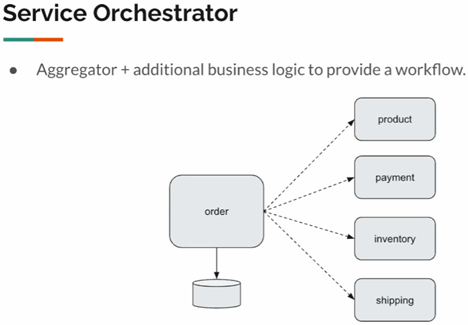
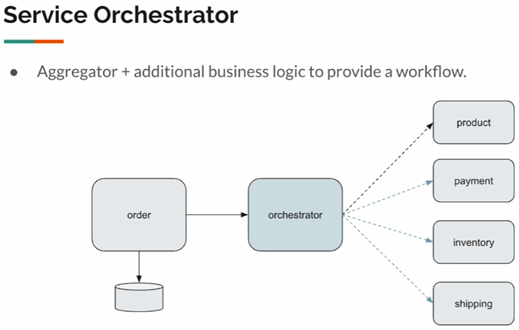
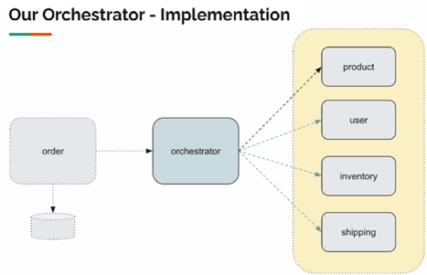
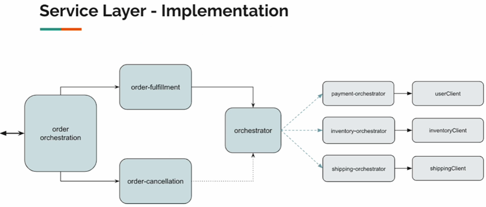

# 📚 Sección 4: Patrón Saga con orquestador: transacciones distribuidas y flujos de trabajo en paralelo

## 🧭 Patrón Orquestador: Introducción

El `patrón Orquestador` permite coordinar la ejecución de varios microservicios para completar un proceso de negocio.
A diferencia de un agregador convencional, que principalmente reúne datos de diferentes servicios, un orquestador
también incorpora lógica de coordinación para controlar el flujo de ejecución y gestionar los posibles fallos.

### ⚠️ El problema: coordinar varios microservicios

Imaginemos un sistema de pedidos compuesto por cuatro microservicios:

- **Product Service:** proporciona información del producto, como su precio.
- **Payment Service:** procesa el pago del cliente.
- **Inventory Service:** comprueba y reserva las existencias.
- **Shipping Service:** gestiona el envío del pedido.

Cada microservicio realiza sus propias operaciones y funciona de manera independiente. Sin embargo, completar un pedido
requiere coordinar las operaciones de varios de ellos.

Por ejemplo, supongamos que un cliente realiza un pedido y el pago se procesa correctamente, pero después el servicio de
inventario informa que el producto no está disponible. No basta con marcar el pedido como fallido: también debemos
**compensar las operaciones que ya se realizaron**, por ejemplo, reembolsar el pago. Asimismo, si se había reservado o
iniciado un envío, podría ser necesario cancelarlo.

Este escenario implica coordinar múltiples servicios, gestionar sus respuestas y decidir qué acciones tomar cuando
alguna operación falla.

### 🧱 Primera alternativa: coordinar desde Order Service

Una solución inicial sería implementar toda la lógica de coordinación dentro de Order Service.

Este servicio recibiría el pedido y realizaría llamadas a Product, Payment, Inventory y Shipping. También tendría que
decidir qué hacer si una operación falla y ejecutar las acciones compensatorias necesarias.



Aunque esta solución podría funcionar, tiene una desventaja: Order Service terminaría acumulando demasiadas
responsabilidades. Además de gestionar los pedidos y su persistencia, tendría que controlar el flujo de ejecución de los
demás microservicios y manejar los fallos de todo el proceso.

Esto aumentaría su complejidad y dificultaría el mantenimiento de la aplicación.

### 🧩 Solución: separar la coordinación en Orchestrator Service

En lugar de concentrar toda esa lógica en Order Service, podemos crear un microservicio independiente llamado
Orchestrator Service, cuya responsabilidad será coordinar las operaciones necesarias para completar el pedido.



El flujo de trabajo sería el siguiente:

1. **Recepción del pedido:** Order Service recibe la solicitud y realiza las validaciones básicas.
2. **Registro inicial:** si las validaciones son correctas, guarda el pedido en su base de datos con el estado CREATED.
   Esto indica que el pedido se ha registrado, pero todavía no se ha completado.
3. **Inicio de la orquestación:** Order Service delega la coordinación del proceso en Orchestrator Service.
4. **Consulta del producto:** el orquestador obtiene la información necesaria del producto, como su precio.
5. **Ejecución de operaciones en paralelo:** después de obtener la información básica del producto, el orquestador
   coordina las llamadas a `Payment Service`, `Inventory Service` y `Shipping Service` **de forma paralela.** De esta
   manera, **las tres operaciones pueden ejecutarse simultáneamente,** en lugar de esperar a que una termine para
   iniciar la siguiente.
6. **Finalización del pedido:** si todas las operaciones requeridas tienen éxito, el pedido se actualiza al estado
   SUCCESSFUL.
7. **Gestión de fallos:** si alguna operación falla, el orquestador determina qué acciones compensatorias son
   necesarias. Por ejemplo, puede solicitar un reembolso si el pago ya se procesó y cancelar un envío que se hubiera
   iniciado.

De esta manera, Order Service se concentra en la gestión del pedido, mientras que Orchestrator Service controla el flujo
de trabajo distribuido.

### 💡 Relación con el patrón Saga

Esta arquitectura es una aplicación del patrón Saga, que permite coordinar una transacción de negocio mediante una
secuencia de operaciones locales ejecutadas en diferentes microservicios.

Como no existe una única transacción de base de datos que abarque todos los servicios, si una operación falla después de
que otras hayan tenido éxito, pueden ejecutarse transacciones compensatorias para deshacer sus efectos de negocio.

En este enfoque, el orquestador mantiene el control del proceso: decide qué operación ejecutar a continuación, cuándo el
pedido puede considerarse exitoso y qué compensaciones deben realizarse ante un fallo.

> **Idea clave:** el patrón Orquestador separa la lógica de coordinación del servicio de pedidos y permite gestionar de
> forma centralizada el flujo de trabajo, los errores y las compensaciones de una transacción distribuida.

## 🎯 Orchestrator Scope

En este apartado implementaremos el `Orchestrator Service`, responsable de coordinar el flujo de trabajo de una
transacción distribuida entre varios microservicios.

Nuestro archivo `external-services-v2.jar` ya incluye los servicios externos que consumiremos, por lo que nuestro
trabajo consistirá en implementar el orquestador y definir cómo debe actuar ante los distintos resultados.

### 🏗️ Arquitectura del Orchestrator

La arquitectura mantiene el flujo iniciado por `Order Service`, que se comunica con `Orchestrator Service`. A partir de
ahí, el orquestador consulta primero a `Product Service` para obtener la información del producto.

Una vez obtenida esa información, **realiza tres llamadas en paralelo** a los siguientes microservicios:

- `User Service`: gestiona las operaciones relacionadas con el usuario, como consultar sus datos, descontar fondos y
  realizar reembolsos.
- `Inventory Service`: gestiona las operaciones relacionadas con el inventario.
- `Shipping Service`: gestiona las operaciones relacionadas con el envío.



En este escenario, `User Service` cumple el papel que desempeñaba `Payment Service` en el ejemplo anterior: sus
endpoints permiten realizar operaciones como descontar fondos y reembolsarlos. Esto no significa necesariamente que
ambos servicios sean idénticos, sino que cumplen una función equivalente dentro del flujo ilustrado.

### ⚙️ Flujo de ejecución

Cuando el orquestador recibe una solicitud, sigue estos pasos:

1. Consulta a Product Service para obtener la información del producto.
2. Si la consulta del producto falla con un 404 Not Found, el proceso no puede continuar y se devuelve ese resultado.
3. Si la consulta tiene éxito, inicia en paralelo las llamadas a User Service, Inventory Service y Shipping Service.
4. Evalúa los resultados de las operaciones para determinar si el pedido puede completarse o si es necesario ejecutar
   acciones compensatorias.
5. Si todas las operaciones requeridas tienen éxito, el pedido termina con estado SUCCESS.
6. Si alguna operación falla, el pedido termina con estado FAILED y el orquestador coordina las compensaciones
   necesarias para revertir los efectos de las operaciones que ya se habían completado.

### 📊 Resultados posibles y acciones del orquestador

La siguiente matriz muestra cómo debe responder el sistema ante diferentes resultados de los microservicios:

| product-service | user-service | inventory-service | shipping-service | Order Status | Orchestrator Actions                |
|-----------------|--------------|-------------------|------------------|--------------|-------------------------------------|
| Success         | Success      | Success           | Success          | Success      | —                                   |
| 404             | —            | —                 | —                | —            | 404                                 |
| Success         | Failed       | Success           | Success          | Failed       | Restore Inventory. Cancel Shipping. |
| Success         | Success      | Failed            | Success          | Failed       | Refund User. Cancel Shipping.       |
| Success         | Success      | Success           | Failed           | Failed       | Refund User. Restore Inventory.     |

#### ¿Por qué son necesarias las compensaciones?

En una transacción distribuida, cada microservicio puede completar su propia operación antes de que otro servicio falle.
Por ejemplo, si el usuario ya realizó el pago y después falla la operación de inventario, no basta con marcar el pedido
como fallido: también hay que devolver el dinero y cancelar las operaciones relacionadas que se hayan completado.

Estas acciones compensatorias permiten mantener la coherencia del proceso de negocio, aunque no equivalen a una única
transacción atómica que abarque todos los microservicios.

## 🔌 Servicios externos

Iniciamos el servicio externo ejecutando el archivo `external-services-v2.jar` desde la terminal:

````bash
D:\programming\spring\01.udemy\03.vinoth_selvaraj\spring-webflux-patterns-resilience (main -> origin)
$ java -jar .\external-services\external-services-v2.jar

  .   ____          _            __ _ _
 /\\ / ___'_ __ _ _(_)_ __  __ _ \ \ \ \
( ( )\___ | '_ | '_| | '_ \/ _` | \ \ \ \
 \\/  ___)| |_)| | | | | || (_| |  ) ) ) )
  '  |____| .__|_| |_|_| |_\__, | / / / /
 =========|_|==============|___/=/_/_/_/
 :: Spring Boot ::                (v2.6.4)

2026-10-28 11:38:34.163  INFO 10264 --- [           main] c.v.e.ExternalServicesApplication        : Starting ExternalServicesApplication v0.0.1-SNAPSHOT using Java 25.0.2 on SysEngJava with PID 10264 (D:\programming\spring\01.udemy\03.vinoth_selvaraj\spring-webflux-patterns-resilience\external-services\external-services-v2.jar started by magadiflo in D:\programming\spring\01.udemy\03.vinoth_selvaraj\spring-webflux-patterns-resilience)
2026-10-28 11:38:34.168  INFO 10264 --- [           main] c.v.e.ExternalServicesApplication        : No active profile set, falling back to 1 default profile: "default"
WARNING: A terminally deprecated method in sun.misc.Unsafe has been called
WARNING: sun.misc.Unsafe::objectFieldOffset has been called by io.netty.util.internal.PlatformDependent0$3 (jar:file:/D:/programming/spring/01.udemy/03.vinoth_selvaraj/spring-webflux-patterns-resilience/external-services/external-services-v2.jar!/BOOT-INF/lib/netty-common-4.1.74.Final.jar!/)
WARNING: Please consider reporting this to the maintainers of class io.netty.util.internal.PlatformDependent0$3
WARNING: sun.misc.Unsafe::objectFieldOffset will be removed in a future release
2026-10-28 11:38:36.325  INFO 10264 --- [           main] o.s.b.web.embedded.netty.NettyWebServer  : Netty started on port 7070
2026-10-28 11:38:36.716  INFO 10264 --- [           main] c.v.e.ExternalServicesApplication        : Started ExternalServicesApplication in 2.947 seconds (JVM running for 3.338)
````

Una vez iniciado el servicio, abrimos Swagger UI en el navegador y buscamos el apartado `sec03-orchestrator`, donde
encontraremos los endpoints que utilizaremos para implementar y probar nuestro Orchestrator Service.

### 🛍️ Product Service

Este servicio proporciona la información de un producto a partir de su identificador.

````bash
$ curl -v http://localhost:7070/sec03/product/1 | jq
>
< HTTP/1.1 200 OK
< Content-Type: application/json
< Content-Length: 77
<
{
  "id": 1,
  "category": "Movies",
  "description": "Practical Iron Gloves",
  "price": 79
}
````

La respuesta contiene el identificador, la categoría, la descripción y el precio del producto. El orquestador utilizará
esta información como parte del proceso de pedido.

### 👤 User Service

Este servicio permite consultar la información de un usuario, descontar fondos de su saldo y realizar reembolsos.

#### 1. Consultar un usuario

````bash
$ curl -v http://localhost:7070/sec03/user/1 | jq
>
< HTTP/1.1 200 OK
< Content-Type: application/json
< Content-Length: 149
<
{
  "userId": 1,
  "name": "Andy Macejkovic",
  "balance": 376,
  "address": {
    "street": "91364 Arnold Key",
    "city": "Bradtkeburgh",
    "state": "Montana",
    "zipCode": "63727"
  }
}
````

La respuesta incluye los datos del usuario, su saldo y su dirección.

#### 2. Descontar fondos

````bash
$ curl -v -X POST -H "Content-Type: application/json" -d "{\"amount\": 100, \"orderId\": \"3fa85f64-5717-4562-b3fc-2c963f66afa6\", \"userId\": 1 }" http://localhost:7070/sec03/user/deduct | jq
>
< HTTP/1.1 200 OK
< Content-Type: application/json
< Content-Length: 73
<
{
  "userId": 1,
  "name": "Novella Turcotte I",
  "balance": 308,
  "status": "SUCCESS"
} 
````

Este endpoint descuenta fondos asociados al pedido. Si la operación se completa correctamente, la respuesta indica
SUCCESS.

#### 3. Reembolsar fondos

````bash
$ curl -v -X POST -H "Content-Type: application/json" -d "{\"amount\": 100, \"orderId\": \"3fa85f64-5717-4562-b3fc-2c963f66afa6\", \"userId\": 1 }" http://localhost:7070/sec03/user/refund | jq
>
< HTTP/1.1 200 OK
< Content-Type: application/json
< Content-Length: 73
<
{
  "userId": 1,
  "name": "Novella Turcotte I",
  "balance": 408,
  "status": "SUCCESS"
}
````

Este endpoint permite devolver los fondos descontados. En el patrón Saga, el reembolso puede utilizarse como acción
compensatoria cuando una operación posterior del proceso falla.

> **Nota:** los valores mostrados corresponden a las respuestas obtenidas durante las pruebas. El saldo puede variar
> según las operaciones realizadas y el estado mantenido por el servicio externo.

### 📦 Inventory Service

Este servicio permite consultar la cantidad disponible de un producto, descontar unidades del inventario y restaurarlas
cuando sea necesario.

#### 1. Consultar el inventario

````bash
$ curl -v http://localhost:7070/sec03/inventory/1 | jq
>
< HTTP/1.1 200 OK
< Content-Type: application/json
< Content-Length: 2
<
10
````

El resultado indica que hay 10 unidades disponibles del producto con identificador 1.

#### 2. Descontar unidades

````bash
$ curl -v -X POST -H "Content-Type: application/json" -d "{\"orderId\": \"3fa85f64-5717-4562-b3fc-2c963f66afa6\", \"productId\": 1, \"quantity\": 3}" http://localhost:7070/sec03/inventory/deduct | jq
>
< HTTP/1.1 200 OK
< Content-Type: application/json
< Content-Length: 69
<
{
  "productId": 1,
  "quantity": 3,
  "remainingQuantity": 2,
  "status": "SUCCESS"
}
````

La respuesta indica que se procesó una solicitud para descontar 3 unidades y que el servicio informa de 2 unidades
restantes.

#### 3. Restaurar unidades

````bash
$ curl -v -X POST -H "Content-Type: application/json" -d "{\"orderId\": \"3fa85f64-5717-4562-b3fc-2c963f66afa6\", \"productId\": 1, \"quantity\": 8}" http://localhost:7070/sec03/inventory/restore | jq
>
< HTTP/1.1 200 OK
< Content-Type: application/json
< Content-Length: 70
<
{
  "productId": 1,
  "quantity": 8,
  "remainingQuantity": 10,
  "status": "SUCCESS"
}
````

Este endpoint permite restaurar unidades al inventario. En una Saga, el orquestador puede invocarlo como acción
compensatoria si otra operación falla después de haber descontado existencias.

### 🚚 Shipping Service

Este servicio permite programar un envío y cancelar una programación existente.

#### 1. Programar un envío

````bash
$ curl -v -X POST -H "Content-Type: application/json" -d "{\"orderId\": \"3fa85f64-5717-4562-b3fc-2c963f66afa6\", \"userId\": 1, \"quantity\": 10}" http://localhost:7070/sec03/shipping/schedule | jq
>
< HTTP/1.1 200 OK
< Content-Type: application/json
< Content-Length: 213
<
{
  "orderId": "3fa85f64-5717-4562-b3fc-2c963f66afa6",
  "quantity": 10,
  "status": "SUCCESS",
  "expectedDelivery": "2026-10-31",
  "address": {
    "street": "467 Senger Isle",
    "city": "Port Cesar",
    "state": "New Jersey",
    "zipCode": "54829"
  }
}
````

La respuesta contiene los datos del envío, su estado y la fecha estimada de entrega.

#### 2. Cancelar un envío

````bash
$ curl -v -X POST -H "Content-Type: application/json" -d "{\"orderId\": \"3fa85f64-5717-4562-b3fc-2c963f66afa6\", \"userId\": 1, \"quantity\": 10}" http://localhost:7070/sec03/shipping/cancel | jq
>
< HTTP/1.1 200 OK
< content-length: 0
<
````

El servidor responde con 200 OK y un cuerpo vacío, lo que indica que la solicitud se procesó correctamente sin devolver
contenido.

La cancelación puede utilizarse como acción compensatoria si el envío ya se programó, pero otra operación del proceso
falla.

### 🧩 Resumen de los servicios

| Servicio            | Operaciones principales                              |
|---------------------|------------------------------------------------------|
| `Product Service`   | Consultar información y precio del producto.         |
| `User Service`      | Consultar usuario, descontar fondos y reembolsarlos. |
| `Inventory Service` | Consultar existencias, descontarlas y restaurarlas.  |
| `Shipping Service`  | Programar y cancelar envíos.                         |

Estos servicios ya están implementados en el archivo JAR proporcionado por el instructor. Nuestro objetivo será consumir
sus endpoints desde el Orchestrator Service y coordinar tanto las operaciones principales como las compensaciones
necesarias cuando el proceso de pedido falle.

## 🧱 Creando DTO - Parte 1

En esta parte crearemos los DTO (Data Transfer Objects) que utilizaremos para representar los datos de entrada y salida
del proceso de pedido coordinado por el Orchestrator Service.

### 📥 OrderRequest

Representa los datos que el cliente envía para solicitar un pedido.

````java
public record OrderRequest(Integer userId,
                           Integer productId,
                           Integer quantity) {
}
````

- **userId:** identificador del usuario que realiza el pedido.
- **productId:** identificador del producto solicitado.
- **quantity:** cantidad de unidades que se desean comprar.

Al utilizar un record, Java genera automáticamente los métodos habituales para almacenar y acceder a estos datos,
evitando escribir código repetitivo.

### 🏠 Address

Representa la dirección de envío asociada al pedido.

````java
public record Address(String street,
                      String city,
                      String state,
                      String zipCode) {
}
````

Sus atributos contienen la calle, la ciudad, el estado o región y el código postal.

Este DTO permite agrupar los datos de la dirección en un solo objeto, en lugar de manejar cada campo por separado.

### 🚦 Status

Define los posibles resultados del proceso de pedido.

````java
public enum Status {
    SUCCESS,
    FAILED
}
````

Al ser un enum, restringe los valores posibles a las constantes declaradas:

- **SUCCESS:** el proceso finalizó correctamente.
- **FAILED:** el proceso falló.

Este estado permite comunicar el resultado del proceso coordinado por el orquestador.

### 📤 OrderResponse

Representa la respuesta que se devuelve al cliente después de procesar el pedido.

````java
public record OrderResponse(Integer userId,
                            Integer productId,
                            UUID orderId,
                            Status status,
                            Address shippingAddress,
                            String expectedDelivery) {
}
````

Sus atributos son:

- **userId:** identificador del usuario asociado al pedido.
- **productId:** identificador del producto solicitado.
- **orderId:** identificador único del pedido, representado mediante UUID.
- **status:** resultado del proceso, expresado mediante el enum Status.
- **shippingAddress:** dirección de envío, representada por el DTO Address.
- **expectedDelivery:** fecha estimada de entrega.

Observa que `OrderResponse` utiliza otros tipos definidos en el proyecto, como Status y Address. Esto permite
estructurar la respuesta de forma clara y reutilizar los mismos tipos de datos.

## 🧱 Creando DTO - Parte 2

Continuamos creando los DTO que utilizaremos para intercambiar información con los microservicios externos de productos,
usuarios, inventario y envíos.

### 🛍️ ProductResponse

Representa la información que devuelve Product Service al consultar un producto.

````java
public record ProductResponse(Integer id,
                              String category,
                              String description,
                              Integer price) {
}
````

- **id:** identificador del producto.
- **category:** categoría a la que pertenece.
- **description:** descripción del producto.
- **price:** precio del producto.

El orquestador utilizará esta información para continuar con el procesamiento del pedido.

### 💳 PaymentRequest

Representa los datos necesarios para solicitar una operación relacionada con el pago del pedido.

````java
public record PaymentRequest(Integer userId,
                             Integer amount,
                             UUID orderId) {
}
````

- **userId:** identificador del usuario al que se le descontarán los fondos.
- **amount:** importe de la operación.
- **orderId:** identificador único del pedido asociado a la operación.

El **orderId** permite relacionar la operación financiera con el pedido correspondiente.

### 💰 PaymentResponse

Representa el resultado de la operación financiera realizada por el servicio de usuarios.

````java
public record PaymentResponse(Integer userId,
                              String name,
                              Integer balance,
                              Status status) {
}
````

- **userId:** identificador del usuario.
- **name:** nombre del usuario.
- **balance:** saldo resultante.
- **status:** resultado de la operación, expresado mediante el enum Status.

Aunque estos DTO se denominan `PaymentRequest` y `PaymentResponse`, las operaciones se realizan mediante los endpoints
de User Service, que permiten descontar y reembolsar fondos.

### 📦 InventoryRequest

Representa los datos necesarios para solicitar una operación sobre el inventario.

````java
public record InventoryRequest(UUID orderId,
                               Integer productId,
                               Integer quantity) {
}
````

- **orderId:** identificador del pedido asociado a la operación.
- **productId:** identificador del producto.
- **quantity:** cantidad de unidades que se desean descontar o restaurar.

Este DTO permite identificar tanto el producto afectado como el pedido al que corresponde la operación.

### 📊 InventoryResponse

Representa el resultado de una operación realizada sobre el inventario.

````java
public record InventoryResponse(Integer productId,
                                Integer quantity,
                                Integer remainingQuantity,
                                Status status) {
}
````

- **productId:** identificador del producto afectado.
- **quantity:** cantidad procesada en la operación.
- **remainingQuantity:** cantidad que el servicio informa que queda disponible después de la operación.
- **status:** resultado de la operación.

El orquestador puede utilizar esta respuesta para determinar si la operación de inventario tuvo éxito y decidir cómo
continuar con el proceso.

### 🚚 ShippingRequest

Representa los datos necesarios para programar o cancelar un envío.

````java
public record ShippingRequest(Integer quantity,
                              Integer userId,
                              UUID orderId) {
}
````

- **quantity:** cantidad de unidades asociadas al envío.
- **userId:** identificador del usuario relacionado con el pedido.
- **orderId:** identificador único del pedido.

Estos datos permiten asociar la operación de envío con el usuario y el pedido correspondiente.

### 📬 ShippingResponse

Representa el resultado de una operación relacionada con el envío.

````java
public record ShippingResponse(UUID orderId,
                               Integer quantity,
                               Status status,
                               String expectedDelivery,
                               Address address) {
}
````

- **orderId:** identificador del pedido.
- **quantity:** cantidad de unidades asociadas al envío.
- **status:** resultado de la operación.
- **expectedDelivery:** fecha estimada de entrega.
- **address:** dirección de envío, representada por el DTO Address creado anteriormente.

La respuesta permite conocer el estado del envío y los datos necesarios para informar al cliente sobre la entrega.

### 📝 Consideraciones

Estos DTO permiten mantener una estructura clara para los datos que circulan entre el orquestador y los microservicios
externos. Cada uno representa una solicitud o una respuesta específica.

Además, se reutilizan tipos definidos previamente:

- **Status**, para representar los resultados de las operaciones.
- **Address**, para agrupar los datos de la dirección.
- **UUID**, para identificar de forma única los pedidos.

**Nota:** aunque algunos DTO tienen nombres relacionados con pagos, inventario o envíos, su función concreta depende de
cómo los utilice el orquestador y de los contratos definidos por los servicios externos. El nombre de una clase, por sí
solo, no determina qué operación ejecuta.

## ⚙️ Definiendo las URL de configuración de los servicios externos

En el archivo `application.properties` definimos las URL base de los servicios externos que consumiremos durante la
implementación del Orchestrator Service.

````properties
sec03.product.service=http://localhost:7070/sec03/product
sec03.user.service=http://localhost:7070/sec03/user
sec03.inventory.service=http://localhost:7070/sec03/inventory
sec03.shipping.service=http://localhost:7070/sec03/shipping
````

Cada propiedad contiene la URL base de un microservicio. De esta manera, evitamos escribir las direcciones directamente
en el código y facilitamos su modificación cuando cambie la configuración del entorno.

Por ejemplo, si la dirección de Product Service cambia, solo tendremos que actualizar `sec03.product.service`.

## 📦 Configurando el escaneo de componentes

Modificamos la clase principal para que Spring Boot escanee el paquete `sec04`, donde se encuentran los componentes de
esta sección.

````java
@SpringBootApplication(scanBasePackages = "dev.magadiflo.patterns.app.sec04")
public class WebfluxPatternsApplication {

    public static void main(String[] args) {
        SpringApplication.run(WebfluxPatternsApplication.class, args);
    }

}
````

## 🔌 Creando los servicios de clientes

Crearemos clases cliente para encapsular las llamadas HTTP a los microservicios externos. Utilizaremos WebClient, que
permite realizar solicitudes HTTP de forma reactiva e integrar las respuestas con tipos de Reactor como Mono.

### 🛍️ ProductClient

Este cliente consulta la información de un producto mediante su identificador.

````java

@Component
public class ProductClient {

    private final WebClient webClient;

    public ProductClient(@Value("${sec03.product.service}") String baseUrl) {
        this.webClient = WebClient.builder()
                .baseUrl(baseUrl)
                .build();
    }

    public Mono<ProductResponse> getProduct(Integer productId) {
        return this.webClient
                .get()
                .uri("/{productId}", productId)
                .retrieve()
                .bodyToMono(ProductResponse.class)
                .onErrorResume(throwable -> Mono.empty());
    }
}
````

#### ¿Cómo funciona?

- `@Component:` registra la clase como un componente administrado por Spring.
- `@Value("${sec03.product.service}")`: obtiene la URL base desde `application.properties`.
- `WebClient.builder()`: configura el cliente HTTP con la URL base.
- `.get()`: indica que se realizará una solicitud HTTP GET.
- `.uri("/{productId}", productId)`: agrega el identificador del producto a la ruta.
- `.retrieve()`: inicia el procesamiento de la respuesta HTTP.
- `.bodyToMono(ProductResponse.class)`: convierte el cuerpo de la respuesta en un `ProductResponse`, emitido mediante un
  `Mono`.
- `.onErrorResume(throwable -> Mono.empty())`: ante un error, sustituye la señal de error por un `Mono` vacío.

#### ¿Por qué devolver un `Mono.empty()` ante un error?

En esta implementación, el cliente evita propagar el error y devuelve una respuesta vacía. Esto permite que el flujo
reactivo continúe sin emitir un producto.

Sin embargo, hay una consideración importante: `retrieve()` genera un error para respuestas HTTP de tipo `4xx` o `5xx`.
Por tanto, este tratamiento no distingue entre un producto inexistente y otros problemas, como un servicio no
disponible. En una aplicación real, convendría registrar y tratar los errores según su causa.

### 👤 UserClient

Este cliente permite realizar dos operaciones sobre el saldo del usuario:

- **Descontar fondos:** mediante el endpoint `deduct`.
- **Reembolsar fondos:** mediante el endpoint `refund`.

````java

@Component
public class UserClient {

    private static final String DEDUCT = "deduct";
    private static final String REFUND = "refund";
    private final WebClient webClient;

    public UserClient(@Value("${sec03.user.service}") String baseUrl) {
        this.webClient = WebClient.builder()
                .baseUrl(baseUrl)
                .build();
    }

    public Mono<PaymentResponse> deduct(PaymentRequest paymentRequest) {
        return this.callUserService(DEDUCT, paymentRequest);
    }

    public Mono<PaymentResponse> refund(PaymentRequest paymentRequest) {
        return this.callUserService(REFUND, paymentRequest);
    }

    private Mono<PaymentResponse> callUserService(String endpoint, PaymentRequest request) {
        return this.webClient
                .post()
                .uri("/{endpoint}", endpoint)
                .bodyValue(request)
                .retrieve()
                .bodyToMono(PaymentResponse.class)
                .onErrorReturn(this.buildErrorResponse(request));
    }

    private PaymentResponse buildErrorResponse(PaymentRequest request) {
        return new PaymentResponse(
                request.userId(),
                null,
                request.amount(),
                Status.FAILED
        );
    }
}
````

#### ¿Cómo funciona?

- **DEDUCT y REFUND:** constantes que identifican los endpoints de las operaciones.
- **deduct ():** delega la solicitud al método común `callUserService()`, indicando el endpoint `deduct`.
- **refund ():** utiliza el mismo método, pero indicando el endpoint `refund`.
- **callUserService ():** centraliza la construcción y ejecución de las solicitudes HTTP POST.
- **.bodyValue (request):** envía el objeto `PaymentRequest` como cuerpo de la solicitud. Spring WebFlux lo serializa,
  normalmente a JSON, mediante sus convertidores configurados.
- **.bodyToMono (PaymentResponse.class)**: convierte la respuesta en un `PaymentResponse`.
- **.onErrorReturn (...):** si se produce un error, emite un objeto `PaymentResponse` construido por
  `buildErrorResponse()`.

#### ¿Para qué sirve `buildErrorResponse()`?

Este método construye una respuesta que representa el fallo de la operación:

- Conserva el identificador del usuario.
- Establece el nombre en `null`, porque no se dispone de una respuesta válida del servicio.
- Coloca `request.amount()` en el campo `balance`. Sin embargo, podríamos asignarle `0`, ya que este objeto representa
  una operación fallida y no una respuesta real del servicio. En cualquier caso, ninguno de esos valores debe
  interpretarse como el saldo real del usuario.
- Establece el estado en Status.FAILED.

Hay que tener presente que `request.amount()` representa el importe solicitado, no necesariamente el saldo real del
usuario. En este caso, se utiliza como valor de respuesta cuando ocurre un error, por lo que no debe interpretarse
como el saldo actual.

### 📦 InventoryClient

Este cliente encapsula las operaciones relacionadas con el inventario: descontar unidades y restaurarlas.

````java

@Component
public class InventoryClient {

    private static final String DEDUCT = "deduct";
    private static final String RESTORE = "restore";
    private final WebClient webClient;

    public InventoryClient(@Value("${sec03.inventory.service}") String baseUrl) {
        this.webClient = WebClient.builder()
                .baseUrl(baseUrl)
                .build();
    }

    public Mono<InventoryResponse> deduct(InventoryRequest inventoryRequest) {
        return this.callInventoryService(DEDUCT, inventoryRequest);
    }

    public Mono<InventoryResponse> restore(InventoryRequest inventoryRequest) {
        return this.callInventoryService(RESTORE, inventoryRequest);
    }

    private Mono<InventoryResponse> callInventoryService(String endpoint, InventoryRequest request) {
        return this.webClient
                .post()
                .uri("/{endpoint}", endpoint)
                .bodyValue(request)
                .retrieve()
                .bodyToMono(InventoryResponse.class)
                .onErrorReturn(this.buildErrorResponse(request));
    }

    private InventoryResponse buildErrorResponse(InventoryRequest request) {
        return new InventoryResponse(
                request.productId(),
                request.quantity(),
                null,
                Status.FAILED
        );
    }
}
````

#### ¿Cómo funciona?

- `DEDUCT` y `RESTORE`: constantes que identifican los endpoints para descontar y restaurar unidades del inventario.
- `deduct()`: solicita el descuento de unidades delegando la operación a `callInventoryService()`.
- `restore()`: solicita la restauración de unidades utilizando el mismo método privado.
- `callInventoryService()`: centraliza la construcción y ejecución de las solicitudes HTTP POST.
- `.uri ("/{endpoint}", endpoint)`: establece dinámicamente el endpoint que se utilizará (`deduct` o `restore`).
- `.bodyValue(request)`: envía el objeto `InventoryRequest` como cuerpo de la solicitud.
- `.retrieve()`: permite procesar la respuesta HTTP.
- `.bodyToMono(InventoryResponse.class)`: convierte el cuerpo de la respuesta en un objeto `InventoryResponse`.
- `.onErrorReturn(...)`: si ocurre un error, emite una respuesta alternativa construida mediante
  `buildErrorResponse()`.

#### Respuesta alternativa ante un error

El método `buildErrorResponse()` construye un `InventoryResponse` con los siguientes valores:

- **productId:** conserva el identificador del producto solicitado.
- **quantity:** conserva la cantidad involucrada en la operación.
- **remainingQuantity:** establece el valor en `null`, porque no conocemos la cantidad real disponible.
- **status:** establece `Status.FAILED` para indicar que la operación no se completó correctamente.

De esta manera, el cliente proporciona una respuesta con estado `FAILED` en lugar de propagar directamente el error al
flujo reactivo.

### 🚚 ShippingClient

Este cliente encapsula las operaciones relacionadas con los envíos: programarlos y cancelarlos.

````java

@Component
public class ShippingClient {

    private static final String SCHEDULE = "schedule";
    private static final String CANCEL = "cancel";
    private final WebClient webClient;

    public ShippingClient(@Value("${sec03.shipping.service}") String baseUrl) {
        this.webClient = WebClient.builder()
                .baseUrl(baseUrl)
                .build();
    }

    public Mono<ShippingResponse> schedule(ShippingRequest shippingRequest) {
        return this.callShippingService(SCHEDULE, shippingRequest);
    }

    public Mono<ShippingResponse> cancel(ShippingRequest shippingRequest) {
        return this.callShippingService(CANCEL, shippingRequest);
    }

    private Mono<ShippingResponse> callShippingService(String endpoint, ShippingRequest request) {
        return this.webClient
                .post()
                .uri("/{endpoint}", endpoint)
                .bodyValue(request)
                .retrieve()
                .bodyToMono(ShippingResponse.class)
                .onErrorReturn(this.buildErrorResponse(request));
    }

    private ShippingResponse buildErrorResponse(ShippingRequest request) {
        return new ShippingResponse(
                request.orderId(),
                request.quantity(),
                Status.FAILED,
                null,
                null
        );
    }
}
````

#### ¿Cómo funciona?

- `SCHEDULE` y `CANCEL`: constantes que identifican los endpoints para programar y cancelar un envío.
- `schedule()`: solicita la programación de un envío y delega la comunicación HTTP a `callShippingService()`.
- `cancel()`: solicita la cancelación de un envío utilizando el mismo método privado.
- `callShippingService()`: centraliza la construcción y ejecución de las solicitudes HTTP POST.
- `.uri("/{endpoint}", endpoint)`: selecciona dinámicamente el endpoint que se invocará.
- `.bodyValue(request)`: envía el objeto `ShippingRequest` como cuerpo de la solicitud.
- `.retrieve()`: permite procesar la respuesta HTTP.
- `.bodyToMono(ShippingResponse.class)`: intenta convertir el cuerpo de la respuesta en un `ShippingResponse`.
- `.onErrorReturn(...)`: ante un error, emite una respuesta alternativa construida por `buildErrorResponse()`.

#### 🔍 ¿Por qué ambos métodos devuelven `Mono<ShippingResponse>`?

Aquí tenemos un detalle importante que debemos comprender para evitar confusiones.

Aunque los métodos `schedule()` y `cancel()` utilizan el mismo método privado para reutilizar la lógica HTTP, los
endpoints externos tienen contratos de respuesta diferentes:

- `schedule`: devuelve un cuerpo JSON con información del envío, como el identificador del pedido, la cantidad, el
  estado, la fecha estimada de entrega y la dirección.
- `cancel`: devuelve `200 OK`, pero sin contenido en el cuerpo de la respuesta.

Por tanto, si implementáramos cada operación de manera independiente, podríamos utilizar tipos de retorno diferentes:

````java
public Mono<ShippingResponse> schedule(ShippingRequest request) {
}

public Mono<Void> cancel(ShippingRequest request) {
}
````

Esto representaría de forma más precisa los contratos de ambos endpoints: `schedule` devuelve información del envío,
mientras que `cancel` solamente indica que la operación finalizó sin devolver un cuerpo.

**Sin embargo, el instructor opta por reutilizar la lógica de ambas operaciones mediante `callShippingService()`.**
Para ello, define un único tipo de retorno: `Mono<ShippingResponse>`.

Observemos qué sucede cuando se invoca el endpoint `cancel`:

1. El servidor responde con `200 OK` y un cuerpo vacío.
2. `WebClient` intenta convertir ese cuerpo mediante `.bodyToMono(ShippingResponse.class)`.
3. Como no existe contenido que deserializar, el resultado es un `Mono` vacío: no emite ningún `ShippingResponse`.
4. Al completarse vacío, no se produce una señal de error, por lo que `.onErrorReturn()` no se ejecuta.

Esto significa que, aunque el método está declarado como `Mono<ShippingResponse>`, puede completar sin emitir ningún
objeto cuando el endpoint `cancel` tiene éxito.

#### ¿Y qué ocurre si se produce un error?

En ese caso sí se ejecuta `onErrorReturn()`, que emite el objeto construido por `buildErrorResponse()`.

Esta respuesta alternativa conserva el identificador del pedido y la cantidad solicitada, establece el estado en
`FAILED` y deja en `null` los datos que no se conocen.

De esta manera, ambas operaciones pueden compartir el mismo método privado y utilizar `Mono<ShippingResponse>`
como tipo de retorno, incluso cuando el endpoint `cancel` no devuelve contenido en una ejecución exitosa.

**Idea clave:** el tipo genérico declarado en el método Java no obliga a que el `Mono` siempre emita un objeto.
Un `Mono<ShippingResponse>` puede emitir un `ShippingResponse`, `completar vacío` o `terminar con un error`.
En esta implementación, los errores se transforman en una respuesta alternativa mediante `onErrorReturn()`.

## 🧩 Orchestrator Request Context

El orquestador debe coordinar las operaciones de varios servicios: `Product`, `User`, `Inventory` y `Shipping`.
Durante ese proceso necesita manejar distintos objetos de solicitud (`request`) y respuesta (`response`).

Para simplificar esta gestión, crearemos una clase llamada `OrchestrationRequestContext`, que funcionará como un
contenedor de referencias a los objetos utilizados durante la orquestación.

De esta manera, podremos mantener en un solo objeto la información relacionada con una solicitud de pedido, incluyendo
los datos iniciales, las solicitudes enviadas a cada servicio, sus respuestas y el estado del proceso.

````java

@Data
public class OrchestrationRequestContext {

    private final UUID orderId = UUID.randomUUID();
    private final OrderRequest orderRequest;

    private Integer productPrice;
    private PaymentRequest paymentRequest;
    private PaymentResponse paymentResponse;
    private InventoryRequest inventoryRequest;
    private InventoryResponse inventoryResponse;
    private ShippingRequest shippingRequest;
    private ShippingResponse shippingResponse;
    private Status status;

    public OrchestrationRequestContext(OrderRequest orderRequest) {
        this.orderRequest = orderRequest;
    }
}
````

### ¿Por qué utilizamos una clase (`class`) y no un `record`?

En los apartados anteriores utilizamos `record` para representar objetos de transferencia de datos (`DTO`). Estos son
apropiados cuando necesitamos transportar información sin modificarla después de su creación.

En cambio, `OrchestrationRequestContext` tiene una responsabilidad diferente: **mantener el estado de una solicitud
mientras avanza el proceso de orquestación.**

Por ejemplo, inicialmente solo conocemos los datos del pedido (`OrderRequest`). A medida que el orquestador ejecuta
las operaciones, irá incorporando información como el precio del producto, las solicitudes enviadas a otros servicios,
las respuestas recibidas y el estado final del proceso.

Por eso necesitamos que sus atributos puedan modificarse durante la ejecución. Una clase convencional permite hacerlo
mediante sus campos y métodos setter, mientras que los componentes de un record son inmutables.

### 🔍 Responsabilidad de sus atributos

- **orderId:** identificador único generado automáticamente para la operación de orquestación.
- **orderRequest:** contiene los datos originales del pedido recibido.
- **productPrice:** almacena el precio obtenido del servicio Product.
- **paymentRequest / paymentResponse:** representan la solicitud y la respuesta de la operación relacionada con el pago
  del usuario.
- **inventoryRequest / inventoryResponse:** representan la solicitud y la respuesta de la operación de inventario.
- **shippingRequest / shippingResponse:** representan la solicitud y la respuesta de la operación de envío.
- **status:** permite almacenar el estado del proceso de orquestación, por ejemplo, `SUCCESS` o `FAILED`.

**Nota:** La anotación `@Data` de `Lombok` genera automáticamente getters, setters para los campos no final, además de
métodos como `toString()`, `equals()` y `hashCode()`.

Los campos `orderId` y `orderRequest` son `final`, por lo que no tendrán métodos setter y sus referencias no podrán
cambiar después de inicializarse. Los demás atributos podrán modificarse a medida que avance el proceso de orquestación.

## 🛠️ Util Class

Crearemos una clase utilitaria llamada `OrchestrationUtil`, cuya responsabilidad será construir los objetos de
solicitud (`request`) necesarios para comunicarnos con los distintos servicios involucrados en la orquestación.

En lugar de construir estos objetos directamente dentro del orquestador, centralizaremos esa lógica en métodos
estáticos, manteniendo así el código más organizado y facilitando su reutilización.

````java

@NoArgsConstructor(access = AccessLevel.PRIVATE)
public class OrchestrationUtil {

    public static void buildRequestContext(OrchestrationRequestContext context) {
        buildPaymentRequest(context);
        buildInventoryRequest(context);
        buildShippingRequest(context);
    }

    private static void buildPaymentRequest(OrchestrationRequestContext context) {
        var paymentRequest = new PaymentRequest(
                context.getOrderRequest().userId(),
                context.getProductPrice() * context.getOrderRequest().quantity(),
                context.getOrderId()
        );
        context.setPaymentRequest(paymentRequest);
    }

    private static void buildInventoryRequest(OrchestrationRequestContext context) {
        var inventoryRequest = new InventoryRequest(
                context.getOrderId(),
                context.getOrderRequest().productId(),
                context.getOrderRequest().quantity()
        );
        context.setInventoryRequest(inventoryRequest);
    }

    private static void buildShippingRequest(OrchestrationRequestContext context) {
        var shippingRequest = new ShippingRequest(
                context.getOrderRequest().quantity(),
                context.getOrderRequest().userId(),
                context.getOrderId()
        );
        context.setShippingRequest(shippingRequest);
    }
}
````

### 🔍 ¿Cómo funciona?

El método público `buildRequestContext()` recibe el contexto de la orquestación y delega la construcción de cada
solicitud en un método privado:

- `buildPaymentRequest()`: construye el objeto `PaymentRequest` utilizando el identificador del usuario, el importe
  total del pedido y el identificador de la orden. El importe se calcula multiplicando el precio del producto por la
  cantidad solicitada.
- `buildInventoryRequest()`: construye el objeto `InventoryRequest` con el identificador de la orden, el producto
  solicitado y la cantidad.
- `buildShippingRequest()`: construye el objeto `ShippingRequest` con la cantidad, el identificador del usuario y
  el identificador de la orden.

Una vez construido cada objeto, se almacena en el `OrchestrationRequestContext` mediante su correspondiente método
setter. Así, el contexto mantiene todas las solicitudes necesarias para las operaciones posteriores.

### 💡 ¿Por qué utilizamos `@NoArgsConstructor(access = AccessLevel.PRIVATE)`?

Esta anotación de Lombok **genera un constructor sin argumentos con acceso private.**

Como `OrchestrationUtil` únicamente contiene métodos estáticos, no necesitamos crear instancias de esta clase.
Al declarar su constructor como privado, evitamos que pueda ser instanciada desde otras clases. De esta manera, podemos
utilizar directamente sus métodos, a través del nombre de la clase `OrchestrationUtil`.

> **Una observación sobre el flujo:** `buildPaymentRequest()` utiliza `productPrice`, por lo que este atributo debe
> haberse establecido previamente en el `OrchestrationRequestContext`. Es decir, antes de construir las solicitudes,
> el orquestador debe haber obtenido el precio del producto y almacenado ese valor en el contexto.
>
> Esto es importante porque, de lo contrario, el cálculo del importe podría provocar un `NullPointerException` si
> `productPrice` todavía es `null`.

## 🏗️ Implementación del Patrón Orquestador - Arquitectura de Alto Nivel

Nuestro Orchestrator Service primero realizará una llamada al servicio de productos para obtener la información del
producto y su precio.

Luego, basándonos en esa información, realizaremos tres llamadas en paralelo hacia los siguientes servicios:

- **User Service:** para procesar el pago.
- **Inventory Service:** para gestionar el inventario.
- **Shipping Service:** para gestionar el envío.

En un escenario real, podríamos realizar llamadas a múltiples servicios, incluso entre 10 y 20, dependiendo de las
necesidades del flujo de trabajo. Sin embargo, en nuestro caso utilizaremos únicamente tres servicios externos.

Por el momento, estas tres estas llamadas se realizarán en paralelo. Más adelante veremos cómo implementar llamadas
secuenciales.


### 🔄 Funcionamiento de la orquestación

Veamos, a grandes rasgos, cómo funciona este proceso. Después de obtener la información del producto, realizamos las
tres llamadas en paralelo:

- **User Service:** ¿se puede realizar el pago?
- **Inventory Service:** ¿se puede gestionar el inventario?
- **Shipping Service:** ¿se puede realizar el envío?

Una vez recibidas las respuestas, validamos cada una de ellas. Si todas las operaciones se completan correctamente,
construimos la respuesta y la retornamos al Order Service. Sin embargo, ¿qué sucede si alguna operación falla?
En ese caso, debemos aplicar acciones compensatorias (rollback) únicamente a las operaciones que se completaron
correctamente.

Por ejemplo, si el **Inventory Service** falla, no tiene sentido ejecutar una acción compensatoria sobre él, porque
su operación no se completó correctamente. Pero si los otros dos servicios sí tuvieron éxito, debemos ejecutar las
acciones compensatorias correspondientes para deshacer sus operaciones.

Lo mismo sucede si fallan dos servicios y uno tiene éxito: únicamente compensamos la operación que se completó
correctamente.

Si los tres servicios fallan, no necesitamos ejecutar ninguna acción compensatoria, puesto que ninguna operación se
completó correctamente.

### ⚙️ Capa de Servicio: Implementación

El siguiente diagrama muestra cómo implementaremos nuestro servicio.

Hasta ahora, únicamente hemos creado tres clases cliente: `userClient`, `inventoryClient` y `shippingClient`.
Sin embargo, todavía necesitamos crear algunas clases adicionales. Por ello, antes de comenzar a implementarlas,
veamos cómo se relacionan los componentes de esta arquitectura.



Actualmente, ya tenemos creadas las tres clases cliente. Ahora crearemos una clase abstracta llamada `Orchestrator`,
de la cual tendremos tres implementaciones:

- `PaymentOrchestrator`
- `InventoryOrchestrator`
- `ShippingOrchestrator`

Esta clase abstracta nos permitirá definir el comportamiento común de los orquestadores especializados, como la
creación y cancelación de operaciones, así como la validación de sus respuestas. También tendremos algunas clases
adicionales: `OrderFulfillment` y `OrderCancellation`.

Por otro lado, `OrderOrchestration` será la clase principal encargada de coordinar la orquestación de las órdenes.
El flujo comienza cuando el controlador recibe una petición y la delega a `OrderOrchestration`. Desde allí, la
ejecución continúa hacia `OrderFulfillment`, donde se desarrolla el flujo de la transacción.

Si todas las operaciones se completan correctamente, `OrderOrchestration` retorna una respuesta exitosa.
Sin embargo, si alguna operación falla, se inicia el proceso de cancelación automática mediante `OrderCancellation`.

## 🧩 Orchestrator

Siguiendo el diagrama de implementación presentado anteriormente, crearemos una clase abstracta llamada `Orchestrator`,
de la cual heredarán las tres implementaciones que desarrollaremos posteriormente.

Esta clase define el contrato común que deberán cumplir los distintos orquestadores. Para ello, declara tres métodos
abstractos:

````java
public abstract class Orchestrator {
    public abstract Mono<OrchestrationRequestContext> create(OrchestrationRequestContext context);

    public abstract Predicate<OrchestrationRequestContext> isSuccess();

    public abstract Consumer<OrchestrationRequestContext> cancel();
}
````

#### 🔍 Responsabilidad de sus métodos

- `create()`: ejecuta la operación principal correspondiente al orquestador y devuelve el contexto actualizado. Al
  utilizar `Mono`, la operación se realiza de forma reactiva y asíncrona.
- `isSuccess()`: devuelve un `Predicate`, es decir, una condición que permite determinar si la operación fue exitosa a
  partir del estado almacenado en el contexto.
- `cancel()`: devuelve un `Consumer`, una función que recibe el contexto y ejecuta la acción compensatoria
  correspondiente cuando sea necesario.

De esta manera, todas las implementaciones compartirán una misma estructura, aunque cada una ejecutará operaciones y
compensaciones diferentes.

## 💳 Payment Handler

Ahora crearemos `PaymentOrchestrator`, encargado de gestionar las operaciones relacionadas con el pago del usuario.

Esta clase hereda de `Orchestrator` e implementa sus tres métodos para realizar el descuento del importe, comprobar el
resultado y ejecutar el reembolso como acción compensatoria.

````java

@Slf4j
@RequiredArgsConstructor
@Service
public class PaymentOrchestrator extends Orchestrator {

    private final UserClient userClient;

    @Override
    public Mono<OrchestrationRequestContext> create(OrchestrationRequestContext context) {
        return this.userClient.deduct(context.getPaymentRequest())
                .doOnNext(context::setPaymentResponse)
                .thenReturn(context);
    }

    @Override
    public Predicate<OrchestrationRequestContext> isSuccess() {
        return context -> context.getPaymentResponse().status() == Status.SUCCESS;
    }

    @Override
    public Consumer<OrchestrationRequestContext> cancel() {
        return context -> {
            Mono.just(context)
                    .filter(isSuccess())
                    .map(OrchestrationRequestContext::getPaymentRequest)
                    .flatMap(this.userClient::refund)
                    .subscribe();
        };
    }
}
````

#### 🔍 Inyección de dependencias

- `@Service`: registra `PaymentOrchestrator` como un componente de Spring para que pueda ser detectado e inyectado en
  otras clases.
- `@RequiredArgsConstructor`: Lombok genera un constructor con los campos final, permitiendo la inyección por
  constructor de `UserClient`.
- `@Slf4j`: genera un logger que puede utilizarse para registrar información mediante log. En el código mostrado todavía
  no se utiliza.

### 🔄 Implementación de los métodos

#### 1. `create()` — Descontar el importe

Este método realiza las siguientes operaciones:

1. Invoca `userClient.deduct()` para solicitar el descuento del importe correspondiente al pedido.
2. Mediante `doOnNext()`, almacena la respuesta recibida en el contexto utilizando `setPaymentResponse()`.
3. Finalmente, `thenReturn(context)` devuelve el contexto una vez que la operación anterior ha finalizado correctamente.

El resultado es un `Mono<OrchestrationRequestContext>` que contiene el contexto actualizado con la respuesta del pago.

#### 2. `isSuccess()` — Comprobar el resultado

Devuelve un `Predicate` que comprueba si el estado de la respuesta del pago es `SUCCESS`.
Esta condición permitirá determinar si el descuento se realizó correctamente y, por tanto, si posteriormente sería
necesario ejecutar una compensación.

#### 3. `cancel()` — Ejecutar la compensación

Este método devuelve un `Consumer` que ejecuta la acción compensatoria del pago:

1. `Mono.just(context)`: crea un `Mono` que contiene el contexto recibido.
2. `filter(isSuccess())`: continúa el flujo únicamente si el pago fue exitoso. Si el estado no es `SUCCESS`, el flujo
   queda vacío y no se realiza el reembolso.
3. `map(OrchestrationRequestContext::getPaymentRequest)`: obtiene la solicitud de pago original almacenada en el
   contexto.
4. `flatMap(this.userClient::refund)`: invoca el servicio de usuario para realizar el reembolso.
5. `subscribe()`: inicia la ejecución de la cadena reactiva.

> **💡 Nota importante:** Podríamos pensar que debemos ejecutar `refund()` cuando el pago falla. Sin embargo, debemos
> recordar que en el patrón Saga solo aplicamos acciones compensatorias (*rollback*) a las operaciones que se ejecutaron
> correctamente.
>
> Si el descuento del pago falló, no existe ninguna operación exitosa que debamos revertir. En cambio, si el descuento
> se realizó correctamente, pero posteriormente falla otra operación de la Saga, sí debemos solicitar el reembolso.
>
> Por esa razón utilizamos `filter(isSuccess())`: **solo continuamos con la compensación si el pago tuvo éxito**. Si no
> fue así, el flujo queda vacío y no se ejecuta `refund()`.

## 📦 Inventory and Shipping Handlers

Como vimos en el apartado anterior con `PaymentOrchestrator`, los demás orquestadores siguen la misma estructura
definida por la clase abstracta `Orchestrator`.

Por ese motivo, no repetiremos la explicación detallada de cada método. Nos centraremos en las operaciones que realiza
cada implementación y en sus respectivas acciones compensatorias.

### 📦 InventoryOrchestrator

Esta clase se encarga de gestionar las operaciones relacionadas con el inventario.

````java
@RequiredArgsConstructor
@Service
public class InventoryOrchestrator extends Orchestrator {

    private final InventoryClient inventoryClient;

    @Override
    public Mono<OrchestrationRequestContext> create(OrchestrationRequestContext context) {
        return this.inventoryClient.deduct(context.getInventoryRequest())
                .doOnNext(context::setInventoryResponse)
                .thenReturn(context);
    }

    @Override
    public Predicate<OrchestrationRequestContext> isSuccess() {
        return context -> context.getInventoryResponse().status() == Status.SUCCESS;
    }

    @Override
    public Consumer<OrchestrationRequestContext> cancel() {
        return context -> {
            Mono.just(context)
                    .filter(isSuccess())
                    .map(OrchestrationRequestContext::getInventoryRequest)
                    .flatMap(this.inventoryClient::restore)
                    .subscribe();
        };
    }
}
````

#### Responsabilidad de sus métodos:

- `create()`: solicita al servicio `Inventory` que descuente las unidades correspondientes al pedido y almacena la
  respuesta en el contexto mediante `setInventoryResponse()`.
- `isSuccess()`: comprueba si la operación de inventario finalizó correctamente, verificando que su estado sea
  `SUCCESS`.
- `cancel()`: ejecuta la acción compensatoria mediante `inventoryClient.restore()`, que solicita al servicio Inventory
  restaurar las unidades descontadas.

Como vimos anteriormente, `filter(isSuccess())` garantiza que la restauración solo se solicite si la operación de
descuento tuvo éxito. Si el descuento falló, no hay ninguna operación exitosa que debamos revertir.

### 🚚 ShippingOrchestrator

Esta clase se encarga de gestionar las operaciones relacionadas con el envío del pedido.

````java
@RequiredArgsConstructor
@Service
public class ShippingOrchestrator extends Orchestrator {

    private final ShippingClient shippingClient;

    @Override
    public Mono<OrchestrationRequestContext> create(OrchestrationRequestContext context) {
        return this.shippingClient.schedule(context.getShippingRequest())
                .doOnNext(context::setShippingResponse)
                .thenReturn(context);
    }

    @Override
    public Predicate<OrchestrationRequestContext> isSuccess() {
        return context -> context.getShippingResponse().status() == Status.SUCCESS;
    }

    @Override
    public Consumer<OrchestrationRequestContext> cancel() {
        return context -> {
            Mono.just(context)
                    .filter(isSuccess())
                    .map(OrchestrationRequestContext::getShippingRequest)
                    .flatMap(this.shippingClient::cancel)
                    .subscribe();
        };
    }
}
````

#### Responsabilidad de sus métodos:

- `create()`: solicita al servicio `Shipping` que programe el envío del pedido mediante `shippingClient.schedule()` y
  almacena la respuesta en el contexto mediante `setShippingResponse()`.
- `isSuccess()`: comprueba si la programación del envío finalizó correctamente, verificando que su estado sea `SUCCESS`.
- `cancel()`: ejecuta la acción compensatoria mediante `shippingClient.cancel()`, que solicita al servicio Shipping
  cancelar el envío previamente programado.

Al igual que en los orquestadores anteriores, `filter(isSuccess())` garantiza que la cancelación solo se solicite
cuando la programación del envío haya sido exitosa.

De esta manera, cada implementación define su propia operación principal, su condición de éxito y su acción
compensatoria, pero todas mantienen el contrato establecido por `Orchestrator`.

## 📦 Order Fulfillment Service

Hasta este punto hemos creado los clientes encargados de realizar las peticiones a los servicios externos, así como la
clase abstracta `Orchestrator` y sus tres implementaciones concretas: `PaymentOrchestrator`, `InventoryOrchestrator` y
`ShippingOrchestrator`.

Ahora trabajaremos en `OrderFulfillmentService` (servicio de cumplimiento de pedidos), cuya responsabilidad es coordinar
la ejecución de todos los orquestadores, recopilar sus resultados y actualizar el estado general del pedido.

Para ello, recibirá un `OrchestrationRequestContext` y lo utilizará como contexto compartido durante el proceso de
orquestación.

````java
@RequiredArgsConstructor
@Service
public class OrderFulfillmentService {

    private final List<Orchestrator> orchestrators;

    public Mono<OrchestrationRequestContext> placeOrder(OrchestrationRequestContext context) {
        List<Mono<OrchestrationRequestContext>> listOfMonos = this.orchestrators.stream()
                .map(orchestrator -> orchestrator.create(context))
                .toList();
        return Mono.zip(listOfMonos, objects -> objects[0])
                .cast(OrchestrationRequestContext.class)
                .doOnNext(this::updateStatus);
    }

    private void updateStatus(OrchestrationRequestContext context) {
        boolean allSuccess = this.orchestrators.stream()
                .allMatch(orchestrator -> orchestrator.isSuccess().test(context));
        Status status = allSuccess ? Status.SUCCESS : Status.FAILED;
        context.setStatus(status);
    }
}
````

### 🔍 Inyección de la lista de orquestadores

Observemos el atributo:

````java
private final List<Orchestrator> orchestrators;
````

Gracias a la inyección de dependencias de Spring, podemos recibir automáticamente una lista con todas las
implementaciones concretas de `Orchestrator` que estén registradas como beans en el contenedor de Spring.

En nuestro caso, la lista contendrá las siguientes implementaciones:

- PaymentOrchestrator
- InventoryOrchestrator
- ShippingOrchestrator

Para ello, no necesitamos declarar cada implementación como un atributo independiente ni inyectarlas manualmente. Spring
se encarga de reunirlas e inyectarlas en la lista.

Esta solución resulta especialmente útil cuando tenemos múltiples implementaciones de una misma clase abstracta o
interfaz, ya que permite incorporar nuevas implementaciones sin tener que modificar la estructura de esta clase.

### 🔄 Método `placeOrder()` — Coordinar los orquestadores

Este método recibe el contexto de la solicitud y coordina la ejecución de todos los orquestadores.

#### 1. Construir la lista de operaciones reactivas

````java
List<Mono<OrchestrationRequestContext>> listOfMonos = this.orchestrators.stream()
        .map(orchestrator -> orchestrator.create(context))
        .toList();
````

Primero, recorremos la lista de orquestadores mediante `stream()`.

- `map()`: por cada orquestador, invocamos su método `create(context)`, obteniendo un
  `Mono<OrchestrationRequestContext>`.
- `toList()`: recopilamos todos esos `Mono` en una lista.

Es importante entender que estamos construyendo una lista que contiene objetos Mono, no una lista de contextos ni de
respuestas.

Además, aunque invocamos `create()` para obtener cada Mono, las operaciones reactivas todavía no se ejecutan en este
punto. Su ejecución comenzará cuando exista una suscripción.

#### 2. Ejecutar las operaciones concurrentemente con `Mono.zip()`

````java
return Mono.zip(listOfMonos, objects ->objects[0])
````

Utilizamos `Mono.zip()` para suscribirnos a todos los `Mono` de la lista y combinar sus resultados.

Esto permite que las operaciones de los distintos orquestadores se ejecuten concurrentemente, en lugar de esperar a que
una termine para comenzar la siguiente.

El combinador recibe un arreglo de tipo `Object[]` que contiene los resultados emitidos por cada Mono. Como todos los
orquestadores devuelven un `OrchestrationRequestContext`, podemos obtener el primer elemento mediante `objects[0]`.

**¿Por qué utilizamos `objects[0]`?**

Porque todos los orquestadores reciben y actualizan la misma instancia de `OrchestrationRequestContext`. Por tanto, no
necesitamos combinar diferentes contextos: basta con recuperar uno de los resultados para continuar con el proceso.

#### 3. Convertir el resultado al tipo esperado

````java
.cast(OrchestrationRequestContext .class)
````

El combinador de `Mono.zip()` recibe un arreglo de objetos `Object`, por lo que el resultado de la expresión
`objects[0]` también se considera de tipo `Object`.

Mediante `cast()`, convertimos el resultado al tipo `OrchestrationRequestContext`, que es el tipo que esperamos devolver
desde `placeOrder()`.

#### 4. Actualizar el estado general del pedido

````java
.doOnNext(this::updateStatus);
````

Una vez que `Mono.zip()` ha recibido los resultados de todos los orquestadores, `doOnNext()` ejecuta `updateStatus()`
con el contexto obtenido.

De esta manera, podemos evaluar el resultado de todas las operaciones y establecer el estado general del pedido.

### 🧮 Método `updateStatus()` — Determinar el resultado final

````java
private void updateStatus(OrchestrationRequestContext context) {
    boolean allSuccess = this.orchestrators.stream()
            .allMatch(orchestrator -> orchestrator.isSuccess().test(context));
    Status status = allSuccess ? Status.SUCCESS : Status.FAILED;
    context.setStatus(status);
}
````

Este método determina si todas las operaciones coordinadas por los orquestadores finalizaron correctamente.

Veamos cómo funciona:

1. `stream()`: recorremos la lista de orquestadores.
2. `allMatch()`: comprueba si todos los elementos cumplen la condición indicada. En este caso, invocamos `isSuccess()`
   para obtener el `Predicate` de cada orquestador y utilizamos `test(context)` para evaluar si su operación fue
   exitosa.
3. `Operador ternario`: si todos los orquestadores tuvieron éxito, establecemos `Status.SUCCESS`; de lo contrario,
   establecemos `Status.FAILED`.
4. `setStatus()`: almacenamos el estado general en el contexto de la orquestación.

En otras palabras, el pedido solo se considera exitoso cuando todas las operaciones de los orquestadores finalizaron
correctamente. Si al menos una falla, el estado general será `FAILED`.

### ⚠️ ¿Por qué todos los orquestadores pueden modificar el mismo contexto?

Podría surgir la duda de si compartir una misma instancia de `OrchestrationRequestContext` entre varias operaciones
concurrentes puede provocar condiciones de carrera (*race conditions*).

Recordemos que cada orquestador actualiza campos diferentes del contexto:

- `PaymentOrchestrator` actualiza `paymentResponse`.
- `InventoryOrchestrator` actualiza `inventoryResponse`.
- `ShippingOrchestrator` actualiza `shippingResponse`.

Por tanto, cada orquestador trabaja sobre su propio conjunto de atributos y no intenta modificar simultáneamente el
mismo campo que los demás.

Esto evita conflictos por escrituras concurrentes sobre un mismo atributo en esta implementación. Además, `Mono.zip()`
espera a que todos los `Mono` emitan sus resultados antes de continuar con `updateStatus()`, por lo que la evaluación
del estado se realiza después de completar las operaciones.

> **Importante:** esta estrategia depende de que cada orquestador mantenga esa separación de responsabilidades. Si
> varios orquestadores comenzaran a modificar concurrentemente los mismos atributos, sí podrían aparecer problemas de
> concurrencia y sería necesario revisar el diseño.

## Order Cancellation Service

En esta lección trabajaremos en el servicio de cancelación de pedidos (`OrderCancellationService`).

Recordemos que `OrderFulfillmentService` coordina las operaciones necesarias para completar una orden. Si alguna de
ellas falla, es necesario ejecutar las operaciones de compensación (`rollback`) en aquellos servicios cuyas operaciones
anteriores se completaron correctamente.

Para ello, el `OrchestratorService` solicita la cancelación de la orden al `OrderCancellationService`, que se encarga de
distribuir esa solicitud entre los diferentes orquestadores. Cada uno ejecutará su correspondiente operación de
compensación.


### ⚙️ Implementación de `OrderCancellationService`

Veamos la implementación:

````java
@RequiredArgsConstructor
@Service
public class OrderCancellationService {

    private final List<Orchestrator> orchestrators;

    private Sinks.Many<OrchestrationRequestContext> sink;
    private Flux<OrchestrationRequestContext> flux;

    @PostConstruct
    public void init() {
        this.sink = Sinks.many().multicast().onBackpressureBuffer();
        this.flux = this.sink.asFlux().publishOn(Schedulers.boundedElastic());

        this.orchestrators.forEach(orchestrator ->
                this.flux.subscribe(orchestrator.cancel())
        );
    }

    public void cancelOrder(OrchestrationRequestContext context) {
        this.sink.emitNext(context, (signalType, emitResult) ->
                emitResult == Sinks.EmitResult.FAIL_NON_SERIALIZED
        );
    }
}
````

Analicemos cada parte.

#### 🔌 1. Inyección de los orquestadores

Spring inyecta una lista con todos los beans que implementan la clase abstracta `Orchestrator`.
En nuestro caso, contiene los siguientes orquestadores:

- `PaymentOrchestrator`: ejecuta la devolución del dinero (`refund`).
- `InventoryOrchestrator`: restaura las unidades del inventario.
- `ShippingOrchestrator`: cancela el envío programado.

De esta manera, el servicio no necesita conocer individualmente cada implementación. Trabaja con la abstracción
`Orchestrator` y puede distribuir la solicitud entre todos sus integrantes.

#### 📡 2. Declaración de Sinks y Flux

Se declaran dos atributos:

- `Sinks.Many`: permite emitir elementos de manera programática hacia un flujo reactivo. En este caso, recibirá los
  objetos `OrchestrationRequestContext` que representan las órdenes que deben cancelarse.
- `Flux`: representa el flujo reactivo al que se suscribirán los diferentes orquestadores para recibir esos contextos y
  ejecutar sus operaciones de compensación.

En otras palabras, el `Sink` será el punto de entrada para publicar los contextos, mientras que el `Flux` permitirá que
los orquestadores reciban esas emisiones.

#### 🚀3. Inicialización del flujo reactivo

El método `init()` está anotado con `@PostConstruct`, por lo que Spring lo ejecuta después de construir el bean e
inyectar sus dependencias. Veamos sus instrucciones.

- **a. Creación del Sink**

````bash
this.sink = Sinks.many().multicast().onBackpressureBuffer();
````

Se crea un `Sink` con las siguientes características:

- `many()`: permite emitir múltiples elementos, es decir, varios contextos de cancelación durante la vida del servicio.
- `multicast()`: permite que un mismo elemento emitido sea recibido por varios suscriptores que estén suscritos al
  flujo.
- `onBackpressureBuffer()`: permite almacenar temporalmente las emisiones cuando los suscriptores no pueden procesarlas
  al mismo ritmo que se producen.

Utilizamos `multicast()` porque tenemos varios orquestadores suscritos al mismo flujo. Así, cuando se publique un
`OrchestrationRequestContext`, todos ellos recibirán ese contexto y podrán evaluar si deben ejecutar su respectiva
operación de compensación.

Es importante distinguir este comportamiento de `replay()`: con `multicast()`, los nuevos suscriptores no reciben
automáticamente los elementos emitidos antes de su suscripción.

- **b. Conversión del Sink a Flux y cambio de Scheduler**

````bash
this.flux = this.sink.asFlux()
        .publishOn(Schedulers.boundedElastic()); 
````

Primero, `asFlux()` expone el `Sink` como un `Flux`, permitiendo que otros componentes se suscriban a las emisiones.
Después, utilizamos `publishOn()` para establecer el `Scheduler` en el que se ejecutarán las operaciones posteriores
del flujo.

**¿Qué significa esto?**

- `publishOn()`: cambia el contexto de ejecución de las operaciones que se encuentran aguas abajo (downstream) de este
  operador. En nuestro caso, el procesamiento de las emisiones por parte de los suscriptores se programa en el Scheduler
  indicado.
- `Schedulers.boundedElastic()`: proporciona un conjunto acotado de hilos de trabajo (thread pool), pensado
  especialmente para ejecutar operaciones bloqueantes o tareas que pueden tardar un tiempo considerable.

Por tanto, sí: podemos entender que esta configuración permite que el procesamiento posterior a `publishOn()` se
realice en hilos administrados por `boundedElastic()`, en lugar de ejecutarse necesariamente en el mismo hilo que
realizó la emisión.

Una precisión importante: `publishOn()` no significa que cada suscriptor obtenga necesariamente un hilo exclusivo ni
garantiza que todas las operaciones se ejecuten simultáneamente. El Scheduler administra los hilos disponibles y el
procesamiento se distribuye de acuerdo con su funcionamiento.

Además, nuestros clientes utilizan `WebClient`, que trabaja de manera no bloqueante. Por ello, `boundedElastic()` no es
un requisito para realizar las llamadas HTTP; el cliente reactivo ya administra su propia ejecución de E/S. En este
ejemplo, el tutor utiliza `publishOn()` para cambiar el contexto de ejecución de los consumidores del flujo.

- **c. Suscripción de los orquestadores**

````bash
this.orchestrators.forEach(orchestrator ->
        this.flux.subscribe(orchestrator.cancel())
);
````

Recorremos la lista de orquestadores y suscribimos cada uno al `Flux`. Recordemos que `cancel()` devuelve un
`Consumer<OrchestrationRequestContext>`. Este consumidor contiene la lógica de compensación correspondiente a cada
orquestador.

Por ejemplo:

- `PaymentOrchestrator.cancel()` ejecutará la devolución del dinero si el pago se completó correctamente.
- `InventoryOrchestrator.cancel()` restaurará el inventario si previamente se descontaron unidades.
- `ShippingOrchestrator.cancel()` cancelará el envío si previamente se programó correctamente.

Al suscribirlos al mismo Flux, los tres reciben cada contexto publicado por el Sink.

Cada suscripción reacciona a la emisión de forma independiente. Por tanto, los orquestadores pueden iniciar sus
respectivas operaciones de compensación sin tener que esperar a que otro orquestador termine.

> **Importante:** en las implementaciones de nuestros orquestadores, las operaciones de compensación terminan utilizando
> `subscribe()` internamente. Por eso, cuando el consumidor recibe el contexto, inicia la correspondiente operación
> reactiva sin esperar su resultado dentro de este flujo.

#### 📤 4. Publicación de una solicitud de cancelación

El método `cancelOrder(...)` recibe el contexto de la orden que debe cancelarse y lo publica mediante el `Sink`.
Al emitir el contexto, los suscriptores reciben el mismo elemento y ejecutan sus respectivas operaciones de
compensación.

De esta manera, el servicio inicia el proceso de cancelación sin tener que esperar a que todas las operaciones de
compensación terminen.

**¿Por qué utilizar `emitNext()` en lugar de `tryEmitNext()`?**

Ambos métodos permiten emitir elementos, pero tienen una diferencia importante en el tratamiento de los fallos:

- `tryEmitNext()`: intenta emitir el elemento y devuelve un `Sinks.EmitResult` indicando si la emisión tuvo éxito o
  falló. No realiza reintentos automáticamente.
- `emitNext()`: permite proporcionar un manejador (EmitFailureHandler) que decide qué hacer cuando ocurre un fallo
  durante la emisión. Dependiendo del resultado, puede reintentar la operación o detenerla.

En nuestro código:

````bash
this.sink.emitNext(context, (signalType, emitResult) ->
                emitResult == Sinks.EmitResult.FAIL_NON_SERIALIZED
        );
````

El manejador devuelve `true` únicamente cuando el resultado es `FAIL_NON_SERIALIZED`. Esto significa que, si la emisión
falla porque existe otra emisión concurrente, se intentará nuevamente.
Para los demás resultados, devuelve `false`, por lo que no se solicita otro intento y Reactor aplica el tratamiento
correspondiente al fallo de emisión.

**¿Por qué nos interesa `FAIL_NON_SERIALIZED`?**

Porque `OrderCancellationService` es un servicio singleton de Spring. Esto significa que existe una única instancia del
bean dentro del contexto de la aplicación, compartida por las solicitudes que recibe.

Sin embargo, esto no significa que sus métodos se ejecuten secuencialmente. Por ejemplo, dos solicitudes HTTP diferentes
podrían invocar `cancelOrder()` prácticamente al mismo tiempo e intentar emitir elementos al mismo `Sink`.

Los `Sinks` de Reactor detectan este tipo de emisiones concurrentes y pueden devolver `FAIL_NON_SERIALIZED` cuando se
producen intentos de emisión simultáneos que no están serializados.

Por tanto, utilizar un manejador que permita reintentar ante ese resultado es una alternativa para afrontar esta
situación.

> `Nota`: este reintento no incorpora una espera explícita entre intentos. Si existe una contención elevada, conviene
> evaluar una estrategia de reintentos con un límite temporal o algún mecanismo de serialización. Además, no debemos
> ignorar los demás resultados de emisión: también pueden indicar problemas que requieren tratamiento.

## 🚀 Order Orchestrator Service

En este apartado implementaremos el servicio principal de orquestación: `OrchestratorService`.
Este servicio será el encargado de recibir la solicitud del controlador y coordinar todo el flujo de creación de una
orden. Además, cuando alguna de las operaciones falle, solicitará la cancelación de la orden para ejecutar las
correspondientes operaciones de compensación.

Antes de implementar este servicio, crearemos una clase de utilidad llamada `DebugUtil`, que nos permitirá imprimir el
contexto de orquestación en formato JSON para facilitar la depuración.

### 🛠️ Implementación de DebugUtil

A diferencia de `OrchestrationUtil`, que implementamos como una clase de utilidad con métodos estáticos, esta vez
crearemos un componente de Spring.

**¿Por qué?** Porque necesitamos inyectar una dependencia: `ObjectMapper`. Al convertir `DebugUtil` en un componente de
Spring, podemos utilizar la inyección por constructor para recibir automáticamente el `ObjectMapper` administrado por
Spring Boot.

````java
@Slf4j
@RequiredArgsConstructor
@Component
public class DebugUtil {

    private final ObjectMapper objectMapper;

    public void print(OrchestrationRequestContext context) {
        String json = this.objectMapper.writerWithDefaultPrettyPrinter().writeValueAsString(context);
        log.info("{}", json);
    }
}
````

Analicemos sus elementos:

- `@Component`: registra la clase como un bean de Spring, permitiendo que otras clases puedan inyectarla.
- `@RequiredArgsConstructor`: Lombok genera un constructor que recibe los atributos final. En este caso, permite
  inyectar `ObjectMapper`.
- `@Slf4j`: genera automáticamente el logger log, que utilizaremos para imprimir el contexto.
- `ObjectMapper`: permite convertir objetos Java a JSON y viceversa.

En el método `print()` utilizamos:

- `writerWithDefaultPrettyPrinter()` configura el escritor JSON para generar una representación con formato legible,
  utilizando indentación y saltos de línea.
- `writeValueAsString()` convierte el objeto recibido en una cadena JSON.
- Utilizamos `log.info()` para imprimir ese JSON en los registros de la aplicación.

> **Nota sobre Spring Boot 4:** en esta versión se utiliza `Jackson 3` como implementación predeterminada para el
> procesamiento JSON. Por ello, la importación de `ObjectMapper` cambia respecto a la utilizada habitualmente con
> `Jackson 2` en Spring Boot 3:
> ````java
> import tools.jackson.databind.ObjectMapper; 
> ````

Esta clase es únicamente una herramienta de depuración, por lo que más adelante podremos utilizarla para inspeccionar el
estado del contexto durante la ejecución del proceso de orquestación.

### 🚀 Implementación de OrchestratorService

Ahora implementaremos `OrchestratorService`, la clase principal que coordinará el proceso completo de creación y
cancelación de órdenes.

````java

@RequiredArgsConstructor
@Service
public class OrchestratorService {

    private final ProductClient productClient;
    private final OrderFulfillmentService fulfillmentService;
    private final OrderCancellationService cancellationService;

    private final DebugUtil debugUtil;

    public Mono<OrderResponse> placeOrder(Mono<OrderRequest> orderRequestMono) {
        return orderRequestMono
                .map(OrchestrationRequestContext::new)
                .flatMap(this::getProduct)
                .doOnNext(OrchestrationUtil::buildRequestContext)
                .flatMap(this.fulfillmentService::placeOrder)
                .doOnNext(this::doOrderPostProcessing)
                .doOnNext(this.debugUtil::print) // solo para debugging
                .map(this::toOrderResponse);
    }

    private Mono<OrchestrationRequestContext> getProduct(OrchestrationRequestContext context) {
        return this.productClient.getProduct(context.getOrderRequest().productId())
                .map(ProductResponse::price)
                .doOnNext(context::setProductPrice)
                .map(price -> context);
    }

    private void doOrderPostProcessing(OrchestrationRequestContext context) {
        if (context.getStatus() == Status.FAILED) {
            this.cancellationService.cancelOrder(context);
        }
    }

    private OrderResponse toOrderResponse(OrchestrationRequestContext context) {
        boolean isSuccess = context.getStatus() == Status.SUCCESS;
        Address address = isSuccess ? context.getShippingResponse().address() : null;
        String deliveryDate = isSuccess ? context.getShippingResponse().expectedDelivery() : null;

        return new OrderResponse(
                context.getOrderRequest().userId(),
                context.getOrderRequest().productId(),
                context.getOrderId(),
                context.getStatus(),
                address,
                deliveryDate
        );
    }
}
````

Analicemos cómo funciona el flujo.

#### 🔌1. Inyección de dependencias

Inyectamos los componentes que necesita este servicio:

- `ProductClient`: permite consultar la información del producto antes de iniciar el proceso de creación de la orden.
- `OrderFulfillmentService`: coordina las operaciones necesarias para completar la orden, como el procesamiento del
  usuario, el descuento del inventario y la programación del envío.
- `OrderCancellationService`: permite iniciar las operaciones de compensación cuando el proceso de creación de la orden
  falla.
- `DebugUtil`: permite imprimir el contexto de orquestación en formato JSON para facilitar la depuración.

#### 📦2. Método placeOrder()

Este es el método principal del servicio. Recibe un `Mono<OrderRequest>` y devuelve un `Mono<OrderResponse>`.

```java
public Mono<OrderResponse> placeOrder(Mono<OrderRequest> orderRequestMono) {
    return orderRequestMono
            .map(OrchestrationRequestContext::new)
            .flatMap(this::getProduct)
            .doOnNext(OrchestrationUtil::buildRequestContext)
            .flatMap(this.fulfillmentService::placeOrder)
            .doOnNext(this::doOrderPostProcessing)
            .doOnNext(this.debugUtil::print)
            .map(this::toOrderResponse);
}
```

Veamos cada operador:

**a. Crear el contexto de orquestación**

```java
.map(OrchestrationRequestContext::new)
```

Transformamos el `OrderRequest` recibido en una instancia de `OrchestrationRequestContext`.

Recordemos que este contexto es el objeto que utilizamos para transportar y mantener la información necesaria durante
todo el proceso de orquestación: la solicitud original, el identificador de la orden, las solicitudes y respuestas de
los servicios externos, el precio del producto y el estado final.

**b. Consultar el producto**

```java
.flatMap(this::getProduct)
```

Invocamos `getProduct()` para consultar el producto solicitado.

Utilizamos `flatMap()` porque este método devuelve un `Mono<OrchestrationRequestContext>`, es decir, otro publisher
reactivo.

Es importante recordar que esta consulta se realiza antes de iniciar las operaciones coordinadas por
`OrderFulfillmentService`. Necesitamos conocer el precio del producto para construir correctamente las solicitudes que
utilizaremos posteriormente.

**c. Construir las solicitudes de los servicios externos**

```java
.doOnNext(OrchestrationUtil::buildRequestContext)
```

Cuando obtenemos el contexto con la información del producto, invocamos `buildRequestContext()`.

Este método construye las solicitudes necesarias para los diferentes servicios:

- `PaymentRequest`.
- `InventoryRequest`.
- `ShippingRequest`.

Recordemos que el importe que se utilizará para el procesamiento del usuario se calcula multiplicando el precio del
producto por la cantidad solicitada.

Utilizamos `doOnNext()` porque queremos ejecutar una operación adicional sobre el contexto sin transformarlo ni
sustituirlo dentro del flujo.

**d. Ejecutar el proceso de creación de la orden**

```java
.flatMap(this.fulfillmentService::placeOrder)
```

Delegamos el proceso a `OrderFulfillmentService`, que se encarga de coordinar las operaciones de los diferentes
orquestadores.

Como vimos anteriormente, este servicio utiliza `Mono.zip()` para ejecutar las operaciones y, una vez obtenidas sus
respuestas, determina el estado general de la orden: `SUCCESS` o `FAILED`.

**e. Ejecutar el procesamiento posterior**

```java
.doOnNext(this::doOrderPostProcessing)
```

Una vez que `OrderFulfillmentService` devuelve el contexto con el estado de la orden, invocamos
`doOrderPostProcessing()`.

Este método verifica si el proceso terminó correctamente o si alguna de las operaciones falló.

Si el estado es `FAILED`, solicita la cancelación de la orden mediante `OrderCancellationService`.

```java
private void doOrderPostProcessing(OrchestrationRequestContext context) {
    if (context.getStatus() == Status.FAILED) {
        this.cancellationService.cancelOrder(context);
    }
}
```

Recordemos que `cancelOrder()` publica el contexto mediante un `Sink`, permitiendo que los diferentes orquestadores
reciban la solicitud y ejecuten sus respectivas operaciones de compensación.

**Importante:** la llamada a `cancelOrder()` no espera a que las compensaciones terminen. El proceso de cancelación se
inicia de manera asíncrona, por lo que este flujo puede continuar con la construcción de la respuesta de la orden sin
esperar su finalización.

**f. Imprimir el contexto para depuración**

```java
.doOnNext(this.debugUtil::print)
```

Invocamos el método `print()` de `DebugUtil` para imprimir el contexto de orquestación en formato JSON.
Esto nos permite inspeccionar las solicitudes, respuestas y el estado de las operaciones durante la ejecución del flujo.
Esta instrucción se utiliza únicamente con fines de depuración.

**g. Construir la respuesta de la orden**

```java
.map(this::toOrderResponse)
```

Finalmente, transformamos el `OrchestrationRequestContext` en un `OrderResponse`, que será el resultado del método
`placeOrder()`. Para ello, utilizamos el método `toOrderResponse()`.

#### 3. 🔍 Método getProduct()

```java
private Mono<OrchestrationRequestContext> getProduct(OrchestrationRequestContext context) {
    return this.productClient.getProduct(context.getOrderRequest().productId())
            .map(ProductResponse::price)
            .doOnNext(context::setProductPrice)
            .map(price -> context);
}
```

Este método consulta el producto utilizando `ProductClient` y obtiene su precio. Analicemos la secuencia:

1. **`getProduct(...)`:** consulta el producto utilizando el identificador recibido en `OrderRequest`. Devuelve un
   `Mono<ProductResponse>`.
2. **`map(ProductResponse::price)`:** transforma la respuesta para obtener únicamente el precio del producto.
3. **`doOnNext(context::setProductPrice)`:** almacena el precio obtenido en el contexto de orquestación.
4. **`map(price -> context)`:** devuelve nuevamente el contexto, ahora con el precio del producto disponible.

**¿Qué sucede si el producto no existe?**

Recordemos que anteriormente implementamos `ProductClient` de manera que, cuando no puede obtener el producto, devuelve
un `Mono.empty()`. En Reactor, cuando un publisher completa vacío, los operadores posteriores que dependen de recibir un
elemento no se ejecutan.

Por tanto, si `getProduct()` recibe un `Mono.empty()`:

- No se ejecutará `doOnNext(context::setProductPrice)`.
- No se ejecutará el último `map()`.
- El método `getProduct()` devolverá un `Mono` vacío.
- No se ejecutarán los operadores posteriores de `placeOrder()`.

Esto significa que tampoco se invocarán `OrchestrationUtil.buildRequestContext()`,
`OrderFulfillmentService.placeOrder()` ni los métodos de procesamiento posteriores.

En consecuencia, **el método `placeOrder()` terminará devolviendo un `Mono.empty()` en lugar de un `Mono<OrderResponse>`
con una respuesta**.

Hay que tener presente que, si el controlador necesita responder con un HTTP 404 cuando el producto no existe, deberá
contemplar explícitamente ese caso. Un `Mono.empty()` por sí solo no significa automáticamente que la respuesta HTTP
sea 404.

#### 4. 🔄 Método doOrderPostProcessing()

```java
private void doOrderPostProcessing(OrchestrationRequestContext context) {
    if (context.getStatus() == Status.FAILED) {
        this.cancellationService.cancelOrder(context);
    }
}
```

Este método se encarga de iniciar el proceso de compensación cuando la orden no pudo completarse correctamente.
Si el estado es `FAILED`, delegamos la cancelación a `OrderCancellationService`, que distribuirá el contexto entre los
diferentes orquestadores.

Cada orquestador evaluará si su operación se completó correctamente y, de ser así, ejecutará su correspondiente
operación de compensación. De esta manera, únicamente se intentará revertir aquellas operaciones que hayan producido un
efecto exitoso.

#### 5. 📋 Método toOrderResponse()

```java
private OrderResponse toOrderResponse(OrchestrationRequestContext context) {
    boolean isSuccess = context.getStatus() == Status.SUCCESS;
    Address address = isSuccess ? context.getShippingResponse().address() : null;
    String deliveryDate = isSuccess ? context.getShippingResponse().expectedDelivery() : null;

    return new OrderResponse(
            context.getOrderRequest().userId(),
            context.getOrderRequest().productId(),
            context.getOrderId(),
            context.getStatus(),
            address,
            deliveryDate
    );
}
```

Este método transforma el contexto de orquestación en el DTO `OrderResponse`, que contiene la información que se
devolverá como resultado de la solicitud.

Primero, verificamos si la orden terminó correctamente:

```java
boolean isSuccess = context.getStatus() == Status.SUCCESS;
```

Después, utilizamos el operador ternario para obtener la dirección de envío y la fecha estimada de entrega únicamente
cuando la orden fue exitosa:

```java
Address address = isSuccess ? context.getShippingResponse().address() : null;
String deliveryDate = isSuccess ? context.getShippingResponse().expectedDelivery() : null;
```

Si la orden terminó con `SUCCESS`, obtenemos estos datos de `ShippingResponse`. En caso contrario, ambos valores serán
`null`.

Finalmente, construimos y devolvemos el `OrderResponse` con los siguientes datos:

- Identificador del usuario.
- Identificador del producto.
- Identificador de la orden.
- Estado final de la orden.
- Dirección de envío, si la operación fue exitosa.
- Fecha estimada de entrega, si la operación fue exitosa.

De esta manera, el cliente recibe una respuesta con la información de la orden y su estado final.

## 🌐 Order Controller

Implementaremos el controlador REST encargado de exponer el endpoint para crear órdenes.

Este controlador recibe las solicitudes HTTP de los clientes y delega su procesamiento a `OrchestratorService`, que se
encarga de coordinar todo el flujo de orquestación.

````java
@RequiredArgsConstructor
@RestController
@RequestMapping(path = "/api/{version}/sec03/orders", version = "1")
public class OrderController {

    private final OrchestratorService orchestratorService;

    @PostMapping
    public Mono<ResponseEntity<OrderResponse>> placeOrder(@RequestBody Mono<OrderRequest> orderRequestMono) {
        return this.orchestratorService.placeOrder(orderRequestMono)
                .map(ResponseEntity::ok)
                .defaultIfEmpty(ResponseEntity.notFound().build());
    }

}
````

## 🧪 Probando el Orchestrator

En esta sección pondremos a prueba la implementación de nuestro patrón Saga mediante diferentes escenarios. Para ello,
levantaremos los servicios externos y realizaremos solicitudes HTTP al endpoint de creación de órdenes.

Comprobaremos dos escenarios:

- **Ejecución exitosa:** todas las operaciones de los servicios externos se completan correctamente.
- **Ejecución fallida:** algunas operaciones fallan y debemos ejecutar las correspondientes operaciones de compensación
  (rollback).

### 🚀 Levantando los servicios externos

Primero, levantamos el simulador de servicios externos desde la raíz del proyecto:

````bash
D:\programming\spring\01.udemy\03.vinoth_selvaraj\spring-webflux-patterns-resilience (main -> origin)
$ java -jar .\external-services\external-services-v2.jar

  .   ____          _            __ _ _
 /\\ / ___'_ __ _ _(_)_ __  __ _ \ \ \ \
( ( )\___ | '_ | '_| | '_ \/ _` | \ \ \ \
 \\/  ___)| |_)| | | | | || (_| |  ) ) ) )
  '  |____| .__|_| |_|_| |_\__, | / / / /
 =========|_|==============|___/=/_/_/_/
 :: Spring Boot ::                (v2.6.4)

2026-11-11 11:25:25.047  INFO 652 --- [           main] c.v.e.ExternalServicesApplication        : Starting ExternalServicesApplication v0.0.1-SNAPSHOT using Java 25.0.2 on SysEngJava with PID 652 (D:\programming\spring\01.udemy\03.vinoth_selvaraj\spring-webflux-patterns-resilience\external-services\external-services-v2.jar started by magadiflo in D:\programming\spring\01.udemy\03.vinoth_selvaraj\spring-webflux-patterns-resilience)
2026-11-11 11:25:25.052  INFO 652 --- [           main] c.v.e.ExternalServicesApplication        : No active profile set, falling back to 1 default profile: "default"
WARNING: A terminally deprecated method in sun.misc.Unsafe has been called
WARNING: sun.misc.Unsafe::objectFieldOffset has been called by io.netty.util.internal.PlatformDependent0$3 (jar:file:/D:/programming/spring/01.udemy/03.vinoth_selvaraj/spring-webflux-patterns-resilience/external-services/external-services-v2.jar!/BOOT-INF/lib/netty-common-4.1.74.Final.jar!/)
WARNING: Please consider reporting this to the maintainers of class io.netty.util.internal.PlatformDependent0$3
WARNING: sun.misc.Unsafe::objectFieldOffset will be removed in a future release
2026-11-11 11:25:28.116  INFO 652 --- [           main] o.s.b.web.embedded.netty.NettyWebServer  : Netty started on port 7070
2026-11-11 11:25:28.669  INFO 652 --- [           main] c.v.e.ExternalServicesApplication        : Started ExternalServicesApplication in 4.28 seconds (JVM running for 5.189) 
````

### ✅ Probando una ejecución exitosa

Primero levantamos nuestra aplicación Spring Boot y enviamos una solicitud al endpoint de creación de órdenes.
En este caso, solicitaremos una unidad del producto con identificador 1 para el usuario con identificador 1.

````bash
$ curl -v -X POST -H "Content-Type: application/json" -d "{\"userId\": 1, \"productId\": 1, \"quantity\": 1}" http://localhost:8080/api/v1/sec03/orders | jq
>
< HTTP/1.1 200 OK
< Content-Type: application/json
< Content-Length: 242
<
{
  "userId": 1,
  "productId": 1,
  "orderId": "2a561b26-52ff-4c77-af28-5a916bdb7220",
  "status": "SUCCESS",
  "shippingAddress": {
    "street": "3682 Sipes Track",
    "city": "Barryville",
    "state": "South Carolina",
    "zipCode": "78316-8879"
  },
  "expectedDelivery": "2026-11-18"
}
````

Como podemos observar, la orden se creó correctamente y recibimos una respuesta con estado `SUCCESS`.

#### Revisando los logs del servicio externo

Si revisamos la consola donde ejecutamos el simulador de servicios externos, encontraremos los registros de las
operaciones realizadas:

````bash
2026-11-11 11:39:01.523  INFO 652 --- [ctor-http-nio-7] c.v.e.s.o.service.UserService            : sec03 - user balance - deduct request : PaymentRequestSec03(userId=1, orderId=2a561b26-52ff-4c77-af28-5a916bdb7220, amount=21)
2026-11-11 11:39:01.523  INFO 652 --- [ctor-http-nio-8] c.v.e.s.o.service.ShippingService        : sec03 - shipping schedule request : ShippingRequestSec03(quantity=1, userId=1, orderId=2a561b26-52ff-4c77-af28-5a916bdb7220)
2026-11-11 11:39:01.523  INFO 652 --- [ctor-http-nio-6] c.v.e.s.o.service.InventoryService       : sec03 - inventory - deduct request : InventoryRequestSec03(orderId=2a561b26-52ff-4c77-af28-5a916bdb7220, productId=1, quantity=1) 
````

Estos registros nos permiten comprobar que los tres servicios recibieron sus respectivas solicitudes:

- **User Service:** recibió la solicitud para descontar 21 del saldo del usuario.
- **Inventory Service:** recibió la solicitud para descontar una unidad del inventario.
- **Shipping Service:** recibió la solicitud para programar el envío.

Observamos que las tres solicitudes aparecen prácticamente en el mismo instante. Esto es consistente con lo que
implementamos anteriormente en `OrderFulfillmentService`, donde utilizamos `Mono.zip()` para coordinar las operaciones
de los orquestadores.

#### Revisando el contexto de orquestación

Ahora revisamos los logs de IntelliJ IDEA, donde `DebugUtil.print()` imprime el contexto de orquestación en formato
JSON:

````bash
2026-11-11T11:39:01.552-05:00  INFO 9812 --- [webflux-patterns] [ctor-http-nio-3] d.m.patterns.app.sec04.util.DebugUtil    : {
  "orderRequest" : {
    "userId" : 1,
    "productId" : 1,
    "quantity" : 1
  },
  "inventoryRequest" : {
    "orderId" : "2a561b26-52ff-4c77-af28-5a916bdb7220",
    "productId" : 1,
    "quantity" : 1
  },
  "inventoryResponse" : {
    "productId" : 1,
    "quantity" : 1,
    "remainingQuantity" : 9,
    "status" : "SUCCESS"
  },
  "orderId" : "2a561b26-52ff-4c77-af28-5a916bdb7220",
  "paymentRequest" : {
    "userId" : 1,
    "amount" : 21,
    "orderId" : "2a561b26-52ff-4c77-af28-5a916bdb7220"
  },
  "paymentResponse" : {
    "userId" : 1,
    "name" : "Toney Daugherty",
    "balance" : 200,
    "status" : "SUCCESS"
  },
  "productPrice" : 21,
  "shippingRequest" : {
    "quantity" : 1,
    "userId" : 1,
    "orderId" : "2a561b26-52ff-4c77-af28-5a916bdb7220"
  },
  "shippingResponse" : {
    "orderId" : "2a561b26-52ff-4c77-af28-5a916bdb7220",
    "quantity" : 1,
    "status" : "SUCCESS",
    "expectedDelivery" : "2026-11-18",
    "address" : {
      "street" : "3682 Sipes Track",
      "city" : "Barryville",
      "state" : "South Carolina",
      "zipCode" : "78316-8879"
    }
  },
  "status" : "SUCCESS"
} 
````

Analicemos algunos datos importantes:

- **productPrice:** el precio del producto es 21.
- **paymentResponse:** el procesamiento del usuario terminó correctamente.
- **inventoryResponse:** el inventario se actualizó correctamente y ahora quedan 9 unidades disponibles.
- **shippingResponse:** el envío se programó correctamente y se obtuvo la dirección junto con la fecha estimada de
  entrega.
- **status:** el estado general de la orden es `SUCCESS`, porque todas las operaciones de los orquestadores terminaron
  correctamente.

Con esto comprobamos que el flujo de creación de órdenes funciona correctamente cuando todos los servicios externos
responden exitosamente.

### ❌ Probando una ejecución fallida

Ahora probaremos un escenario en el que algunas operaciones no puedan completarse. En la prueba anterior solicitamos
una unidad del producto 1 y observamos que quedaron 9 unidades disponibles en el inventario.

Esta vez realizaremos una nueva solicitud, pero pediremos 15 unidades del mismo producto. Como solamente quedan 9
unidades disponibles, esperamos que la operación de inventario falle.

Además, el importe total de la compra será de 315 (21 × 15). Como el usuario dispone de un saldo de 200, también
esperamos que falle el procesamiento del pago.

````bash
$ curl -v -X POST -H "Content-Type: application/json" -d "{\"userId\": 1, \"productId\": 1, \"quantity\": 15}" http://localhost:8080/api/v1/sec03/orders | jq
>
< HTTP/1.1 200 OK
< Content-Type: application/json
< Content-Length: 140
<
{
  "userId": 1,
  "productId": 1,
  "orderId": "3d9a8123-a09a-401c-bbfc-083e5ce963ff",
  "status": "FAILED",
  "shippingAddress": null,
  "expectedDelivery": null
}
````

Esta vez, aunque la respuesta HTTP es 200 OK, el estado de negocio de la orden es `FAILED`.

**¿Por qué recibimos un 200 OK si la operación falló?** Recordemos la implementación de nuestro `OrderController`:

````bash
return this.orchestratorService.placeOrder(orderRequestMono)
        .map(ResponseEntity::ok)
        .defaultIfEmpty(ResponseEntity.notFound().build());
````

El servicio no devuelve un `Mono.empty()`, sino un `Mono<OrderResponse>` que contiene una respuesta con estado `FAILED`.
Por tanto, `map(ResponseEntity::ok)` transforma esa respuesta en un õ.

**Esto es importante:** el estado HTTP indica que la solicitud fue procesada y se obtuvo una respuesta, mientras que
el campo status indica si la operación de negocio terminó correctamente. En esta implementación, un fallo de negocio
no se traduce automáticamente en un código HTTP de error.

#### Revisando los logs del servicio externo

Ahora revisamos la consola del simulador de servicios externos:

````bash
2026-11-11 11:50:13.020  INFO 652 --- [ctor-http-nio-7] c.v.e.s.o.service.InventoryService       : sec03 - inventory - deduct request : InventoryRequestSec03(orderId=3d9a8123-a09a-401c-bbfc-083e5ce963ff, productId=1, quantity=15)
2026-11-11 11:50:13.021  INFO 652 --- [ctor-http-nio-8] c.v.e.s.o.service.UserService            : sec03 - user balance - deduct request : PaymentRequestSec03(userId=1, orderId=3d9a8123-a09a-401c-bbfc-083e5ce963ff, amount=315)
2026-11-11 11:50:13.022  INFO 652 --- [ctor-http-nio-6] c.v.e.s.o.service.ShippingService        : sec03 - shipping schedule request : ShippingRequestSec03(quantity=15, userId=1, orderId=3d9a8123-a09a-401c-bbfc-083e5ce963ff)
2026-11-11 11:50:13.052  WARN 652 --- [ctor-http-nio-5] c.v.e.s.o.service.ShippingService        : sec03 - shipping cancel request : ShippingRequestSec03(quantity=15, userId=1, orderId=3d9a8123-a09a-401c-bbfc-083e5ce963ff)
````

Observamos que los tres servicios recibieron sus solicitudes, tal como ocurrió en la prueba anterior.
Sin embargo, no todas las operaciones terminaron correctamente.

#### Revisando el contexto de orquestación

En los logs de IntelliJ IDEA encontramos el contexto que imprimió `DebugUtil`:

````bash
2026-11-11T11:50:13.045-05:00  INFO 9812 --- [webflux-patterns] [ctor-http-nio-3] d.m.patterns.app.sec04.util.DebugUtil    : {
  "orderRequest" : {
    "userId" : 1,
    "productId" : 1,
    "quantity" : 15
  },
  "inventoryRequest" : {
    "orderId" : "3d9a8123-a09a-401c-bbfc-083e5ce963ff",
    "productId" : 1,
    "quantity" : 15
  },
  "inventoryResponse" : {
    "productId" : 1,
    "quantity" : 15,
    "remainingQuantity" : null,
    "status" : "FAILED"
  },
  "orderId" : "3d9a8123-a09a-401c-bbfc-083e5ce963ff",
  "paymentRequest" : {
    "userId" : 1,
    "amount" : 315,
    "orderId" : "3d9a8123-a09a-401c-bbfc-083e5ce963ff"
  },
  "paymentResponse" : {
    "userId" : 1,
    "name" : null,
    "balance" : 315,
    "status" : "FAILED"
  },
  "productPrice" : 21,
  "shippingRequest" : {
    "quantity" : 15,
    "userId" : 1,
    "orderId" : "3d9a8123-a09a-401c-bbfc-083e5ce963ff"
  },
  "shippingResponse" : {
    "orderId" : "3d9a8123-a09a-401c-bbfc-083e5ce963ff",
    "quantity" : 15,
    "status" : "SUCCESS",
    "expectedDelivery" : "2026-11-15",
    "address" : {
      "street" : "3682 Sipes Track",
      "city" : "Barryville",
      "state" : "South Carolina",
      "zipCode" : "78316-8879"
    }
  },
  "status" : "FAILED"
}
````

Analicemos los resultados de cada servicio:

#### 1. Inventory Service: `FAILED`

Como anticipamos, la operación de inventario falló porque solicitamos 15 unidades, pero solamente quedaban 9
disponibles. Por eso, `inventoryResponse` contiene el estado `FAILED` y `remainingQuantity` aparece como `null`.

#### 2. User Service: `FAILED`

El procesamiento del usuario también falló porque el importe solicitado fue de 315, mientras que su saldo disponible
era de 200. Podemos comprobarlo realizando una petición directamente al endpoint `/sec03/user/deduct` con los datos
de esta operación:

````json
{
  "userId": 1,
  "orderId": "3d9a8123-a09a-401c-bbfc-083e5ce963ff",
  "amount": 315
} 
````

El servicio externo responde con un error HTTP 500 Internal Server Error y el siguiente cuerpo:

````json
{
  "userId": 1,
  "name": "Toney Daugherty",
  "balance": 200,
  "status": "FAILED"
} 
````

Como podemos observar, el usuario tiene un saldo de 200, insuficiente para cubrir los 315 que cuesta la compra.

Una aclaración sobre `paymentResponse`: en el contexto de orquestación observamos que balance tiene el valor 315,
mientras que la respuesta directa del servicio externo muestra 200. Esto se debe a que nuestro UserClient convierte el
error mediante `onErrorReturn()` y construye una respuesta alternativa con estado `FAILED`. En esa respuesta de
respaldo, el campo balance se establece utilizando el importe de la solicitud, no el saldo real del usuario.

#### 3. Shipping Service: `SUCCESS`

A diferencia de los otros dos servicios, la operación de envío terminó correctamente.
El servicio pudo programar el envío y devolver la dirección junto con la fecha estimada de entrega.
Por tanto, tenemos el siguiente resultado:

| Servicio  | Operación            | Resultado |
|-----------|----------------------|-----------|
| User      | Descontar saldo      | FAILED    |
| Inventory | Descontar inventario | FAILED    |
| Shipping  | Programar envío      | SUCCESS   |

Como no todas las operaciones terminaron correctamente, `OrderFulfillmentService` establece el estado general de la
orden como `FAILED`.

### 🔄 Comprobando las operaciones de compensación

Recordemos que, cuando el estado general de la orden es `FAILED`, `OrchestratorService` invoca:

````java
this.cancellationService.cancelOrder(context);
````

Esto publica el contexto mediante el `Sink` de `OrderCancellationService`, cuyos suscriptores son los diferentes
orquestadores. Cada uno evalúa si su operación principal terminó correctamente antes de ejecutar su compensación.

En este escenario:

- **PaymentOrchestrator:** no ejecuta el reembolso porque el procesamiento del usuario falló.
- **InventoryOrchestrator:** no restaura el inventario porque el descuento de unidades falló.
- **ShippingOrchestrator:** sí ejecuta la cancelación porque la programación del envío terminó correctamente.

Podemos comprobarlo en los logs del servicio externo:

````bash
2026-11-11 11:50:13.052  WARN 652 --- [ctor-http-nio-5] c.v.e.s.o.service.ShippingService : sec03 - shipping cancel request : ShippingRequestSec03(quantity=15, userId=1, orderId=3d9a8123-a09a-401c-bbfc-083e5ce963ff)
````

Este registro confirma que se ejecutó la operación de cancelación del envío. No encontramos solicitudes de reembolso ni
de restauración de inventario porque, en ambos casos, las operaciones originales habían fallado y, por tanto, no existía
una operación exitosa que compensar.

Con esta prueba comprobamos que nuestro mecanismo de compensación ejecuta únicamente las operaciones correspondientes a
los servicios que habían completado exitosamente su operación principal.
