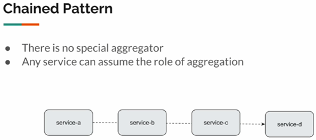
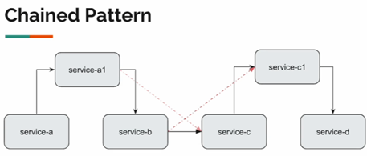
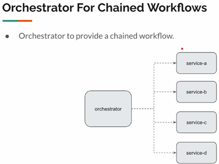
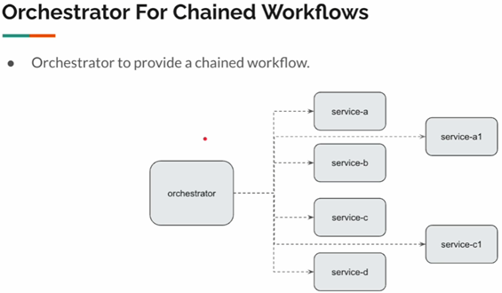
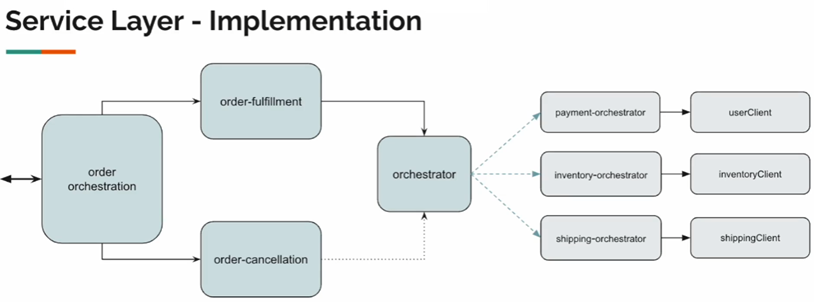

# 📚 Sección 5: Patrón Saga con orquestador: transacciones distribuidas y flujo de trabajo secuencial

---

## 🔄 Flujo de trabajo secuencial: Introducción

En esta sección retomaremos el **patrón Saga con orquestador (Orchestrator Saga)** que estudiamos anteriormente, pero
con una variación importante: en lugar de ejecutar varias operaciones en paralelo, utilizaremos el orquestador para
coordinar un flujo de trabajo secuencial.

En muchos escenarios, las operaciones de un proceso deben ejecutarse siguiendo un orden específico, ya que cada paso
depende de que el anterior haya finalizado correctamente.

Por ejemplo, consideremos algunas etapas del ciclo de vida del desarrollo de software:

1. Analizar el documento de requerimientos.
2. Diseñar e implementar la solución.
3. Desplegar la aplicación.
4. Realizar las pruebas.
5. Lanzar la aplicación.

No sería conveniente ejecutar todas estas actividades en paralelo, porque algunas necesitan los resultados de las
anteriores para poder continuar.

En arquitecturas de microservicios podemos encontrarnos con este mismo escenario: determinados servicios deben
ejecutarse uno después de otro, siguiendo una secuencia de procesamiento.

Para implementar este tipo de flujo existen diferentes alternativas. Una de ellas es el `Chained Pattern`.

### 🔗 Chained Pattern



El `Chained Pattern` consiste en encadenar varios servicios, de manera que cada servicio invoque al siguiente para
completar un flujo de trabajo.

Por ejemplo:

1. `service-a` recibe la solicitud y procesa su parte del trabajo.
2. Cuando termina, invoca a `service-b`.
3. `service-b` procesa su parte e invoca a `service-c`.
4. Finalmente, `service-c` invoca a `service-d`.

De esta manera, cada servicio conoce al siguiente componente que debe participar en el procesamiento.

#### Características principales:

- No existe un orquestador o agregador centralizado que controle todo el flujo.
- Cada servicio puede asumir la responsabilidad de invocar al siguiente.
- La secuencia de ejecución queda distribuida entre los diferentes servicios.

En cierto sentido, este patrón funciona como una composición de llamadas entre servicios, donde cada uno delega parte
del procesamiento al siguiente.

#### ⚖️ Chained Pattern: ventajas y desventajas

##### Ventajas:

- Es relativamente sencillo de implementar.
- Permite construir flujos de trabajo secuenciales mediante llamadas entre servicios.

##### Desventajas:

- **Mayor latencia:** las llamadas deben ejecutarse secuencialmente. Cada servicio debe esperar la respuesta del
  siguiente antes de completar el flujo.
- **Difícil depuración:** al estar distribuida la secuencia entre varios servicios, resulta más complicado identificar
  dónde se produjo un error.
- **Difícil mantenimiento:** los cambios en los requisitos pueden obligar a modificar varios servicios para adaptar la
  cadena de ejecución.

### 🔧 Chained Pattern: cambios en los requisitos

Supongamos que nuestro sistema necesita adaptarse a nuevos requisitos y debemos incorporar dos servicios adicionales:
`service-a1` y `service-c1`.



Inicialmente, la secuencia era:

````text
service-a → service-b → service-c → service-d
````

Con los nuevos requisitos, el flujo podría quedar así:

````text
service-a → service-a1 → service-b → service-c → service-c1 → service-d
````

Esto implica modificar las llamadas entre servicios:

- `service-a` ahora debe invocar a `service-a1` en lugar de llamar directamente a `service-b`.
- `service-a1` debe decidir si continúa hacia `service-b` o si, dependiendo de los requisitos, invoca directamente a
  `service-c`.
- `service-b` debe decidir si continúa hacia `service-c` o si debe invocar a `service-c1`.

Como consecuencia, los cambios en el flujo de trabajo pueden afectar a varios servicios, aumentando el acoplamiento
entre ellos.

Por tanto, aunque el `Chained Pattern` puede ser útil para flujos sencillos, no resulta una alternativa conveniente
cuando los requisitos cambian frecuentemente o el flujo de trabajo comienza a crecer.

### 🎯 Orchestrator for Chained Workflows

En lugar de distribuir la responsabilidad de coordinar el flujo entre los diferentes servicios, podemos reutilizar el
`patrón Orchestrator Saga`, introduciendo una pequeña variación para controlar las operaciones de manera secuencial.



En este enfoque, incorporamos un servicio central llamado orchestrator, que recibe la solicitud y controla todo el flujo
de trabajo.

El funcionamiento sería el siguiente:

1. El orchestrator recibe la solicitud.
2. Invoca a `service-a` y espera su respuesta.
3. Cuando obtiene la respuesta, invoca a `service-b` y espera nuevamente.
4. Después invoca a `service-c`.
5. Finalmente, invoca a `service-d`.

A diferencia del `Chained Pattern`, los servicios ya no necesitan conocer cuál es el siguiente servicio que debe
ejecutarse. Esa responsabilidad queda centralizada en el orquestador.

**¿Qué sucede si ocurre un error?**

El orquestador tiene una visión completa del flujo de trabajo, por lo que puede identificar qué servicio produjo el
fallo y gestionar la respuesta correspondiente.

Esto también facilita la depuración, ya que podemos revisar desde un único punto la secuencia de operaciones ejecutadas.

### 🔧 Orchestrator for Chained Workflows: cambios en los requisitos

Ahora supongamos que nuevamente debemos incorporar los servicios `service-a1` y `service-c1` debido a nuevos requisitos.



En este caso, la secuencia de ejecución sería:

````text
service-a → service-a1 → service-b → service-c → service-c1 → service-d
````

La diferencia es que no necesitamos modificar las llamadas internas de los servicios existentes.
Simplemente, actualizamos el orquestador para incorporar los nuevos pasos en el orden correspondiente.

De esta manera, el orquestador sigue siendo el responsable de determinar qué servicio se ejecuta, cuándo se ejecuta y
cuál será el siguiente paso.

#### ⚖️ Orchestrator for Chained Workflows: ventajas y desventajas

##### Ventajas:

- **Fácil depuración:** el orquestador centraliza el control del flujo y permite identificar con mayor facilidad dónde
  ocurrió un fallo.
- **Fácil mantenimiento:** los cambios en los requisitos se gestionan principalmente modificando el flujo de trabajo del
  orquestador.
- **Menor acoplamiento entre servicios:** cada servicio se concentra en su propia responsabilidad sin necesidad de
  conocer los demás participantes del proceso.

##### Desventajas:

- **Mayor latencia:** al tratarse de un flujo secuencial, cada operación debe esperar a que finalice la anterior antes
  de comenzar.

Para implementar este tipo de flujo de trabajo secuencial utilizando el patrón Orchestrator, retomaremos el ejemplo
desarrollado anteriormente, pero realizaremos algunos ajustes para adaptarlo a este nuevo escenario.

## 🔌 Servicios externos

Para esta sección utilizaremos nuevamente el servicio externo `external-services-v2.jar`, que contiene los endpoints
necesarios para implementar y probar nuestro flujo de trabajo secuencial. Lo iniciamos desde la terminal:

````bash
D:\programming\spring\01.udemy\03.vinoth_selvaraj\spring-webflux-patterns-resilience (main -> origin)
$ java -jar .\external-services\external-services-v2.jar

  .   ____          _            __ _ _
 /\\ / ___'_ __ _ _(_)_ __  __ _ \ \ \ \
( ( )\___ | '_ | '_| | '_ \/ _` | \ \ \ \
 \\/  ___)| |_)| | | | | || (_| |  ) ) ) )
  '  |____| .__|_| |_|_| |_\__, | / / / /
 =========|_|==============|___/=/_/_/_/
 :: Spring Boot ::                (v2.6.4)

2026-11-13 10:49:12.253  INFO 13456 --- [           main] c.v.e.ExternalServicesApplication        : Starting ExternalServicesApplication v0.0.1-SNAPSHOT using Java 25.0.2 on SysEngJava with PID 13456 (D:\programming\spring\01.udemy\03.vinoth_selvaraj\spring-webflux-patterns-resilience\external-services\external-services-v2.jar started by magadiflo in D:\programming\spring\01.udemy\03.vinoth_selvaraj\spring-webflux-patterns-resilience)
2026-11-13 10:49:12.256  INFO 13456 --- [           main] c.v.e.ExternalServicesApplication        : No active profile set, falling back to 1 default profile: "default"
WARNING: A terminally deprecated method in sun.misc.Unsafe has been called
WARNING: sun.misc.Unsafe::objectFieldOffset has been called by io.netty.util.internal.PlatformDependent0$3 (jar:file:/D:/programming/spring/01.udemy/03.vinoth_selvaraj/spring-webflux-patterns-resilience/external-services/external-services-v2.jar!/BOOT-INF/lib/netty-common-4.1.74.Final.jar!/)
WARNING: Please consider reporting this to the maintainers of class io.netty.util.internal.PlatformDependent0$3
WARNING: sun.misc.Unsafe::objectFieldOffset will be removed in a future release
2026-11-13 10:49:14.662  INFO 13456 --- [           main] o.s.b.web.embedded.netty.NettyWebServer  : Netty started on port 7070
2026-11-13 10:49:15.149  INFO 13456 --- [           main] c.v.e.ExternalServicesApplication        : Started ExternalServicesApplication in 3.35 seconds (JVM running for 4.068)1:38:36.716  INFO 10264 --- [           main] c.v.e.ExternalServicesApplication        : Started ExternalServicesApplication in 2.947 seconds (JVM running for 3.338)
````

Una vez iniciado, accedemos a Swagger UI y buscamos el apartado `sec04-orchestrator (sequential workflow)`.
Los endpoints son similares a los utilizados en la sección anterior. Sin embargo, existe una diferencia importante:
ahora algunas operaciones necesitan identificadores generados por servicios ejecutados previamente.

### 🛍️ Product Service

Este servicio proporciona la información de un producto a partir de su identificador.

````bash
$ curl -v http://localhost:7070/sec04/product/1 | jq
>
< HTTP/1.1 200 OK
< Content-Type: application/json
< Content-Length: 82
<
{
  "id": 1,
  "category": "Books & Kids",
  "description": "Durable Bronze Chair",
  "price": 16
}
````

### 👤 User Service

Este servicio permite consultar la información de un usuario, descontar fondos de su saldo y realizar reembolsos.

#### 1. Consultar un usuario

````bash
$ curl -v http://localhost:7070/sec04/user/1 | jq
>
< HTTP/1.1 200 OK
< Content-Type: application/json
< Content-Length: 142
<
{
  "userId": 1,
  "name": "Ms. Danny King",
  "balance": 395,
  "address": {
    "street": "873 Kris Crest",
    "city": "West Don",
    "state": "Florida",
    "zipCode": "60259"
  }
}
````

La respuesta incluye los datos del usuario, su saldo y su dirección.

#### 2. Descontar fondos

Este endpoint permite descontar fondos del saldo del usuario. La diferencia respecto a la sección anterior es que
ahora la respuesta incluye un nuevo campo: `paymentId`.

````bash
$ curl -v -X POST -H "Content-Type: application/json" -d "{\"amount\": 10, \"orderId\": \"3fa85f64-5717-4562-b3fc-2c963f66afa6\", \"userId\": 1 }" http://localhost:7070/sec04/user/deduct | jq
>
< HTTP/1.1 200 OK
< Content-Type: application/json
< Content-Length: 120
<
{
  "paymentId": "33c8896f-c4bb-47ef-896f-1ffd7a23c544",
  "userId": 1,
  "name": "Ms. Danny King",
  "balance": 375,
  "status": "SUCCESS"
}
````

Este identificador será necesario para ejecutar el siguiente paso del flujo: **descontar unidades del inventario.**

#### 3. Reembolsar fondos

````bash
$ curl -v -X POST -H "Content-Type: application/json" -d "{\"amount\": 10, \"orderId\": \"3fa85f64-5717-4562-b3fc-2c963f66afa6\", \"userId\": 1 }" http://localhost:7070/sec04/user/refund | jq
>
< HTTP/1.1 200 OK
< Content-Type: application/json
< Content-Length: 69
<
{
  "userId": 1,
  "name": "Ms. Danny King",
  "balance": 395,
  "status": "SUCCESS"
}
````

### 📦 Inventory Service

Este servicio permite consultar la cantidad disponible de un producto, descontar unidades del inventario y restaurarlas
cuando sea necesario.

#### 1. Consultar el inventario

````bash
$ curl -v http://localhost:7070/sec04/inventory/2 | jq
>
< HTTP/1.1 200 OK
< Content-Type: application/json
< Content-Length: 2
<
10
````

El resultado indica que hay 10 unidades disponibles del producto con identificador 2.

#### 2. Descontar unidades

Este endpoint permite descontar unidades del inventario. A diferencia de la implementación anterior, ahora debemos
enviar el `paymentId` obtenido en **la operación de descuento de fondos.**

Request:

````bash
$ curl -v -X POST -H "Content-Type: application/json" -d "{\"paymentId\": \"33c8896f-c4bb-47ef-896f-1ffd7a23c544\", \"productId\": 2, \"quantity\": 4}" http://localhost:7070/sec04/inventory/deduct | jq
>
< HTTP/1.1 200 OK
< Content-Type: application/json
< Content-Length: 122
<
{
  "inventoryId": "3f0d049e-67ae-41c8-bb2c-2a2cce973b66",
  "productId": 2,
  "quantity": 4,
  "remainingQuantity": 6,
  "status": "SUCCESS"
}
````

Observamos que la respuesta también genera un identificador: `inventoryId`. Este identificador será utilizado
posteriormente para **programar el envío.**

#### 3. Restaurar unidades

````bash
$ curl -v -X POST -H "Content-Type: application/json" -d "{\"paymentId\": \"33c8896f-c4bb-47ef-896f-1ffd7a23c544\", \"productId\": 2, \"quantity\": 4}" http://localhost:7070/sec04/inventory/restore | jq
>
< HTTP/1.1 200 OK
< Content-Type: application/json
< Content-Length: 89
<
{
  "inventoryId": null,
  "productId": 2,
  "quantity": 4,
  "remainingQuantity": 10,
  "status": "SUCCESS"
}
````

### 🚚 Shipping Service

Este servicio permite programar un envío y cancelar una programación existente.

#### 1. Programar un envío

Ahora, la petición necesita el `inventoryId` generado por el servicio de inventario.

````bash
$ curl -v -X POST -H "Content-Type: application/json" -d "{\"inventoryId\": \"3f0d049e-67ae-41c8-bb2c-2a2cce973b66\", \"userId\": 1, \"quantity\": 4}" http://localhost:7070/sec04/shipping/schedule | jq
>
< HTTP/1.1 200 OK
< Content-Type: application/json
< Content-Length: 209
<
{
  "shippingId": "d8314de2-3944-4ac5-a939-4d5b74c56697",
  "quantity": 4,
  "status": "SUCCESS",
  "expectedDelivery": "2026-11-18",
  "address": {
    "street": "873 Kris Crest",
    "city": "West Don",
    "state": "Florida",
    "zipCode": "60259"
  }
}
````

La respuesta contiene el identificador del envío, su estado y la fecha estimada de entrega.

#### 2. Cancelar un envío

````bash
$ curl -v -X POST -H "Content-Type: application/json" -d "{\"inventoryId\": \"3f0d049e-67ae-41c8-bb2c-2a2cce973b66\", \"userId\": 1, \"quantity\": 4}" http://localhost:7070/sec04/shipping/cancel | jq
>
< HTTP/1.1 200 OK
< content-length: 0
<
````

El servidor responde con 200 OK y un cuerpo vacío, lo que indica que la solicitud se procesó correctamente sin devolver
contenido.

## ⚙️ Configuración del proyecto

Para comenzar con esta nueva implementación, creamos el paquete `sec05` y copiamos dentro de él todo lo que hicimos
dentro del paquete `sec04`: `/client`, `/controller`, `/dto`, `/service` y `/util`.

De esta manera, partimos de la implementación anterior y realizamos únicamente los ajustes necesarios para trabajar con
el nuevo flujo secuencial.

### 🎮 Actualización del controlador

En `OrderController` modificamos el mapeo de la ruta para identificar esta implementación como parte de la sección
`sec04` de los servicios externos. El controlador mantiene la misma lógica de la sección anterior: recibe una solicitud
para procesar una orden y delega su ejecución al OrchestratorService.

````java
@RequiredArgsConstructor
@RestController
@RequestMapping(path = "/api/{version}/sec04/orders", version = "1")
public class OrderController {

    private final OrchestratorService orchestratorService;

    @PostMapping
    public Mono<ResponseEntity<OrderResponse>> placeOrder(@RequestBody Mono<OrderRequest> orderRequestMono) {
        return this.orchestratorService.placeOrder(orderRequestMono)
                .map(ResponseEntity::ok)
                .defaultIfEmpty(ResponseEntity.notFound().build());
    }

}
````

### 🔌 Actualización de los clientes

En los clientes (`InventoryClient`, `ProductClient`, `ShippingClient` y `UserClient`) modificamos la propiedad que
se utiliza mediante `@Value` para obtener la URL base desde `application.properties`.

Por ejemplo, en `InventoryClient`:

````java
@Component
public class InventoryClient {

    private static final String DEDUCT = "deduct";
    private static final String RESTORE = "restore";
    private final WebClient webClient;

    public InventoryClient(@Value("${sec04.inventory.service}") String baseUrl) {
        this.webClient = WebClient.builder()
                .baseUrl(baseUrl)
                .build();
    }
    /* other codes */
}
````

Aplicamos el mismo cambio en los demás clientes, utilizando la propiedad correspondiente a cada servicio:

- **ProductClient:** `${sec04.product.service}`
- **UserClient:** `${sec04.user.service}`
- **InventoryClient:** `${sec04.inventory.service}`
- **ShippingClient:** `${sec04.shipping.service}`

No cambia la configuración de `WebClient`; simplemente centralizamos las URL base en las propiedades de la aplicación.

### 📝 Configuración en application.properties

Finalmente, agregamos las siguientes propiedades:

````properties
sec04.product.service=http://localhost:7070/sec04/product
sec04.user.service=http://localhost:7070/sec04/user
sec04.inventory.service=http://localhost:7070/sec04/inventory
sec04.shipping.service=http://localhost:7070/sec04/shipping
````

Así, los clientes obtienen sus respectivas URL base mediante inyección de dependencias, evitando tenerlas directamente
codificadas en las clases.

> **Nota:** Aunque estamos trabajando dentro del paquete `sec05`, las rutas del controlador y las propiedades de
> configuración utilizan `sec04` porque apuntan a los endpoints de los servicios externos correspondientes a esa
> sección. No debemos confundir la versión de nuestra implementación con la versión de los servicios externos.

### ⚙️ Actualizando el paquete de escaneo de componentes

Finalmente, actualizamos la configuración de la clase principal de Spring Boot para que el escaneo de componentes se
realice sobre el paquete correspondiente a la `sección 5`.

````java
@SpringBootApplication(scanBasePackages = "dev.magadiflo.patterns.app.sec05")
public class WebfluxPatternsApplication {

    public static void main(String[] args) {
        SpringApplication.run(WebfluxPatternsApplication.class, args);
    }

}
````

Mediante el atributo `scanBasePackages` indicamos a Spring Boot dónde debe buscar componentes administrados por el
contenedor, como clases anotadas con `@Service`, `@Component`, `@Repository` y `@Controller`.

De esta manera, Spring podrá detectar y registrar los componentes correspondientes a nuestra nueva implementación.

## 📦 Modificando DTOs

En esta sección necesitamos realizar algunos ajustes en los DTO para manejar los identificadores que se generan
durante la ejecución secuencial del flujo de trabajo.

Los principales cambios son:

- **PaymentResponse:** incorpora `paymentId`, devuelto por el servicio de usuarios después de descontar los fondos.
- **InventoryRequest:** incorpora `paymentId`, necesario para solicitar el descuento de unidades del inventario.
- **InventoryResponse:** incorpora `inventoryId`, generado después de descontar las unidades.
- **ShippingRequest:** incorpora `inventoryId`, necesario para programar el envío.
- **ShippingResponse:** representa la respuesta del servicio de envíos, incluyendo `shippingId` y la fecha estimada
  de entrega.

````java
public record PaymentResponse(UUID paymentId,
                              Integer userId,
                              String name,
                              Integer balance,
                              Status status) {
}
````

````java
public record InventoryRequest(UUID paymentId,
                               Integer productId,
                               Integer quantity) {
}
````

````java
public record InventoryResponse(UUID inventoryId,
                                Integer productId,
                                Integer quantity,
                                Integer remainingQuantity,
                                Status status) {
}
````

````java

public record ShippingRequest(Integer quantity,
                              Integer userId,
                              UUID inventoryId) {
}
````

````java
public record ShippingResponse(UUID shippingId,
                               Integer quantity,
                               Status status,
                               String expectedDelivery,
                               Address address) {
}
````

De esta manera, los DTO permiten transportar los identificadores generados por cada servicio y utilizarlos en las
solicitudes posteriores del flujo secuencial.

> **Nota:** Los DTO mostrados corresponden a los nuevos campos y estructuras necesarios para esta implementación;
> los demás atributos y tipos se mantienen según las respuestas de los servicios externos.

## 🔧 Modificando los clientes

Realizamos un pequeño ajuste en los métodos `buildErrorResponse()` de tres clientes: `InventoryClient`,
`ShippingClient` y `UserClient`.

Como ahora las respuestas incluyen nuevos identificadores (`paymentId`, `inventoryId` y `shippingId`), debemos
actualizar también la construcción de las respuestas de error para que coincidan con las nuevas estructuras de los DTO.

En cada cliente agregamos un primer argumento con valor `null`, correspondiente al nuevo identificador:

- **InventoryClient:** agrega `null` para `inventoryId`.
- **ShippingClient:** agrega `null` para `shippingId`.
- **UserClient:** agrega `null` para `paymentId`.

De esta manera, las respuestas de error siguen siendo compatibles con los DTO actualizados y mantienen el estado
`Status.FAILED`.

No se modifica el comportamiento de las llamadas a los servicios; únicamente adaptamos la construcción de las respuestas
de error a los nuevos campos.

````java
@Component
public class InventoryClient {

    /* other codes */

    private InventoryResponse buildErrorResponse(InventoryRequest request) {
        return new InventoryResponse(
                null, // <-- agregado
                request.productId(),
                request.quantity(),
                null,
                Status.FAILED
        );
    }
}
````

````java
@Component
public class ShippingClient {

    /* other codes */

    private ShippingResponse buildErrorResponse(ShippingRequest request) {
        return new ShippingResponse(
                null, // <-- agregado
                request.quantity(),
                Status.FAILED,
                null,
                null
        );
    }
}
````

````java
@Component
public class UserClient {

    /* other codes */

    private PaymentResponse buildErrorResponse(PaymentRequest request) {
        return new PaymentResponse(
                null, // <-- agregado
                request.userId(),
                null,
                request.amount(),
                Status.FAILED
        );
    }
}
````

## 🔄 Actualizando el OrchestrationUtil

Actualizamos la clase `OrchestrationUtil` para adaptar la construcción de las solicitudes al nuevo flujo de trabajo
secuencial. A diferencia de la implementación anterior, eliminamos completamente el método `buildRequestContext()`,
que se encargaba de construir todas las solicitudes de manera anticipada:

````java
// ❌ Eliminado: ya no construimos todas las solicitudes al inicio,
// porque ahora deben generarse secuencialmente según las respuestas obtenidas.
public static void buildRequestContext(OrchestrationRequestContext context) {
    buildPaymentRequest(context);
    buildInventoryRequest(context);
    buildShippingRequest(context);
}
````

Este método ya no es necesario porque ahora cada solicitud debe construirse únicamente cuando se dispone de la
respuesta de la operación anterior. Por ello, mantenemos los tres métodos de construcción independientes:

- `buildPaymentRequest()`: construye la solicitud de pago utilizando los datos de la orden. El único cambio
  respecto a la implementación anterior es que ahora es público.
- `buildInventoryRequest()`: obtiene el `paymentId` de `PaymentResponse` para incorporarlo en `InventoryRequest`.
- `buildShippingRequest()`: obtiene el `inventoryId` de `InventoryResponse` para incorporarlo en `ShippingRequest`.

````java
@NoArgsConstructor(access = AccessLevel.PRIVATE)
public class OrchestrationUtil {

    public static void buildPaymentRequest(OrchestrationRequestContext context) {
        var paymentRequest = new PaymentRequest(
                context.getOrderRequest().userId(),
                context.getProductPrice() * context.getOrderRequest().quantity(),
                context.getOrderId()
        );
        context.setPaymentRequest(paymentRequest);
    }

    public static void buildInventoryRequest(OrchestrationRequestContext context) {
        var inventoryRequest = new InventoryRequest(
                context.getPaymentResponse().paymentId(),
                context.getOrderRequest().productId(),
                context.getOrderRequest().quantity()
        );
        context.setInventoryRequest(inventoryRequest);
    }

    public static void buildShippingRequest(OrchestrationRequestContext context) {
        var shippingRequest = new ShippingRequest(
                context.getOrderRequest().quantity(),
                context.getOrderRequest().userId(),
                context.getInventoryResponse().inventoryId()
        );
        context.setShippingRequest(shippingRequest);
    }
}
````

La razón de este cambio es que las solicitudes ya no pueden construirse todas al inicio del proceso. Cada método deberá
invocarse desde el orquestador en el momento correspondiente, una vez que se haya obtenido la respuesta necesaria del
servicio anterior. De esta manera, trasladamos al orquestador el control del orden en que se construyen y ejecutan las
solicitudes.

## 🏗️ Flujo de trabajo secuencial - Arquitectura

Antes de modificar la implementación anterior, revisaremos cómo adaptaremos la arquitectura para soportar el nuevo
flujo de trabajo secuencial.



En la sección anterior teníamos una clase abstracta Orchestrator, de la cual heredaban tres implementaciones concretas:

- PaymentOrchestrator, que utiliza UserClient.
- InventoryOrchestrator, que utiliza InventoryClient.
- ShippingOrchestrator, que utiliza ShippingClient.

Estas implementaciones eran utilizadas por dos servicios principales:

- OrderFulfillmentService: coordinaba las operaciones necesarias para completar una orden.
- OrderCancellationService: coordinaba las operaciones de compensación cuando era necesario cancelar una orden.

En el flujo anterior, OrderFulfillmentService ejecutaba los tres orquestadores en paralelo. Cada uno realizaba su
operación y devolvía una respuesta indicando si había tenido éxito o había fallado.

Posteriormente, se evaluaban los resultados:

- Si todas las operaciones eran exitosas, la orden se consideraba completada.
- Si alguna operación fallaba, se iniciaba el proceso de cancelación mediante OrderCancellationService, que ejecutaba
  las operaciones de compensación correspondientes, como reembolsar el pago y restaurar el inventario.

### 🔄 Nueva arquitectura: ejecución secuencial

Para esta sección mantendremos prácticamente la misma arquitectura. No necesitamos modificar por completo la estructura
existente, sino adaptar la manera en que se ejecutan los orquestadores.

El principal cambio estará en `OrderFulfillmentService`.

Anteriormente, este servicio ejecutaba los tres orquestadores en paralelo. Ahora los ejecutará uno después del otro,
respetando el orden de las operaciones:

1. Primero se invoca PaymentOrchestrator.
2. Si el pago es exitoso, se continúa con InventoryOrchestrator.
3. Si el descuento del inventario es exitoso, se continúa con ShippingOrchestrator.
4. Si todas las operaciones finalizan correctamente, la orden se considera completada.

#### ¿Qué sucede si alguna operación falla?

Si cualquiera de los orquestadores devuelve una respuesta de error, el flujo se interrumpe inmediatamente y no se
ejecutan los pasos posteriores. En ese escenario, se inicia el proceso de cancelación de la orden para ejecutar las
operaciones de compensación que correspondan.

Por tanto, la principal modificación consiste en reemplazar la ejecución paralela por una coordinación secuencial de
los orquestadores, manteniendo las responsabilidades de cada uno y reutilizando la arquitectura desarrollada
anteriormente.

Los cambios concretos los iremos implementando en los siguientes apartados.

## 🔍 Flujo de trabajo secuencial - Implementación - Parte 1

En esta primera parte se introduce una mejora importante en los tres orquestadores: centralizar la validación del
resultado de cada operación mediante un método reutilizable definido en la clase abstracta `Orchestrator`.

Vamos por partes.

### 1. Creación de `OrderFulfillmentException`

````java
public class OrderFulfillmentException extends RuntimeException {

}
````

Se crea una excepción personalizada que extiende de `RuntimeException`. Su propósito es representar un fallo
durante el proceso de cumplimiento de una orden (`Order Fulfillment`).

Al extender de `RuntimeException`, es una excepción no verificada (`unchecked exception`), por lo que no estamos
obligados a declararla con `throws` ni a capturarla mediante un bloque `try-catch`.

### 2. Centralización de la validación en `Orchestrator`

Se agrega el método `statusHandler()` a nuestra clase abstracta:

````java
public abstract class Orchestrator {
    public abstract Mono<OrchestrationRequestContext> create(OrchestrationRequestContext context);

    public abstract Predicate<OrchestrationRequestContext> isSuccess();

    public abstract Consumer<OrchestrationRequestContext> cancel();

    protected BiConsumer<OrchestrationRequestContext, SynchronousSink<OrchestrationRequestContext>> statusHandler() {
        return (context, synchronousSink) -> {
            if (this.isSuccess().test(context)) {
                synchronousSink.next(context);
            } else {
                synchronousSink.error(new OrderFulfillmentException());
            }
        };
    }
}
````

Recordemos que `isSuccess()` es un método abstracto. Por tanto, cada orquestador concreto debe proporcionar su propia
implementación de esta validación.

El método `statusHandler()` aprovecha ese comportamiento polimórfico para aplicar una lógica común:

- **Si la operación fue exitosa:** utiliza `synchronousSink.next(context)` para emitir el contexto y continuar el
  flujo reactivo.
- **Si la operación falló:** utiliza `synchronousSink.error(...)` para propagar un error y detener el flujo.

Aquí tenemos una aplicación interesante del patrón `Template Method`: la clase abstracta proporciona una estructura de
comportamiento reutilizable, mientras que las subclases implementan los detalles específicos.

### 3. Integración en los orquestadores concretos

Se modifica el método `create()` de los tres orquestadores.

#### `PaymentOrchestrator`

````java
@Slf4j
@RequiredArgsConstructor
@Service
public class PaymentOrchestrator extends Orchestrator {

    private final UserClient userClient;

    @Override
    public Mono<OrchestrationRequestContext> create(OrchestrationRequestContext context) {
        return this.userClient.deduct(context.getPaymentRequest())
                .doOnNext(context::setPaymentResponse)
                .thenReturn(context)
                .handle(this.statusHandler()); //<-- Se agregó
    }
    /* other codes */
}
````

#### `ShippingOrchestrator`

````java
@RequiredArgsConstructor
@Service
public class ShippingOrchestrator extends Orchestrator {

    private final ShippingClient shippingClient;

    @Override
    public Mono<OrchestrationRequestContext> create(OrchestrationRequestContext context) {
        return this.shippingClient.schedule(context.getShippingRequest())
                .doOnNext(context::setShippingResponse)
                .thenReturn(context)
                .handle(this.statusHandler()); //<-- Se agregó
    }
    /* other codes */
}
````

#### `InventoryOrchestrator`

````java
@RequiredArgsConstructor
@Service
public class InventoryOrchestrator extends Orchestrator {

    private final InventoryClient inventoryClient;

    @Override
    public Mono<OrchestrationRequestContext> create(OrchestrationRequestContext context) {
        return this.inventoryClient.deduct(context.getInventoryRequest())
                .doOnNext(context::setInventoryResponse)
                .thenReturn(context)
                .handle(this.statusHandler());
    }
    /* other codes */
}
````

Observemos que los tres orquestadores siguen prácticamente la misma estructura. Lo importante es la incorporación de
`.handle(this.statusHandler());`.

El operador `handle()` de Reactor permite realizar una transformación síncrona del elemento emitido, utilizando un
`SynchronousSink`. En este caso, lo utilizamos para decidir si debemos continuar emitiendo el contexto o propagar un
error.

### 4. 🔄 ¿Cómo queda el flujo de ejecución?

Tomemos como ejemplo `PaymentOrchestrator`:

1. **`userClient.deduct()`**
    - Se ejecuta la operación de pago y se obtiene un `Mono` con la respuesta del servicio.

2. **`doOnNext(context::setPaymentResponse)`**
    - Se guarda la respuesta del pago en el contexto compartido (`OrchestrationRequestContext`).

3. **`thenReturn(context)`**
    - Una vez completada la operación anterior, se vuelve a emitir el contexto actualizado.

4. **`handle(this.statusHandler())`**
    - Se evalúa si la operación fue exitosa mediante el método `isSuccess()` implementado por el orquestador concreto.
    - Si la operación fue exitosa, se emite el contexto mediante `synchronousSink.next(context)`, permitiendo que el
      flujo continúe.
    - Si la operación falló, se propaga un error mediante `synchronousSink.error(new OrderFulfillmentException())`,
      interrumpiendo el flujo.

**Representación del flujo:**

```text
userClient.deduct()
        |
        v
doOnNext(context::setPaymentResponse)
        |
        v
thenReturn(context)
        |
        v
handle(this.statusHandler())
        |
        v
   ¿isSuccess()?
       /   \
     Sí     No
     |       |
     v       v
  next()   error()
     |       |
     v       v
 Continúa  Se interrumpe
 el flujo  el flujo
```

### 5. 💡 ¿Qué conseguimos con este cambio?

Antes, cada orquestador tendría que implementar individualmente la lógica para comprobar si su operación fue exitosa y
decidir qué hacer ante un fallo.

Ahora, esa responsabilidad se centraliza en Orchestrator.

Esto nos proporciona:

- **Reutilización:** evitamos duplicar la lógica de validación.
- **Consistencia:** los tres orquestadores gestionan sus resultados siguiendo el mismo mecanismo.
- **Polimorfismo:** cada orquestador conserva la responsabilidad de definir su propia condición de éxito mediante
  `isSuccess()`.
- **Mantenibilidad:** si necesitamos modificar la forma en que gestionamos un resultado fallido, podemos hacerlo desde
  un único lugar.

### Una observación importante sobre el manejo de errores

En nuestra implementación, los clientes (`PaymentClient`, `ShippingClient` e `InventoryClient`) se encargan de capturar
los errores que pueden producirse durante la comunicación con los servicios externos. Para ello, utilizan
`onErrorReturn()`, devolviendo una respuesta por defecto que representa un resultado fallido (`Status.FAILED`).

Esto significa que, cuando ocurre un error de comunicación contemplado por estos operadores, el flujo reactivo no
continúa con una señal de error, sino que emite una respuesta normal que posteriormente será evaluada por el
orquestador.

Por tanto, cuando se ejecuta `handle(this.statusHandler())`, el método `isSuccess()` puede identificar que la operación
falló y, en ese caso, propagar una `OrderFulfillmentException` mediante `synchronousSink.error()`.

Es importante recordar que este comportamiento depende de cómo se gestionen los errores en los clientes. Por ejemplo, si
un cliente no capturara los errores de comunicación ni devolviera una respuesta por defecto, el flujo reactivo
propagaría directamente la señal de error hacia los operadores posteriores. En ese escenario, `handle()` no ejecutaría
el callback de `statusHandler()`, sino que transmitiría el error tal como lo recibió, sin llegar a evaluar el método
`isSuccess()`.

**Idea clave:** `handle()` solamente ejecuta su callback cuando recibe un elemento emitido por el flujo. Si recibe una
señal de error, esta se propaga directamente.

## 🔄 Flujo de trabajo secuencial - Implementación - Parte 2

En esta parte se actualiza `OrderFulfillmentService` para implementar el flujo secuencial que vimos anteriormente.

La principal diferencia respecto a la implementación de la sección anterior es que los orquestadores ya no se ejecutan
en paralelo. Ahora cada uno se invoca únicamente cuando la operación anterior ha finalizado correctamente.

### 💻 OrderFulfillmentService

````java
@RequiredArgsConstructor
@Service
public class OrderFulfillmentService {

    private final ProductClient productClient;
    private final PaymentOrchestrator paymentOrchestrator;
    private final InventoryOrchestrator inventoryOrchestrator;
    private final ShippingOrchestrator shippingOrchestrator;

    public Mono<OrchestrationRequestContext> placeOrder(OrchestrationRequestContext context) {
        return this.getProduct(context)
                .doOnNext(OrchestrationUtil::buildPaymentRequest)
                .flatMap(this.paymentOrchestrator::create)
                .doOnNext(OrchestrationUtil::buildInventoryRequest)
                .flatMap(this.inventoryOrchestrator::create)
                .doOnNext(OrchestrationUtil::buildShippingRequest)
                .flatMap(this.shippingOrchestrator::create)
                .doOnNext(context1 -> context1.setStatus(Status.SUCCESS))
                .doOnError(throwable -> context.setStatus(Status.FAILED))
                .onErrorReturn(context);
    }

    private Mono<OrchestrationRequestContext> getProduct(OrchestrationRequestContext context) {
        return this.productClient.getProduct(context.getOrderRequest().productId())
                .map(ProductResponse::price)
                .doOnNext(context::setProductPrice)
                .map(price -> context);
    }
}
````

#### 📌 Método `getProduct()`

Este método mantiene la responsabilidad de consultar el producto y almacenar su precio en el contexto. Su resultado es
un `Mono<OrchestrationRequestContext>`, que permite continuar con la cadena reactiva utilizando el mismo contexto de
orquestación.

#### 🔍 ¿Cómo funciona el flujo?

El método `placeOrder()` construye una cadena reactiva donde cada operación depende del resultado de la anterior.

El orden de ejecución es el siguiente:

1. Obtener el producto (`getProduct`): consulta el producto y almacena su precio en `OrchestrationRequestContext`.
2. Construir la solicitud de pago (`buildPaymentRequest`): utiliza el precio obtenido y los datos de la orden para
   preparar `PaymentRequest`.
3. Procesar el pago (`paymentOrchestrator.create`): ejecuta la operación de pago. Si tiene éxito, continúa con el
   siguiente paso.
4. Construir la solicitud de inventario (`buildInventoryRequest`): utiliza el `paymentId` obtenido de la respuesta del
   pago.
5. Procesar el inventario (`inventoryOrchestrator.create`): descuenta las unidades correspondientes. Si tiene éxito,
   continúa.
6. Construir la solicitud de envío (`buildShippingRequest`): utiliza el `inventoryId` obtenido de la respuesta del
   inventario.
7. Programar el envío (`shippingOrchestrator.create`): ejecuta la última operación del flujo.

Si todas las operaciones finalizan correctamente, se establece el estado de la orden como `Status.SUCCESS`.

### ⚙️ Operadores reactivos utilizados

Hay dos operadores especialmente importantes para comprender esta implementación:

- `doOnNext()`: permite ejecutar una acción secundaria (*efecto secundario*) cuando el `Mono` emite un elemento,
  sin modificar el flujo reactivo ni reemplazar el elemento emitido. Se utiliza habitualmente para realizar tareas como
  registrar logs, imprimir información o ejecutar otras acciones sobre el elemento recibido.

  > En nuestra implementación, aprovechamos este operador para modificar el estado interno de
  > `OrchestrationRequestContext`: construimos las solicitudes de pago, inventario y envío, y actualizamos el estado de
  > la orden. Aunque el objeto recibido se modifica internamente, `doOnNext()` continúa propagando la misma referencia
  > al siguiente operador.

- `flatMap()`: permite encadenar operaciones asíncronas que devuelven otro Mono. La siguiente operación se ejecuta
  cuando se recibe el resultado de la anterior.

Esta combinación permite construir las solicitudes justo en el momento en que se necesitan, aprovechando las respuestas
de las operaciones previas.

### ⚠️ Manejo de errores

Al final de la cadena encontramos:

````bash
.doOnError(throwable -> context.setStatus(Status.FAILED))
.onErrorReturn(context); 
````

- `doOnError()`: se ejecuta cuando ocurre un error en cualquier punto de la cadena y establece el estado del contexto
  como `Status.FAILED`.
- `onErrorReturn(context)`: captura el error y devuelve el contexto como resultado alternativo, evitando que el error se
  propague al consumidor de este `Mono`.

Por lo tanto, si falla el pago, el descuento de inventario o la programación del envío, el flujo se interrumpe y no se
ejecutan las etapas posteriores.

El contexto se devuelve con estado `FAILED`, lo que permite que la capa que invoca este servicio pueda identificar el
fallo y continuar con el proceso de cancelación correspondiente.

> **Nota:** `doOnError()` es un operador de efecto secundario; no transforma el error. Es `onErrorReturn()` el que
> realiza la recuperación devolviendo el contexto.

## 🔄 Flujo de trabajo secuencial - Implementación - Parte 3

En esta parte se realizan ajustes en `OrchestratorService` y en los orquestadores individuales para adaptar el proceso
de cancelación al nuevo flujo de ejecución secuencial.

El cambio más importante consiste en proteger las validaciones de éxito (`isSuccess()`) frente a respuestas que
todavía no existen, evitando posibles `NullPointerException` durante las operaciones de compensación.

### 1. Actualizando OrchestratorService

La implementación de `OrchestratorService` mantiene prácticamente la misma estructura:

````java
@RequiredArgsConstructor
@Service
public class OrchestratorService {

    private final OrderFulfillmentService fulfillmentService;
    private final OrderCancellationService cancellationService;

    private final DebugUtil debugUtil;

    public Mono<OrderResponse> placeOrder(Mono<OrderRequest> orderRequestMono) {
        return orderRequestMono
                .map(OrchestrationRequestContext::new)
                .flatMap(this.fulfillmentService::placeOrder)
                .doOnNext(this::doOrderPostProcessing)
                .doOnNext(this.debugUtil::print) // solo para debugging
                .map(this::toOrderResponse);
    }

    private void doOrderPostProcessing(OrchestrationRequestContext context) {
        if (context.getStatus() == Status.FAILED) {
            this.cancellationService.cancelOrder(context);
        }
    }

    private OrderResponse toOrderResponse(OrchestrationRequestContext context) {
        boolean isSuccess = context.getStatus() == Status.SUCCESS;
        Address address = isSuccess ? context.getShippingResponse().address() : null;
        String deliveryDate = isSuccess ? context.getShippingResponse().expectedDelivery() : null;

        return new OrderResponse(
                context.getOrderRequest().userId(),
                context.getOrderRequest().productId(),
                context.getOrderId(),
                context.getStatus(),
                address,
                deliveryDate
        );
    }
}
````

El método `doOrderPostProcessing()` continúa verificando el estado de la orden. Si alguna operación del flujo
secuencial falló, se invoca `OrderCancellationService` para iniciar las operaciones de compensación correspondientes.

El método `toOrderResponse()` también conserva su lógica: solamente obtiene la dirección y la fecha estimada de entrega
cuando la orden finalizó correctamente. Si hubo un fallo, ambos valores serán `null`.

### 2. 🛡️ Protegiendo las validaciones de éxito contra `NullPointerException`

Este es el ajuste más importante de esta implementación.

Recordemos que en la sección anterior los tres orquestadores se ejecutaban en paralelo. Por tanto, cuando comenzaba el
proceso de cancelación, las respuestas de los tres orquestadores ya se encontraban almacenadas en
`OrchestrationRequestContext`.

Ahora, con la ejecución secuencial, la situación es diferente.

Por ejemplo, imaginemos el siguiente escenario:

1. El pago se procesa correctamente y se almacena `PaymentResponse`.
2. El descuento de inventario falla y se almacena `InventoryResponse` con estado `FAILED`.
3. La programación del envío nunca llega a ejecutarse, por lo que `ShippingResponse` permanece en `null`.
4. Se inicia el proceso de cancelación.

Aunque el flujo principal sea secuencial, `OrderCancellationService` continúa ejecutando las operaciones de
compensación de los orquestadores en paralelo. Esto significa que cada orquestador debe verificar si su operación
original fue exitosa antes de ejecutar su compensación.

El problema aparece cuando `isSuccess()` intenta consultar el estado de una respuesta que todavía no existe.
Por ejemplo:

````bash
// ❌ Implementación anterior
return context ->context.getShippingResponse().status() ==Status.SUCCESS;
````

Si `shippingResponse` es `null`, se producirá un `NullPointerException` al intentar invocar `status()`.
Para solucionar este problema, se agrega una validación con `Objects.nonNull()`.

### 3. 🔧 Actualizando los orquestadores

`InventoryOrchestrator`

````java
@RequiredArgsConstructor
@Service
public class InventoryOrchestrator extends Orchestrator {

    private final InventoryClient inventoryClient;

    @Override
    public Mono<OrchestrationRequestContext> create(OrchestrationRequestContext context) {
        return this.inventoryClient.deduct(context.getInventoryRequest())
                .doOnNext(context::setInventoryResponse)
                .thenReturn(context)
                .handle(this.statusHandler());
    }

    @Override
    public Predicate<OrchestrationRequestContext> isSuccess() {
        return context -> Objects.nonNull(context.getInventoryResponse()) //<- Realizamos una protección contra NullPointerException
                          && context.getInventoryResponse().status() == Status.SUCCESS;
    }

    @Override
    public Consumer<OrchestrationRequestContext> cancel() {
        return context -> {
            Mono.just(context)
                    .filter(isSuccess())
                    .map(OrchestrationRequestContext::getInventoryRequest)
                    .flatMap(this.inventoryClient::restore)
                    .subscribe();
        };
    }
}
````

`PaymentOrchestrator`

````java
@Slf4j
@RequiredArgsConstructor
@Service
public class PaymentOrchestrator extends Orchestrator {

    private final UserClient userClient;

    @Override
    public Mono<OrchestrationRequestContext> create(OrchestrationRequestContext context) {
        return this.userClient.deduct(context.getPaymentRequest())
                .doOnNext(context::setPaymentResponse)
                .thenReturn(context)
                .handle(this.statusHandler());
    }

    @Override
    public Predicate<OrchestrationRequestContext> isSuccess() {
        return context -> Objects.nonNull(context.getPaymentResponse())
                          && context.getPaymentResponse().status() == Status.SUCCESS;
    }

    @Override
    public Consumer<OrchestrationRequestContext> cancel() {
        return context -> {
            Mono.just(context)
                    .filter(isSuccess())
                    .map(OrchestrationRequestContext::getPaymentRequest)
                    .flatMap(this.userClient::refund)
                    .subscribe();
        };
    }
}
````

`ShippingOrchestrator`

````java
@RequiredArgsConstructor
@Service
public class ShippingOrchestrator extends Orchestrator {

    private final ShippingClient shippingClient;

    @Override
    public Mono<OrchestrationRequestContext> create(OrchestrationRequestContext context) {
        return this.shippingClient.schedule(context.getShippingRequest())
                .doOnNext(context::setShippingResponse)
                .thenReturn(context)
                .handle(this.statusHandler());
    }

    @Override
    public Predicate<OrchestrationRequestContext> isSuccess() {
        return context -> Objects.nonNull(context.getShippingResponse())
                          && context.getShippingResponse().status() == Status.SUCCESS;
    }

    @Override
    public Consumer<OrchestrationRequestContext> cancel() {
        return context -> {
            Mono.just(context)
                    .filter(isSuccess())
                    .map(OrchestrationRequestContext::getShippingRequest)
                    .flatMap(this.shippingClient::cancel)
                    .subscribe();
        };
    }
}
````

El resto de la implementación de estos orquestadores se mantiene igual. La nueva validación utiliza dos condiciones:

- `Objects.nonNull(...)`: comprueba que la respuesta del orquestador exista.
- `&&`: permite evaluar la segunda condición únicamente si la primera es verdadera. Es decir, solo se consulta
  `status()` cuando la respuesta no es `null`.

De esta manera, si un orquestador no llegó a ejecutarse debido a un fallo en una etapa anterior, su método `isSuccess()`
devolverá false sin provocar una excepción.

### 📌 ¿Cómo afecta esto al proceso de cancelación?

Retomemos el escenario anterior:

| Orquestador | Respuesta | isSuccess() | Compensación                 |
|-------------|-----------|-------------|------------------------------|
| Payment     | SUCCESS   | `true`      | Se realiza el reembolso      |
| Inventory   | FAILED    | `false`     | No se restaura el inventario |
| Shipping    | null      | `false`     | No se cancela el envío       |

Así, aunque los tres orquestadores participen en el proceso de cancelación, cada uno ejecutará su operación
compensatoria únicamente cuando su operación original haya finalizado exitosamente.

> **En resumen:** el cambio de ejecución paralela a secuencial introduce la posibilidad de que algunas respuestas no
> existan dentro de `OrchestrationRequestContext`. Por eso, ahora los tres métodos `isSuccess()` comprueban primero que
> sus respectivas respuestas no sean `null`, evitando errores durante el proceso de compensación.

## 🧪 Flujo de trabajo secuencial - Prueba

Para comprobar el funcionamiento de la implementación, primero levantamos el servicio externo y luego realizamos tres
peticiones con diferentes escenarios.

### 🚀 Levantando el servicio externo

Ejecutamos el siguiente comando desde la raíz del proyecto:

````bash
D:\programming\spring\01.udemy\03.vinoth_selvaraj\spring-webflux-patterns-resilience (main -> origin)
$ java -jar .\external-services\external-services-v2.jar 
````

### 1. Primera petición: producto inexistente

Enviamos una solicitud con `productId = 51`:

````bash
$ curl -v -X POST -H "Content-Type: application/json" -d "{\"userId\": 1, \"productId\": 51, \"quantity\": 1}" http://localhost:8080/api/v1/sec04/orders | jq
>
< HTTP/1.1 404 Not Found
< content-length: 0
<
````

La petición devuelve 404 Not Found porque el producto solicitado no se encuentra. Como la consulta del producto es el
primer paso del flujo secuencial, el proceso se interrumpe y no se ejecutan las operaciones posteriores de pago,
inventario y envío.

### 2. Segunda petición: pago rechazado

Ahora enviamos una solicitud con `productId = 1` y una cantidad de `10000 unidades`:

````bash
$ curl -v -X POST -H "Content-Type: application/json" -d "{\"userId\": 1, \"productId\": 1, \"quantity\": 10000}" http://localhost:8080/api/v1/sec04/orders | jq
>
< HTTP/1.1 200 OK
< Content-Type: application/json
< Content-Length: 140
<
{
  "userId": 1,
  "productId": 1,
  "orderId": "7a599f50-7368-4557-8c1b-cd3c3260e6f2",
  "status": "FAILED",
  "shippingAddress": null,
  "expectedDelivery": null
}
````

Aunque la respuesta HTTP es 200 OK, el estado de la orden es FAILED. Esto se debe a que la operación de pago no pudo
completarse correctamente.

Podemos comprobarlo en el log del servicio externo:

````bash
2026-11-18 12:38:28.183  INFO 12816 --- [ctor-http-nio-3] c.v.e.s.o.service.Sec4UserService        : sec04 - user balance - deduct request : PaymentRequest(userId=1, orderId=7a599f50-7368-4557-8c1b-cd3c3260e6f2, amount=990000) 
````

El importe solicitado para el pago es 990000, correspondiente a 10000 unidades del producto, cuyo precio unitario es 99.
En el log de nuestra aplicación podemos observar el contenido de `OrchestrationRequestContext`:

````bash
2026-11-18T12:38:28.204-05:00  INFO 17848 --- [webflux-patterns] [ctor-http-nio-2] d.m.patterns.app.sec05.util.DebugUtil    : {
  "orderRequest" : {
    "userId" : 1,
    "productId" : 1,
    "quantity" : 10000
  },
  "inventoryRequest" : null,
  "inventoryResponse" : null,
  "orderId" : "7a599f50-7368-4557-8c1b-cd3c3260e6f2",
  "paymentRequest" : {
    "userId" : 1,
    "amount" : 990000,
    "orderId" : "7a599f50-7368-4557-8c1b-cd3c3260e6f2"
  },
  "paymentResponse" : {
    "paymentId" : null,
    "userId" : 1,
    "name" : null,
    "balance" : 990000,
    "status" : "FAILED"
  },
  "productPrice" : 99,
  "shippingRequest" : null,
  "shippingResponse" : null,
  "status" : "FAILED"
} 
````

Observamos que:

- productPrice contiene el precio unitario del producto: 99.
- paymentRequest fue construido correctamente con un importe de 990000.
- paymentResponse tiene estado FAILED y no contiene un paymentId, porque el pago no se completó correctamente.
- inventoryRequest e inventoryResponse permanecen en null.
- shippingRequest y shippingResponse también permanecen en null.
  Esto demuestra el comportamiento secuencial: al fallar el pago, el flujo se interrumpe y no se ejecutan las
  operaciones de inventario ni de envío.

Además, el proceso de cancelación puede verificar qué operaciones finalizaron exitosamente y ejecutar únicamente las
compensaciones que correspondan.

### 3. Tercera petición: orden completada correctamente

Finalmente, enviamos una solicitud con productId = 2 y una cantidad de 2 unidades:

````bash
$ curl -v -X POST -H "Content-Type: application/json" -d "{\"userId\": 1, \"productId\": 2, \"quantity\": 2}" http://localhost:8080/api/v1/sec04/orders | jq
>
< HTTP/1.1 200 OK
< Content-Type: application/json
< Content-Length: 236
<
{
  "userId": 1,
  "productId": 2,
  "orderId": "1579cbf3-eb71-49cf-96ad-9d9376c23bd0",
  "status": "SUCCESS",
  "shippingAddress": {
    "street": "440 Allena Spur",
    "city": "Jaskolskiville",
    "state": "Idaho",
    "zipCode": "86918-2329"
  },
  "expectedDelivery": "2026-11-19"
}
````

En este caso, la orden se procesa correctamente y obtenemos el estado SUCCESS.
Esto significa que las tres operaciones finalizaron exitosamente y en el orden establecido:

1. Pago: se procesó correctamente.
2. Inventario: se descontaron las unidades solicitadas.
3. Envío: se programó la entrega y se obtuvo la dirección junto con la fecha estimada.

La respuesta incluye los datos del envío porque todas las etapas del flujo finalizaron correctamente.
