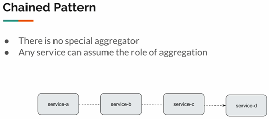
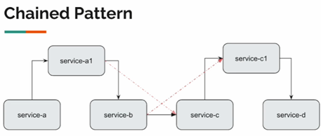
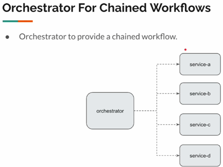
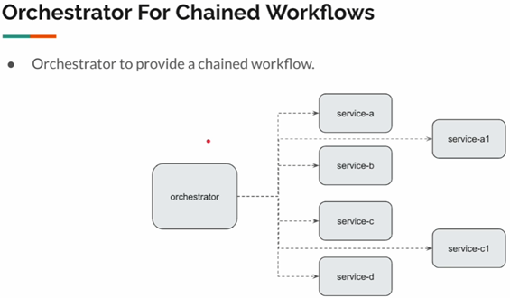

# 📚 Sección 5: Patrón Saga con orquestador: transacciones distribuidas y flujo de trabajo secuencial

---

## 🔄 Flujo de trabajo secuencial: Introducción

En esta sección retomaremos el **patrón Saga con orquestador (Orchestrator Saga)** que estudiamos anteriormente, pero
con una variación importante: en lugar de ejecutar varias operaciones en paralelo, utilizaremos el orquestador para
coordinar un flujo de trabajo secuencial.

En muchos escenarios, las operaciones de un proceso deben ejecutarse siguiendo un orden específico, ya que cada paso
depende de que el anterior haya finalizado correctamente.

Por ejemplo, consideremos algunas etapas del ciclo de vida del desarrollo de software:

1. Analizar el documento de requerimientos.
2. Diseñar e implementar la solución.
3. Desplegar la aplicación.
4. Realizar las pruebas.
5. Lanzar la aplicación.

No sería conveniente ejecutar todas estas actividades en paralelo, porque algunas necesitan los resultados de las
anteriores para poder continuar.

En arquitecturas de microservicios podemos encontrarnos con este mismo escenario: determinados servicios deben
ejecutarse uno después de otro, siguiendo una secuencia de procesamiento.

Para implementar este tipo de flujo existen diferentes alternativas. Una de ellas es el `Chained Pattern`.

### 🔗 Chained Pattern



El `Chained Pattern` consiste en encadenar varios servicios, de manera que cada servicio invoque al siguiente para
completar un flujo de trabajo.

Por ejemplo:

1. `service-a` recibe la solicitud y procesa su parte del trabajo.
2. Cuando termina, invoca a `service-b`.
3. `service-b` procesa su parte e invoca a `service-c`.
4. Finalmente, `service-c` invoca a `service-d`.

De esta manera, cada servicio conoce al siguiente componente que debe participar en el procesamiento.

#### Características principales:

- No existe un orquestador o agregador centralizado que controle todo el flujo.
- Cada servicio puede asumir la responsabilidad de invocar al siguiente.
- La secuencia de ejecución queda distribuida entre los diferentes servicios.

En cierto sentido, este patrón funciona como una composición de llamadas entre servicios, donde cada uno delega parte
del procesamiento al siguiente.

#### ⚖️ Chained Pattern: ventajas y desventajas

##### Ventajas:

- Es relativamente sencillo de implementar.
- Permite construir flujos de trabajo secuenciales mediante llamadas entre servicios.

##### Desventajas:

- **Mayor latencia:** las llamadas deben ejecutarse secuencialmente. Cada servicio debe esperar la respuesta del
  siguiente antes de completar el flujo.
- **Difícil depuración:** al estar distribuida la secuencia entre varios servicios, resulta más complicado identificar
  dónde se produjo un error.
- **Difícil mantenimiento:** los cambios en los requisitos pueden obligar a modificar varios servicios para adaptar la
  cadena de ejecución.

### 🔧 Chained Pattern: cambios en los requisitos

Supongamos que nuestro sistema necesita adaptarse a nuevos requisitos y debemos incorporar dos servicios adicionales:
`service-a1` y `service-c1`.



Inicialmente, la secuencia era:

````text
service-a → service-b → service-c → service-d
````

Con los nuevos requisitos, el flujo podría quedar así:

````text
service-a → service-a1 → service-b → service-c → service-c1 → service-d
````

Esto implica modificar las llamadas entre servicios:

- `service-a` ahora debe invocar a `service-a1` en lugar de llamar directamente a `service-b`.
- `service-a1` debe decidir si continúa hacia `service-b` o si, dependiendo de los requisitos, invoca directamente a
  `service-c`.
- `service-b` debe decidir si continúa hacia `service-c` o si debe invocar a `service-c1`.

Como consecuencia, los cambios en el flujo de trabajo pueden afectar a varios servicios, aumentando el acoplamiento
entre ellos.

Por tanto, aunque el `Chained Pattern` puede ser útil para flujos sencillos, no resulta una alternativa conveniente
cuando los requisitos cambian frecuentemente o el flujo de trabajo comienza a crecer.

### 🎯 Orchestrator for Chained Workflows

En lugar de distribuir la responsabilidad de coordinar el flujo entre los diferentes servicios, podemos reutilizar el
`patrón Orchestrator Saga`, introduciendo una pequeña variación para controlar las operaciones de manera secuencial.



En este enfoque, incorporamos un servicio central llamado orchestrator, que recibe la solicitud y controla todo el flujo
de trabajo.

El funcionamiento sería el siguiente:

1. El orchestrator recibe la solicitud.
2. Invoca a `service-a` y espera su respuesta.
3. Cuando obtiene la respuesta, invoca a `service-b` y espera nuevamente.
4. Después invoca a `service-c`.
5. Finalmente, invoca a `service-d`.

A diferencia del `Chained Pattern`, los servicios ya no necesitan conocer cuál es el siguiente servicio que debe
ejecutarse. Esa responsabilidad queda centralizada en el orquestador.

**¿Qué sucede si ocurre un error?**

El orquestador tiene una visión completa del flujo de trabajo, por lo que puede identificar qué servicio produjo el
fallo y gestionar la respuesta correspondiente.

Esto también facilita la depuración, ya que podemos revisar desde un único punto la secuencia de operaciones ejecutadas.

### 🔧 Orchestrator for Chained Workflows: cambios en los requisitos

Ahora supongamos que nuevamente debemos incorporar los servicios `service-a1` y `service-c1` debido a nuevos requisitos.



En este caso, la secuencia de ejecución sería:

````text
service-a → service-a1 → service-b → service-c → service-c1 → service-d
````

La diferencia es que no necesitamos modificar las llamadas internas de los servicios existentes.
Simplemente, actualizamos el orquestador para incorporar los nuevos pasos en el orden correspondiente.

De esta manera, el orquestador sigue siendo el responsable de determinar qué servicio se ejecuta, cuándo se ejecuta y
cuál será el siguiente paso.

#### ⚖️ Orchestrator for Chained Workflows: ventajas y desventajas

##### Ventajas:

- **Fácil depuración:** el orquestador centraliza el control del flujo y permite identificar con mayor facilidad dónde
  ocurrió un fallo.
- **Fácil mantenimiento:** los cambios en los requisitos se gestionan principalmente modificando el flujo de trabajo del
  orquestador.
- **Menor acoplamiento entre servicios:** cada servicio se concentra en su propia responsabilidad sin necesidad de
  conocer los demás participantes del proceso.

##### Desventajas:

- **Mayor latencia:** al tratarse de un flujo secuencial, cada operación debe esperar a que finalice la anterior antes
  de comenzar.

Para implementar este tipo de flujo de trabajo secuencial utilizando el patrón Orchestrator, retomaremos el ejemplo
desarrollado anteriormente, pero realizaremos algunos ajustes para adaptarlo a este nuevo escenario.

## 🔌 Servicios externos

Para esta sección utilizaremos nuevamente el servicio externo `external-services-v2.jar`, que contiene los endpoints
necesarios para implementar y probar nuestro flujo de trabajo secuencial. Lo iniciamos desde la terminal:

````bash
D:\programming\spring\01.udemy\03.vinoth_selvaraj\spring-webflux-patterns-resilience (main -> origin)
$ java -jar .\external-services\external-services-v2.jar

  .   ____          _            __ _ _
 /\\ / ___'_ __ _ _(_)_ __  __ _ \ \ \ \
( ( )\___ | '_ | '_| | '_ \/ _` | \ \ \ \
 \\/  ___)| |_)| | | | | || (_| |  ) ) ) )
  '  |____| .__|_| |_|_| |_\__, | / / / /
 =========|_|==============|___/=/_/_/_/
 :: Spring Boot ::                (v2.6.4)

2026-11-13 10:49:12.253  INFO 13456 --- [           main] c.v.e.ExternalServicesApplication        : Starting ExternalServicesApplication v0.0.1-SNAPSHOT using Java 25.0.2 on SysEngJava with PID 13456 (D:\programming\spring\01.udemy\03.vinoth_selvaraj\spring-webflux-patterns-resilience\external-services\external-services-v2.jar started by magadiflo in D:\programming\spring\01.udemy\03.vinoth_selvaraj\spring-webflux-patterns-resilience)
2026-11-13 10:49:12.256  INFO 13456 --- [           main] c.v.e.ExternalServicesApplication        : No active profile set, falling back to 1 default profile: "default"
WARNING: A terminally deprecated method in sun.misc.Unsafe has been called
WARNING: sun.misc.Unsafe::objectFieldOffset has been called by io.netty.util.internal.PlatformDependent0$3 (jar:file:/D:/programming/spring/01.udemy/03.vinoth_selvaraj/spring-webflux-patterns-resilience/external-services/external-services-v2.jar!/BOOT-INF/lib/netty-common-4.1.74.Final.jar!/)
WARNING: Please consider reporting this to the maintainers of class io.netty.util.internal.PlatformDependent0$3
WARNING: sun.misc.Unsafe::objectFieldOffset will be removed in a future release
2026-11-13 10:49:14.662  INFO 13456 --- [           main] o.s.b.web.embedded.netty.NettyWebServer  : Netty started on port 7070
2026-11-13 10:49:15.149  INFO 13456 --- [           main] c.v.e.ExternalServicesApplication        : Started ExternalServicesApplication in 3.35 seconds (JVM running for 4.068)1:38:36.716  INFO 10264 --- [           main] c.v.e.ExternalServicesApplication        : Started ExternalServicesApplication in 2.947 seconds (JVM running for 3.338)
````

Una vez iniciado, accedemos a Swagger UI y buscamos el apartado `sec04-orchestrator (sequential workflow)`.
Los endpoints son similares a los utilizados en la sección anterior. Sin embargo, existe una diferencia importante:
ahora algunas operaciones necesitan identificadores generados por servicios ejecutados previamente.

### 🛍️ Product Service

Este servicio proporciona la información de un producto a partir de su identificador.

````bash
$ curl -v http://localhost:7070/sec04/product/1 | jq
>
< HTTP/1.1 200 OK
< Content-Type: application/json
< Content-Length: 82
<
{
  "id": 1,
  "category": "Books & Kids",
  "description": "Durable Bronze Chair",
  "price": 16
}
````

### 👤 User Service

Este servicio permite consultar la información de un usuario, descontar fondos de su saldo y realizar reembolsos.

#### 1. Consultar un usuario

````bash
$ curl -v http://localhost:7070/sec04/user/1 | jq
>
< HTTP/1.1 200 OK
< Content-Type: application/json
< Content-Length: 142
<
{
  "userId": 1,
  "name": "Ms. Danny King",
  "balance": 395,
  "address": {
    "street": "873 Kris Crest",
    "city": "West Don",
    "state": "Florida",
    "zipCode": "60259"
  }
}
````

La respuesta incluye los datos del usuario, su saldo y su dirección.

#### 2. Descontar fondos

Este endpoint permite descontar fondos del saldo del usuario. La diferencia respecto a la sección anterior es que
ahora la respuesta incluye un nuevo campo: `paymentId`.

````bash
$ curl -v -X POST -H "Content-Type: application/json" -d "{\"amount\": 10, \"orderId\": \"3fa85f64-5717-4562-b3fc-2c963f66afa6\", \"userId\": 1 }" http://localhost:7070/sec04/user/deduct | jq
>
< HTTP/1.1 200 OK
< Content-Type: application/json
< Content-Length: 120
<
{
  "paymentId": "33c8896f-c4bb-47ef-896f-1ffd7a23c544",
  "userId": 1,
  "name": "Ms. Danny King",
  "balance": 375,
  "status": "SUCCESS"
}
````

Este identificador será necesario para ejecutar el siguiente paso del flujo: **descontar unidades del inventario.**

#### 3. Reembolsar fondos

````bash
$ curl -v -X POST -H "Content-Type: application/json" -d "{\"amount\": 10, \"orderId\": \"3fa85f64-5717-4562-b3fc-2c963f66afa6\", \"userId\": 1 }" http://localhost:7070/sec04/user/refund | jq
>
< HTTP/1.1 200 OK
< Content-Type: application/json
< Content-Length: 69
<
{
  "userId": 1,
  "name": "Ms. Danny King",
  "balance": 395,
  "status": "SUCCESS"
}
````

### 📦 Inventory Service

Este servicio permite consultar la cantidad disponible de un producto, descontar unidades del inventario y restaurarlas
cuando sea necesario.

#### 1. Consultar el inventario

````bash
$ curl -v http://localhost:7070/sec04/inventory/2 | jq
>
< HTTP/1.1 200 OK
< Content-Type: application/json
< Content-Length: 2
<
10
````

El resultado indica que hay 10 unidades disponibles del producto con identificador 2.

#### 2. Descontar unidades

Este endpoint permite descontar unidades del inventario. A diferencia de la implementación anterior, ahora debemos
enviar el `paymentId` obtenido en **la operación de descuento de fondos.**

Request:

````bash
$ curl -v -X POST -H "Content-Type: application/json" -d "{\"paymentId\": \"33c8896f-c4bb-47ef-896f-1ffd7a23c544\", \"productId\": 2, \"quantity\": 4}" http://localhost:7070/sec04/inventory/deduct | jq
>
< HTTP/1.1 200 OK
< Content-Type: application/json
< Content-Length: 122
<
{
  "inventoryId": "3f0d049e-67ae-41c8-bb2c-2a2cce973b66",
  "productId": 2,
  "quantity": 4,
  "remainingQuantity": 6,
  "status": "SUCCESS"
}
````

Observamos que la respuesta también genera un identificador: `inventoryId`. Este identificador será utilizado
posteriormente para **programar el envío.**

#### 3. Restaurar unidades

````bash
$ curl -v -X POST -H "Content-Type: application/json" -d "{\"paymentId\": \"33c8896f-c4bb-47ef-896f-1ffd7a23c544\", \"productId\": 2, \"quantity\": 4}" http://localhost:7070/sec04/inventory/restore | jq
>
< HTTP/1.1 200 OK
< Content-Type: application/json
< Content-Length: 89
<
{
  "inventoryId": null,
  "productId": 2,
  "quantity": 4,
  "remainingQuantity": 10,
  "status": "SUCCESS"
}
````

### 🚚 Shipping Service

Este servicio permite programar un envío y cancelar una programación existente.

#### 1. Programar un envío

Ahora, la petición necesita el `inventoryId` generado por el servicio de inventario.

````bash
$ curl -v -X POST -H "Content-Type: application/json" -d "{\"inventoryId\": \"3f0d049e-67ae-41c8-bb2c-2a2cce973b66\", \"userId\": 1, \"quantity\": 4}" http://localhost:7070/sec04/shipping/schedule | jq
>
< HTTP/1.1 200 OK
< Content-Type: application/json
< Content-Length: 209
<
{
  "shippingId": "d8314de2-3944-4ac5-a939-4d5b74c56697",
  "quantity": 4,
  "status": "SUCCESS",
  "expectedDelivery": "2026-11-18",
  "address": {
    "street": "873 Kris Crest",
    "city": "West Don",
    "state": "Florida",
    "zipCode": "60259"
  }
}
````

La respuesta contiene el identificador del envío, su estado y la fecha estimada de entrega.

#### 2. Cancelar un envío

````bash
$ curl -v -X POST -H "Content-Type: application/json" -d "{\"inventoryId\": \"3f0d049e-67ae-41c8-bb2c-2a2cce973b66\", \"userId\": 1, \"quantity\": 4}" http://localhost:7070/sec04/shipping/cancel | jq
>
< HTTP/1.1 200 OK
< content-length: 0
<
````

El servidor responde con 200 OK y un cuerpo vacío, lo que indica que la solicitud se procesó correctamente sin devolver
contenido.

## ⚙️ Configuración del proyecto

Para comenzar con esta nueva implementación, creamos el paquete `sec05` y copiamos dentro de él todo lo que hicimos
dentro del paquete `sec04`: `/client`, `/controller`, `/dto`, `/service` y `/util`.

De esta manera, partimos de la implementación anterior y realizamos únicamente los ajustes necesarios para trabajar con
el nuevo flujo secuencial.

### 🎮 Actualización del controlador

En `OrderController` modificamos el mapeo de la ruta para identificar esta implementación como parte de la sección
`sec04` de los servicios externos. El controlador mantiene la misma lógica de la sección anterior: recibe una solicitud
para procesar una orden y delega su ejecución al OrchestratorService.

````java
@RequiredArgsConstructor
@RestController
@RequestMapping(path = "/api/{version}/sec04/orders", version = "1")
public class OrderController {

    private final OrchestratorService orchestratorService;

    @PostMapping
    public Mono<ResponseEntity<OrderResponse>> placeOrder(@RequestBody Mono<OrderRequest> orderRequestMono) {
        return this.orchestratorService.placeOrder(orderRequestMono)
                .map(ResponseEntity::ok)
                .defaultIfEmpty(ResponseEntity.notFound().build());
    }

}
````

### 🔌 Actualización de los clientes

En los clientes (`InventoryClient`, `ProductClient`, `ShippingClient` y `UserClient`) modificamos la propiedad que
se utiliza mediante `@Value` para obtener la URL base desde `application.properties`.

Por ejemplo, en `InventoryClient`:

````java
@Component
public class InventoryClient {

    private static final String DEDUCT = "deduct";
    private static final String RESTORE = "restore";
    private final WebClient webClient;

    public InventoryClient(@Value("${sec04.inventory.service}") String baseUrl) {
        this.webClient = WebClient.builder()
                .baseUrl(baseUrl)
                .build();
    }
    /* other codes */
}
````

Aplicamos el mismo cambio en los demás clientes, utilizando la propiedad correspondiente a cada servicio:

- **ProductClient:** `${sec04.product.service}`
- **UserClient:** `${sec04.user.service}`
- **InventoryClient:** `${sec04.inventory.service}`
- **ShippingClient:** `${sec04.shipping.service}`

No cambia la configuración de `WebClient`; simplemente centralizamos las URL base en las propiedades de la aplicación.

### 📝 Configuración en application.properties

Finalmente, agregamos las siguientes propiedades:

````properties
sec04.product.service=http://localhost:7070/sec04/product
sec04.user.service=http://localhost:7070/sec04/user
sec04.inventory.service=http://localhost:7070/sec04/inventory
sec04.shipping.service=http://localhost:7070/sec04/shipping
````

Así, los clientes obtienen sus respectivas URL base mediante inyección de dependencias, evitando tenerlas directamente
codificadas en las clases.

> **Nota:** Aunque estamos trabajando dentro del paquete `sec05`, las rutas del controlador y las propiedades de
> configuración utilizan `sec04` porque apuntan a los endpoints de los servicios externos correspondientes a esa
> sección. No debemos confundir la versión de nuestra implementación con la versión de los servicios externos.

## 📦 Modificando DTOs

En esta sección necesitamos realizar algunos ajustes en los DTO para manejar los identificadores que se generan
durante la ejecución secuencial del flujo de trabajo.

Los principales cambios son:

- **PaymentResponse:** incorpora `paymentId`, devuelto por el servicio de usuarios después de descontar los fondos.
- **InventoryRequest:** incorpora `paymentId`, necesario para solicitar el descuento de unidades del inventario.
- **InventoryResponse:** incorpora `inventoryId`, generado después de descontar las unidades.
- **ShippingRequest:** incorpora `inventoryId`, necesario para programar el envío.
- **ShippingResponse:** representa la respuesta del servicio de envíos, incluyendo `shippingId` y la fecha estimada
  de entrega.

````java
public record PaymentResponse(UUID paymentId,
                              Integer userId,
                              String name,
                              Integer balance,
                              Status status) {
}
````

````java
public record InventoryRequest(UUID paymentId,
                               Integer productId,
                               Integer quantity) {
}
````

````java
public record InventoryResponse(UUID inventoryId,
                                Integer productId,
                                Integer quantity,
                                Integer remainingQuantity,
                                Status status) {
}
````

````java

public record ShippingRequest(Integer quantity,
                              Integer userId,
                              UUID inventoryId) {
}
````

````java
public record ShippingResponse(UUID shippingId,
                               Integer quantity,
                               Status status,
                               String expectedDelivery,
                               Address address) {
}
````

De esta manera, los DTO permiten transportar los identificadores generados por cada servicio y utilizarlos en las
solicitudes posteriores del flujo secuencial.

> **Nota:** Los DTO mostrados corresponden a los nuevos campos y estructuras necesarios para esta implementación;
> los demás atributos y tipos se mantienen según las respuestas de los servicios externos.

