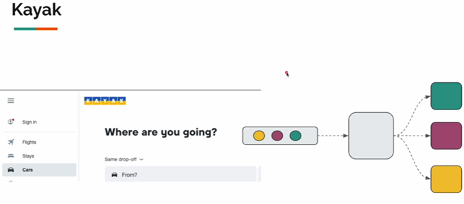

# 📚 Sección 6: Patrón Splitter: Enrutamiento de mensajes a múltiples servicios

---

## 🔀 Splitter Pattern: Introducción

### 🔄 Scatter-Gather Pattern

Observemos la siguiente imagen y recordemos el patrón que estudiamos anteriormente: `Scatter-Gather Pattern`.

En la imagen tenemos un flujo reactivo principal que recibe elementos provenientes de cuatro flujos independientes. Cada
uno de estos flujos emite elementos de un tipo determinado, representados mediante círculos de diferentes colores:

- Un flujo emite elementos verdes.
- Otro emite elementos naranjas.
- Otro emite elementos rosados.
- Otro emite elementos morados.

Todos estos elementos se combinan en un único flujo reactivo, que contiene los elementos emitidos por los cuatro
publishers. Esto se parece al funcionamiento del operador merge de Project Reactor, que permite combinar varios
publishers en un único flujo (`Flux`), emitiendo los elementos a medida que llegan, sin esperar a que todos los
publishers terminen.

Es importante tener en cuenta que el orden de emisión en el flujo resultante depende de cuándo cada publisher produce
sus elementos, no necesariamente del orden en que fueron definidos los flujos originales.

Este concepto nos recuerda al `Scatter-Gather Pattern`, que estudiamos en la sección
`03.scatter-gather-pattern-high-performance-service-composition.md`.

En ese patrón, una solicitud se distribuye entre varios servicios independientes (`Scatter`) y posteriormente se
combinan sus respuestas en un único resultado (`Gather`).

### ✂️ Splitter Pattern

El patrón que estudiaremos en esta sección tiene una idea similar, pero el flujo de los mensajes es diferente.
En lugar de combinar elementos provenientes de varios flujos en uno solo, partimos de un único flujo reactivo que
contiene elementos de distintos tipos y los dividimos en flujos independientes según algún criterio.

En la imagen tenemos un único Flux que contiene elementos de diferentes colores:

- Naranja
- Rosado
- Morado
- Verde

El `Splitter Pattern` se encarga de separar esos elementos y dirigirlos hacia diferentes flujos según su tipo:

- Todos los elementos verdes se envían a un flujo.
- Todos los elementos naranjas se envían a otro.
- Todos los elementos rosados se envían a otro.
- Todos los elementos morados se envían a otro.

> Debemos tener presente que el `Splitter Pattern` y el `Scatter-Gather Pattern` no son exactamente
> operaciones inversas. Cada uno resuelve una necesidad diferente: `Scatter-Gather` distribuye una solicitud y reúne
> respuestas, mientras que `Splitter` divide un mensaje o conjunto de elementos para procesarlos por separado.

### 🏨 Aplicación del Splitter Pattern

Consideremos una aplicación llamada Kayak, que permite a los usuarios realizar reservas de diferentes servicios, como
vuelos, coches y hoteles.

Imaginemos que un usuario selecciona un vuelo, un coche de alquiler y un hotel. El frontend recopila toda esa
información y la envía al backend mediante una única solicitud.

El backend recibe un mensaje que contiene los diferentes elementos que deben procesarse. A partir de esa información,
identifica el tipo de cada elemento y lo dirige al servicio correspondiente:

- Si el elemento representa un vuelo, se envía al servicio de vuelos.
- Si representa un coche de alquiler, se envía al servicio de coches.
- Si representa un hotel, se envía al servicio de hoteles.

De esta manera, una única solicitud recibida por el backend puede dividirse en varios mensajes o flujos independientes,
permitiendo que cada servicio procese la parte de la información que le corresponde.

Este escenario representa una aplicación práctica del Splitter Pattern, ya que el backend recibe información agrupada y
se encarga de separarla para distribuirla entre los diferentes servicios especializados.

