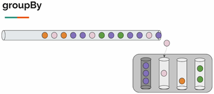
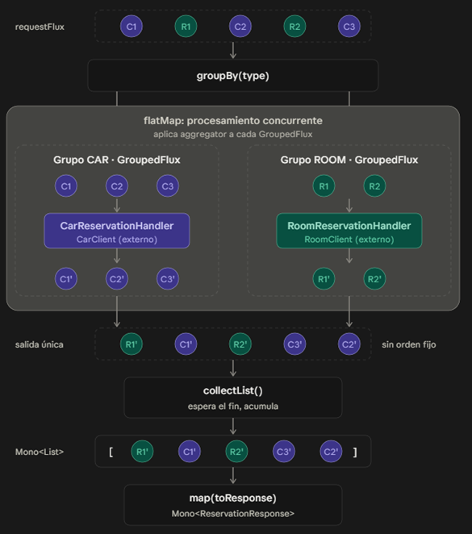

# 📚 Sección 6: Patrón Splitter: Enrutamiento de mensajes a múltiples servicios

---

## 🔀 Splitter Pattern: Introducción

### 🔄 Scatter-Gather Pattern

Observemos la siguiente imagen y recordemos el patrón que estudiamos anteriormente: `Scatter-Gather Pattern`.


En la imagen tenemos un flujo reactivo principal que recibe elementos provenientes de cuatro flujos independientes. Cada
uno de estos flujos emite elementos de un tipo determinado, representados mediante círculos de diferentes colores:

- Un flujo emite elementos verdes.
- Otro emite elementos naranjas.
- Otro emite elementos rosados.
- Otro emite elementos morados.

Todos estos elementos se combinan en un único flujo reactivo, que contiene los elementos emitidos por los cuatro
publishers. Esto se parece al funcionamiento del operador merge de Project Reactor, que permite combinar varios
publishers en un único flujo (`Flux`), emitiendo los elementos a medida que llegan, sin esperar a que todos los
publishers terminen.

Es importante tener en cuenta que el orden de emisión en el flujo resultante depende de cuándo cada publisher produce
sus elementos, no necesariamente del orden en que fueron definidos los flujos originales.

Este concepto nos recuerda al `Scatter-Gather Pattern`, que estudiamos en la sección
`03.scatter-gather-pattern-high-performance-service-composition.md`.

En ese patrón, una solicitud se distribuye entre varios servicios independientes (`Scatter`) y posteriormente se
combinan sus respuestas en un único resultado (`Gather`).

### ✂️ Splitter Pattern

El patrón que estudiaremos en esta sección tiene una idea similar, pero el flujo de los mensajes es diferente.
En lugar de combinar elementos provenientes de varios flujos en uno solo, partimos de un único flujo reactivo que
contiene elementos de distintos tipos y los dividimos en flujos independientes según algún criterio.

En la imagen tenemos un único Flux que contiene elementos de diferentes colores:

- Naranja
- Rosado
- Morado
- Verde

El `Splitter Pattern` se encarga de separar esos elementos y dirigirlos hacia diferentes flujos según su tipo:

- Todos los elementos verdes se envían a un flujo.
- Todos los elementos naranjas se envían a otro.
- Todos los elementos rosados se envían a otro.
- Todos los elementos morados se envían a otro.


> Debemos tener presente que el `Splitter Pattern` y el `Scatter-Gather Pattern` no son exactamente
> operaciones inversas. Cada uno resuelve una necesidad diferente: `Scatter-Gather` distribuye una solicitud y reúne
> respuestas, mientras que `Splitter` divide un mensaje o conjunto de elementos para procesarlos por separado.

### 🏨 Aplicación del Splitter Pattern

Consideremos una aplicación llamada Kayak, que permite a los usuarios realizar reservas de diferentes servicios, como
vuelos, coches y hoteles.


Imaginemos que un usuario selecciona un vuelo, un coche de alquiler y un hotel. El frontend recopila toda esa
información y la envía al backend mediante una única solicitud.

El backend recibe un mensaje que contiene los diferentes elementos que deben procesarse. A partir de esa información,
identifica el tipo de cada elemento y lo dirige al servicio correspondiente:

- Si el elemento representa un vuelo, se envía al servicio de vuelos.
- Si representa un coche de alquiler, se envía al servicio de coches.
- Si representa un hotel, se envía al servicio de hoteles.

De esta manera, una única solicitud recibida por el backend puede dividirse en varios mensajes o flujos independientes,
permitiendo que cada servicio procese la parte de la información que le corresponde.

Este escenario representa una aplicación práctica del Splitter Pattern, ya que el backend recibe información agrupada y
se encarga de separarla para distribuirla entre los diferentes servicios especializados.

## 🔌 Servicios externos

Para esta sección utilizaremos nuevamente el servicio externo `external-services-v2.jar`, que contiene los endpoints
necesarios para implementar y probar el `Splitter Pattern`.

Iniciamos el servicio desde la terminal:

````bash
D:\programming\spring\01.udemy\03.vinoth_selvaraj\spring-webflux-patterns-resilience (main -> origin)
$ java -jar .\external-services\external-services-v2.jar

  .   ____          _            __ _ _
 /\\ / ___'_ __ _ _(_)_ __  __ _ \ \ \ \
( ( )\___ | '_ | '_| | '_ \/ _` | \ \ \ \
 \\/  ___)| |_)| | | | | || (_| |  ) ) ) )
  '  |____| .__|_| |_|_| |_\__, | / / / /
 =========|_|==============|___/=/_/_/_/
 :: Spring Boot ::                (v2.6.4)

2026-11-19 12:21:20.561  INFO 13068 --- [           main] c.v.e.ExternalServicesApplication        : Starting ExternalServicesApplication v0.0.1-SNAPSHOT using Java 25.0.2 on SysEngJava with PID 13068 (D:\programming\spring\01.udemy\03.vinoth_selvaraj\spring-webflux-patterns-resilience\external-services\external-services-v2.jar started by magadiflo in D:\programming\spring\01.udemy\03.vinoth_selvaraj\spring-webflux-patterns-resilience)
2026-11-19 12:21:20.565  INFO 13068 --- [           main] c.v.e.ExternalServicesApplication        : No active profile set, falling back to 1 default profile: "default"
WARNING: A terminally deprecated method in sun.misc.Unsafe has been called
WARNING: sun.misc.Unsafe::objectFieldOffset has been called by io.netty.util.internal.PlatformDependent0$3 (jar:file:/D:/programming/spring/01.udemy/03.vinoth_selvaraj/spring-webflux-patterns-resilience/external-services/external-services-v2.jar!/BOOT-INF/lib/netty-common-4.1.74.Final.jar!/)
WARNING: Please consider reporting this to the maintainers of class io.netty.util.internal.PlatformDependent0$3
WARNING: sun.misc.Unsafe::objectFieldOffset will be removed in a future release
2026-11-19 12:21:23.021  INFO 13068 --- [           main] o.s.b.web.embedded.netty.NettyWebServer  : Netty started on port 7070
2026-11-19 12:21:23.397  INFO 13068 --- [           main] c.v.e.ExternalServicesApplication        : Started ExternalServicesApplication in 3.306 seconds (JVM running for 3.792)
````

### 📖 Swagger UI

Una vez iniciado, accedemos a [Swagger UI](http://localhost:7070/swagger-ui/) y buscamos el apartado
`sec05-splitter (Reservation Controller)` que contiene dos endpoints para realizar reservas de coches y habitaciones.

### 🚗 Car Reserve

Este endpoint permite reservar coches. Recibe una lista de solicitudes con información como la ciudad, las fechas de
recogida y devolución, y la categoría del vehículo.

````bash
$ curl -v -X POST -H "Content-Type: application/json" -d "[{\"category\": \"LUXURY\", \"city\": \"Chimbote\", \"drop\": \"2026-11-29\", \"pickup\": \"2026-11-19\"}]" http://localhost:7070/sec05/car/reserve | jq
>
< HTTP/1.1 200 OK
< transfer-encoding: chunked
< Content-Type: application/json
<
[
  {
    "reservationId": "163399bb-dcf8-4427-9ee0-02be877801c4",
    "city": "Chimbote",
    "pickup": "2026-11-19",
    "drop": "2026-11-29",
    "category": "LUXURY",
    "price": 520
  }
]
````

La respuesta contiene la información de la reserva realizada, incluyendo el identificador generado (`reservationId`) y
el precio correspondiente.

### 🏨 Room Reserve

Este endpoint permite reservar habitaciones. Recibe una lista de solicitudes con información como la ciudad,
las fechas de entrada y salida, y la categoría de la habitación.

````bash
$ curl -v -X POST -H "Content-Type: application/json" -d "[{\"category\": \"KING\", \"checkIn\": \"2026-11-19\", \"checkOut\": \"2026-11-29\", \"city\": \"Chimbote\"}]" http://localhost:7070/sec05/room/reserve | jq
>
< HTTP/1.1 200 OK
< transfer-encoding: chunked
< Content-Type: application/json
<
[
  {
    "reservationId": "509d8daa-d32b-43b3-8499-2d1bc35db82b",
    "city": "Chimbote",
    "checkIn": "2026-11-19",
    "checkOut": "2026-11-29",
    "category": "KING",
    "price": 400
  }
]
````

De manera similar al endpoint anterior, obtenemos la información de la reserva de habitación, incluyendo su
identificador y precio.

### 📌 Consideraciones

Los dos endpoints reciben **listas de solicitudes** y devuelven listas de respuestas, incluso cuando enviamos un solo
elemento en nuestras pruebas.

Esto será importante para la implementación del `Splitter Pattern`, ya que trabajaremos con una solicitud que puede
contener diferentes elementos de reserva y tendremos que separarlos para enviarlos al servicio correspondiente.

## 📦 Creando DTO - Parte 1

Creamos los DTO necesarios para representar las solicitudes y respuestas de las reservas de coches y habitaciones.

Cada tipo de reserva tendrá dos DTO:

- `Request`: representa la información que enviamos al servicio externo para solicitar una reserva.
- `Response`: representa la información que recibimos como resultado de la reserva.

### 🚗 DTO para reservas de coches

#### `CarReservationRequest`

````java
public record CarReservationRequest(String city,
                                    LocalDate pickup,
                                    LocalDate drop,
                                    String category) {
}
````

#### `CarReservationResponse`

````java
public record CarReservationResponse(UUID reservationId,
                                     String city,
                                     LocalDate pickup,
                                     LocalDate drop,
                                     String category,
                                     Integer price) {
}
````

### 🏨 DTO para reservas de habitaciones

#### `RoomReservationRequest`

````java
public record RoomReservationRequest(String city,
                                     LocalDate checkIn,
                                     LocalDate checkOut,
                                     String category) {
}
````

#### `RoomReservationResponse`

````java
public record RoomReservationResponse(UUID reservationId,
                                      String city,
                                      LocalDate checkIn,
                                      LocalDate checkOut,
                                      String category,
                                      Integer price) {
}
````

### 📌 Consideraciones

- `CarReservationRequest` y `RoomReservationRequest` contienen los datos necesarios para solicitar cada tipo de reserva.
- `CarReservationResponse` y `RoomReservationResponse` representan los resultados devueltos por los servicios externos.
  Incluyen el identificador de la reserva (`reservationId`) y el precio (`price`), además de los datos originales de la
  solicitud.
- Se utiliza `LocalDate` para representar las fechas, ya que únicamente necesitamos almacenar fechas sin información de
  hora ni zona horaria.

Estos DTO servirán para representar los diferentes elementos de reserva que posteriormente procesaremos mediante el
`Splitter Pattern`.

## 📦 Creando DTO - Parte 2

En esta parte creamos los DTO que permitirán representar una solicitud de reserva de manera unificada,
independientemente de si corresponde a un coche o a una habitación.

### 🔖 ReservationType

Primero, definimos un `enum` para identificar el tipo de reserva:

````java
public enum ReservationType {
    CAR,
    ROOM
}
````

Este enum permite distinguir entre los dos tipos de reserva que soporta nuestro sistema: `CAR` para coches y `ROOM`
para habitaciones.

### 📥 ReservationItemRequest

Representa un elemento individual de reserva dentro de la solicitud:

````java
public record ReservationItemRequest(ReservationType type,
                                     String category,
                                     String city,
                                     LocalDate from,
                                     LocalDate to) {
}
````

A diferencia de los DTO creados en la parte anterior, este objeto utiliza una estructura genérica para representar ambos
tipos de reserva. Por ejemplo:

- Para una reserva de coche, `from` y `to` representan las fechas de recogida y devolución.
- Para una reserva de habitación, representan las fechas de entrada (`checkIn`) y salida (`checkOut`).

El campo `type` permite identificar cómo debe interpretarse cada elemento.

### 📤 ReservationItemResponse

Representa el resultado de procesar un elemento individual de reserva:

````java
public record ReservationItemResponse(UUID itemId,
                                      ReservationType type,
                                      String category,
                                      String city,
                                      LocalDate from,
                                      LocalDate to,
                                      Integer price) {
}
````

Incluye `itemId` para identificar el elemento reservado, además de conservar su información principal e incorporar el
precio correspondiente.

### 📋 ReservationResponse

Finalmente, creamos el DTO que representa la respuesta completa de una solicitud de reserva:

````java
public record ReservationResponse(UUID reservationId,
                                  Integer price,
                                  List<ReservationItemResponse> items) {
}
````

Este objeto agrupa el resultado general de la reserva:

- `reservationId`: identificador de la reserva principal.
- `price`: precio total de la reserva.
- `items`: lista de elementos individuales procesados, que pueden corresponder a coches o habitaciones.

### 💡 Consideración importante

Con estos DTO tenemos dos niveles de representación:

- **Reserva individual:** `ReservationItemRequest` y `ReservationItemResponse` representan cada elemento que se desea
  reservar y su resultado.
- **Reserva completa:** `ReservationResponse` agrupa los elementos procesados y proporciona información general de la
  operación.

Esta estructura unificada será importante para aplicar el `Splitter Pattern`, ya que una solicitud puede contener
distintos tipos de elementos y necesitaremos identificarlos para dirigirlos al servicio correspondiente.

## 🔌 Servicio de Clientes

En esta parte creamos los clientes encargados de comunicarse con los servicios externos de reservas de coches y
habitaciones. Ambos clientes utilizan `Spring WebClient` para realizar peticiones HTTP de manera reactiva y procesar
las respuestas como flujos de datos (`Flux`).

### 🚗 CarClient

Este cliente se encarga de comunicarse con el servicio externo de reservas de coches.

````java
@Component
public class CarClient {

    private final WebClient webClient;

    public CarClient(@Value("${sec05.car.service}") String baseUrl) {
        this.webClient = WebClient.builder()
                .baseUrl(baseUrl)
                .build();
    }

    public Flux<CarReservationResponse> reserve(Flux<CarReservationRequest> requestFlux) {
        return this.webClient
                .post()
                .body(requestFlux, CarReservationRequest.class)
                .retrieve()
                .bodyToFlux(CarReservationResponse.class)
                .onErrorResume(throwable -> Mono.empty());
    }
}
````

Aspectos importantes:

- La URL base del servicio se obtiene desde la propiedad `sec05.car.service`.
- El método `reserve()` recibe un `Flux<CarReservationRequest>`, por lo que puede procesar un flujo de solicitudes de
  reserva.
- Se realiza una petición HTTP POST enviando el flujo en el cuerpo de la solicitud.
- La respuesta se convierte en un `Flux<CarReservationResponse>`.
- `onErrorResume(throwable -> Mono.empty())` permite recuperarse de un error devolviendo un publisher vacío, evitando
  que el error se propague por este flujo.

### 🏨 RoomClient

Este cliente cumple una función similar, pero se comunica con el servicio externo encargado de las reservas de
habitaciones.

````java
@Component
public class RoomClient {
    private final WebClient webClient;

    public RoomClient(@Value("${sec05.room.service}") String baseUrl) {
        this.webClient = WebClient.builder()
                .baseUrl(baseUrl)
                .build();
    }

    public Flux<RoomReservationResponse> reserve(Flux<RoomReservationRequest> requestFlux) {
        return this.webClient
                .post()
                .body(requestFlux, RoomReservationRequest.class)
                .retrieve()
                .bodyToFlux(RoomReservationResponse.class)
                .onErrorResume(throwable -> Mono.empty());
    }
}
````

Al igual que `CarClient`, obtiene su URL base desde la configuración, envía las solicitudes mediante POST y procesa las
respuestas como un Flux, utilizando los DTO correspondientes a las reservas de habitaciones.

### 💡 Consideraciones

Ambos clientes siguen la misma estructura y se diferencian principalmente en:

- La propiedad de configuración utilizada para obtener la URL del servicio.
- Los DTO de solicitud y respuesta.
- El servicio externo al que se dirigen.

Un detalle importante sobre el manejo de errores: `onErrorResume(throwable -> Mono.empty())` no reintenta la petición ni
devuelve una respuesta de error. Simplemente, reemplaza el flujo que falló por uno vacío. Por tanto, el consumidor
recibirá cero elementos si ocurre un error durante la comunicación.

Con estos clientes tenemos preparada la comunicación con ambos servicios externos. Posteriormente, los utilizaremos para
enviar las solicitudes que resulten de separar los distintos tipos de reserva mediante el `Splitter Pattern`.

## 🌊 Breve nota sobre las solicitudes de Flux

Antes de continuar, es importante aclarar que utilizar Flux para enviar y recibir datos no significa necesariamente que
la comunicación con el servicio externo se realice en streaming.

Recordemos el método `reserve()` de `RoomClient`:

````java
public Flux<RoomReservationResponse> reserve(Flux<RoomReservationRequest> requestFlux) {
    return this.webClient
            .post()
            .body(requestFlux, RoomReservationRequest.class)
            .retrieve()
            .bodyToFlux(RoomReservationResponse.class)
            .onErrorResume(throwable -> Mono.empty());
}
````

En este método trabajamos con:

- Entrada: `Flux<RoomReservationRequest>`, que representa un flujo de solicitudes de reserva.
- Salida: `Flux<RoomReservationResponse>`, que representa un flujo de respuestas de reserva.

Sin embargo, aunque utilizamos `Flux` en ambos extremos, esto no garantiza que los datos se intercambien de manera
continua entre nuestra aplicación y el servicio externo.

### 📦 ¿Cómo funciona realmente nuestra comunicación?

En nuestro caso, los servicios externos no están implementados para procesar las solicitudes y emitir las respuestas
progresivamente. Sus endpoints reciben una lista de solicitudes, procesan el conjunto y devuelven una lista con los
resultados.

Por tanto, el comportamiento es el siguiente:

1. Nuestra aplicación prepara el Flux con las solicitudes de reserva.
2. Se envía la petición HTTP al servicio externo.
3. El servicio externo recibe y procesa el conjunto de solicitudes.
4. Una vez procesadas, devuelve las respuestas.
5. Nuestra aplicación consume los resultados mediante un `Flux<RoomReservationResponse>`.

Es decir, podemos trabajar con publishers reactivos en nuestra aplicación sin que necesariamente exista una
comunicación streaming de extremo a extremo.

### 🌐 ¿Qué necesitamos para una comunicación realmente streaming?

Para intercambiar datos de manera continua, el servicio externo también debe estar preparado para procesarlos y
emitirlos progresivamente.

Existen diferentes mecanismos para implementar este tipo de comunicación, por ejemplo:

- `WebSocket`: permite mantener una conexión bidireccional para intercambiar mensajes continuamente entre cliente y
  servidor.
- `Server-Sent Events (SSE)`: permite que el servidor envíe eventos al cliente de manera continua a través de una
  conexión HTTP.

También existen otros mecanismos, como las respuestas HTTP en formato NDJSON, que permiten transmitir elementos
progresivamente. En nuestro caso, los servicios externos no utilizan estos mecanismos para ofrecer una comunicación
streaming.

### 💡 Consideración importante

El uso de Flux permite representar y procesar múltiples elementos de forma reactiva, pero no garantiza por sí solo que
la comunicación HTTP se realice en streaming.

El comportamiento depende también de cómo estén implementados los servicios que participan en la comunicación y de cómo
intercambien los datos.

En conclusión, utilizar Flux nos permite trabajar reactivamente con múltiples elementos, pero no significa que estos se
envíen o reciban progresivamente a través de la comunicación HTTP. Para conseguir un intercambio realmente streaming,
tanto nuestra aplicación como el servicio externo deben estar preparados para soportarlo.

## 🧩 Abstract Reservation Handler

Creamos la clase abstracta `ReservationHandler`, que establece un contrato común para los diferentes tipos de reservas
que procesará nuestra aplicación.

````java
public abstract class ReservationHandler {
    public abstract ReservationType getType();

    public abstract Flux<ReservationItemResponse> reserve(Flux<ReservationItemRequest> requestFlux);
}
````

La clase define dos métodos abstractos que deberán implementar las clases concretas:

- `getType()`: devuelve el tipo de reserva que manejará cada implementación. Por ejemplo, `CAR` o `ROOM`.
- `reserve()`: recibe un flujo de solicitudes (`Flux<ReservationItemRequest>`) y devuelve un flujo de respuestas
  `(Flux<ReservationItemResponse>`).

### 💡 Consideración importante

Esta clase permite unificar el tratamiento de los distintos tipos de reserva mediante una misma abstracción.

Posteriormente, tendremos implementaciones específicas para coches y habitaciones. Cada una identificará el tipo de
reserva que le corresponde y se encargará de adaptar las solicitudes genéricas a los DTO específicos que esperan los
clientes externos (`CarClient` y `RoomClient`).

De esta manera, podremos trabajar con diferentes tipos de reserva utilizando una estructura común, algo fundamental
para implementar el `Splitter Pattern`.

## 🚗 Car Reservation Handler

Creamos `CarReservationHandler`, una implementación concreta de `ReservationHandler` encargada de procesar las
solicitudes de reservas de coches.

Esta clase utiliza `CarClient` para comunicarse con el servicio externo y adapta los DTO genéricos de nuestra
aplicación a los DTO específicos que requiere dicho servicio.

````java
@RequiredArgsConstructor
@Service
public class CarReservationHandler extends ReservationHandler {

    private final CarClient carClient;

    @Override
    public ReservationType getType() {
        return ReservationType.CAR;
    }

    @Override
    public Flux<ReservationItemResponse> reserve(Flux<ReservationItemRequest> requestFlux) {
        return requestFlux.map(this::toCarRequest)
                .transform(this.carClient::reserve)
                .map(this::toResponse);
    }

    private CarReservationRequest toCarRequest(ReservationItemRequest request) {
        return new CarReservationRequest(
                request.city(),
                request.from(),
                request.to(),
                request.category()
        );
    }

    private ReservationItemResponse toResponse(CarReservationResponse response) {
        return new ReservationItemResponse(
                response.reservationId(),
                this.getType(),
                response.category(),
                response.city(),
                response.pickup(),
                response.drop(),
                response.price()
        );
    }
}
````

### 🔍 Funcionamiento del handler

#### 1. Identificación del tipo de reserva

````java
@Override
public ReservationType getType() {
    return ReservationType.CAR;
}
````

Indica que esta implementación se encarga exclusivamente de las reservas de tipo `CAR`.

#### 2. Procesamiento de las solicitudes

````java
@Override
public Flux<ReservationItemResponse> reserve(Flux<ReservationItemRequest> requestFlux) {
    return requestFlux.map(this::toCarRequest)
            .transform(this.carClient::reserve)
            .map(this::toResponse);
}
````

Este método realiza tres operaciones:

1. **Adaptación de las solicitudes:** `map(this::toCarRequest)` transforma cada `ReservationItemRequest` en un
   `CarReservationRequest`, utilizando el DTO específico que espera el servicio externo.
2. **Comunicación con el servicio externo:**
    ````bash
    .transform(this.carClient::reserve)
    ````
   Entrega el `Flux<CarReservationRequest>` a `CarClient`, que realiza la petición HTTP y devuelve un
   `Flux<CarReservationResponse>`.

   > `¿Qué hace transform()?`
   >
   > Aplica una función al publisher completo (`Flux` o `Mono`) y devuelve otro publisher. La función se ejecuta una
   > sola vez, al armar la cadena reactiva, no por cada elemento.
   >
   > Podemos entenderlo comparándolo con `map()`:
   >
   > - `map()`: transforma cada elemento emitido en otro elemento.
   > - `transform()`: transforma el publisher completo en otro publisher.
   >
   > En nuestro ejemplo, `transform()` recibe el `Flux<CarReservationRequest>` y lo entrega al método
   > `this.carClient.reserve(...)`, que devuelve un `Flux<CarReservationResponse>`.
   >
   > **En pocas palabras:** `map()` transforma los elementos; `transform()` transforma el publisher.

3. **Adaptación de las respuestas:** `map(this::toResponse)` convierte cada `CarReservationResponse` recibido en un
   `ReservationItemResponse`, utilizando nuevamente el DTO genérico de nuestra aplicación.

#### 3. Conversión de los DTO

Los métodos `toCarRequest()` y `toResponse()` se encargan de adaptar los datos entre los DTO genéricos y los
específicos del servicio externo.

- `toCarRequest()`: convierte una solicitud genérica en una solicitud específica para reservar un coche. Los campos
  from y to se asignan a pickup y drop, respectivamente.
- `toResponse()`: convierte la respuesta específica del servicio externo en una respuesta genérica. Además, establece
  el tipo de reserva mediante `getType()`.

### 💡 Consideración importante

Observemos que `CarReservationHandler` trabaja exclusivamente con los DTO genéricos de nuestra aplicación en su método
`reserve()`, mientras que `CarClient` se encarga de manejar los DTO específicos del servicio externo.

Esta separación permite que nuestra lógica de procesamiento no dependa directamente de la estructura particular de
cada servicio. Además, facilita incorporar otros tipos de reservas mediante nuevas implementaciones de
`ReservationHandler`, como veremos con `RoomReservationHandler`.

## 🏨 Room Reservation Handler

Creamos `RoomReservationHandler`, una implementación concreta de `ReservationHandler` encargada de procesar las
solicitudes de reservas de habitaciones.

Al igual que `CarReservationHandler`, utiliza su cliente correspondiente (`RoomClient`) para comunicarse con el
servicio externo y adaptar los DTO genéricos a los DTO específicos de dicho servicio.

````java
@RequiredArgsConstructor
@Service
public class RoomReservationHandler extends ReservationHandler {

    private final RoomClient roomClient;

    @Override
    public ReservationType getType() {
        return ReservationType.ROOM;
    }

    @Override
    public Flux<ReservationItemResponse> reserve(Flux<ReservationItemRequest> requestFlux) {
        return requestFlux.map(this::toRoomRequest)
                .transform(this.roomClient::reserve)
                .map(this::toResponse);
    }

    private RoomReservationRequest toRoomRequest(ReservationItemRequest request) {
        return new RoomReservationRequest(
                request.city(),
                request.from(),
                request.to(),
                request.category()
        );
    }

    private ReservationItemResponse toResponse(RoomReservationResponse response) {
        return new ReservationItemResponse(
                response.reservationId(),
                this.getType(),
                response.category(),
                response.city(),
                response.checkIn(),
                response.checkOut(),
                response.price()
        );
    }
}
````

### 🔍 Funcionamiento general

- `getType()`: identifica esta implementación como responsable de las reservas de tipo `ROOM`.
- `reserve()`: recibe un `Flux<ReservationItemRequest>`, transforma cada elemento en un `RoomReservationRequest`,
  invoca a `RoomClient` mediante `transform()` y convierte las respuestas obtenidas en `ReservationItemResponse`.
- `toRoomRequest()`: adapta los datos de la solicitud genérica al DTO específico de habitaciones. Los campos from y
  to se asignan a checkIn y checkOut, respectivamente.
- `toResponse()`: convierte la respuesta específica del servicio externo en el DTO genérico de nuestra aplicación.

### 💡 Consideración importante

Con esta implementación completamos los dos handlers concretos: `CarReservationHandler` y `RoomReservationHandler`.

Ambos comparten la misma abstracción (`ReservationHandler`), pero cada uno identifica su tipo de reserva y utiliza el
cliente externo correspondiente. Esto permitirá que posteriormente podamos seleccionar el handler adecuado según el
tipo de cada elemento recibido.

## ⚙️ Reservation Service

Antes de revisar la implementación de `ReservationService`, recordemos el funcionamiento del operador `groupBy()`,
que ya estudiamos en el curso de
[Mastering Java Reactive Programming](https://github.com/magadiflo/java-reactive-programming/blob/main/10.%5Boptional%5D_batching_windowing_grouping.md#groupby).

### 🔀 Recordando el operador `groupBy()`

Imaginemos que tenemos un Flux que recibe elementos de diferentes colores: morado, rosado, naranja y verde.



Nuestro objetivo es separar esos elementos según su color. Para ello, utilizamos el operador `groupBy()`, que agrupa
los elementos de acuerdo con un criterio determinado.

En el ejemplo de las bolas de colores, se generan cuatro grupos:

- Un grupo para los elementos morados.
- Un grupo para los elementos rosados.
- Un grupo para los elementos naranjas.
- Un grupo para los elementos verdes.

Cada grupo es representado por un `GroupedFlux`, que contiene los elementos que comparten la misma clave de agrupación.

#### ¿Qué devuelve `groupBy()`?

El operador `groupBy()` devuelve un `Flux<GroupedFlux<K, T>>`, es decir, un `Flux` cuyos elementos son otros publishers
(`GroupedFlux`).

Podemos imaginarlo como una estructura similar a una lista de listas en Java:

- La lista externa representa el conjunto de grupos.
- Cada lista interna representa los elementos pertenecientes a un grupo.

En nuestra implementación aplicaremos exactamente la misma idea, pero en lugar de agrupar por color, agruparemos por
el campo `type` de cada solicitud. De esta manera, separaremos las reservas de coches (CAR) de las reservas de
habitaciones (ROOM).

### 🧩 Implementación de ReservationService

````java
@Service
public class ReservationService {

    private final Map<ReservationType, ReservationHandler> handlerMap;

    public ReservationService(List<ReservationHandler> reservationHandlerList) {
        this.handlerMap = reservationHandlerList.stream()
                .collect(Collectors.toMap(
                        ReservationHandler::getType,
                        Function.identity()
                ));
    }

    public Mono<ReservationResponse> reserve(Flux<ReservationItemRequest> requestFlux) {
        return requestFlux.groupBy(ReservationItemRequest::type) // Splitter
                .flatMap(this::aggregator)
                .collectList()
                .map(this::toResponse);
    }

    private Flux<ReservationItemResponse> aggregator(GroupedFlux<ReservationType, ReservationItemRequest> groupedFlux) {
        ReservationType reservationType = groupedFlux.key();
        ReservationHandler reservationHandler = this.handlerMap.get(reservationType);
        return reservationHandler.reserve(groupedFlux);
    }

    private ReservationResponse toResponse(List<ReservationItemResponse> reservationItemResponses) {
        return new ReservationResponse(
                UUID.randomUUID(),
                reservationItemResponses.stream().mapToInt(ReservationItemResponse::price).sum(),
                reservationItemResponses
        );
    }
}
````

### 🔍 Funcionamiento de ReservationService

#### 1. Construcción del mapa de handlers

Spring inyecta automáticamente una lista con las implementaciones de `ReservationHandler` disponibles
(`CarReservationHandler` y `RoomReservationHandler`). A partir de esa lista construimos un Map que relaciona cada tipo
de reserva con su handler correspondiente:

- `CAR` → `CarReservationHandler`.
- `ROOM` → `RoomReservationHandler`.

De esta manera, podremos localizar directamente la implementación encargada de procesar cada grupo de solicitudes.

#### 2. Separación de las solicitudes mediante `groupBy()`

Aplicamos `groupBy()` utilizando `ReservationItemRequest::type` como criterio de agrupación.
Esto genera un `Flux<GroupedFlux<ReservationType, ReservationItemRequest>>`, donde cada `GroupedFlux` contiene las
solicitudes que comparten el mismo tipo de reserva. Por ejemplo, si recibimos solicitudes de coches y habitaciones,
obtendremos dos grupos: uno para CAR y otro para ROOM.

#### 3. Procesamiento de cada grupo

Utilizamos `flatMap()` para procesar cada grupo mediante el método `aggregator()`.
Este método recibe un `GroupedFlux` y se encarga de identificar su tipo, localizar el handler correspondiente y
delegarle el procesamiento.

Veamos sus operaciones:

- `groupedFlux.key()`: obtiene la clave del grupo, es decir, el tipo de reserva (CAR o ROOM).
- `handlerMap.get(key)`: busca el handler asociado a ese tipo.
- `reservationHandler.reserve(groupedFlux)`: delega el procesamiento de las solicitudes al handler correspondiente.

Cada handler devuelve un `Flux<ReservationItemResponse>` con los resultados de su grupo.

> 📝 **Nota:** `GroupedFlux` y su relación con `Flux`  
> Observemos que el método `reserve()` definido en nuestra clase abstracta `ReservationHandler` espera recibir un
> `Flux<ReservationItemRequest>`. Sin embargo, desde el método `aggregator()` le estamos pasando un
> `GroupedFlux<ReservationType, ReservationItemRequest>`.
>
> **¿Por qué es válido?**  
> Porque `GroupedFlux` es una clase abstracta que extiende de `Flux`:
> ````java
> public abstract class GroupedFlux<K, V> extends Flux<V> {
> 	public abstract K key();
> }
> ````
> Por tanto, un `GroupedFlux<ReservationType, ReservationItemRequest>` también es un `Flux<ReservationItemRequest>` y
> puede utilizarse donde se espera este último.
>
> Además, `GroupedFlux` proporciona el método `key()`, que permite obtener la clave utilizada para formar el grupo,
> en nuestro caso, el tipo de reserva (CAR o ROOM).
>
> **En resumen:** `GroupedFlux` es un tipo especializado de `Flux`, por lo que podemos pasarlo directamente a los
> métodos que esperan un `Flux`, sin necesidad de convertirlo.

#### 4. Recopilación de las respuestas

Una vez procesados los grupos, utilizamos `collectList()` para recopilar todas las respuestas emitidas en una única
lista (`List<ReservationItemResponse>`).

#### 5. Construcción de la respuesta final

Finalmente, transformamos la lista de respuestas en un objeto `ReservationResponse` mediante el método `toResponse()`.
Este método:

- Genera un identificador único para la reserva principal mediante `UUID.randomUUID()`.
- Calcula el precio total sumando los precios de todos los elementos reservados.
- Incluye la lista completa de respuestas individuales.

### 💡 Consideraciones importantes

- `groupBy()` es la operación central del `Splitter Pattern` en esta implementación: permite separar las solicitudes
  según su tipo para que cada grupo sea procesado por el handler correspondiente.
- `flatMap()` permite procesar los grupos y combinar los resultados: cada handler devuelve un Flux de respuestas, y
  `flatMap()` integra esas emisiones en un único flujo.
- El resultado final es un `Mono<ReservationResponse>`: aunque trabajamos con múltiples solicitudes y respuestas
  mediante `Flux`, al finalizar recopilamos todos los resultados y construimos una única respuesta que contiene la
  información de la reserva completa.

Con esta implementación tenemos el flujo principal del `Splitter Pattern`: recibimos una colección de solicitudes, las
dividimos según su tipo, delegamos su procesamiento y finalmente reunimos los resultados en una única respuesta.

### ⚡ Procesamiento concurrente y recolección de resultados

Supongamos que recibimos una solicitud con varios elementos, algunos de tipo `CAR` y otros de tipo `ROOM`. La solicitud
llega al método `reserve(Flux<ReservationItemRequest> requestFlux)` de la clase `ReservationService`. El atributo
`category` es opcional.

````json
[
  {
    "type": "CAR",
    "from": "2026-11-25",
    "to": "2026-11-26",
    "city": "Chimbote",
    "category": "SUV"
  },
  {
    "type": "ROOM",
    "from": "2026-11-25",
    "to": "2026-11-26",
    "city": "Chimbote"
  },
  {
    "type": "CAR",
    "from": "2026-11-25",
    "to": "2026-11-27",
    "city": "Chimbote"
  },
  {
    "type": "ROOM",
    "from": "2026-11-26",
    "to": "2026-11-27",
    "city": "Chimbote",
    "category": "DOUBLE"
  },
  {
    "type": "CAR",
    "from": "2026-11-26",
    "to": "2026-11-28",
    "city": "Chimbote"
  }
]
````

En el diagrama siguiente, `C1`, `C2` y `C3` representan los elementos `CAR`, y `R1` y `R2` los elementos `ROOM`, en el
mismo orden en que llegan:



```java
public Mono<ReservationResponse> reserve(Flux<ReservationItemRequest> requestFlux) {
    return requestFlux.groupBy(ReservationItemRequest::type) // Splitter
            .flatMap(this::aggregator)
            .collectList()
            .map(this::toResponse);
}
```

1. `groupBy(type)`: separación por tipo  
   `groupBy` no divide el `Flux` en dos listas. Crea un `GroupedFlux` por cada clave (`CAR`, `ROOM`) y reparte cada
   elemento al grupo que le corresponde en cuanto llega. Los grupos se abren a medida que aparecen tipos nuevos y
   solo se completan cuando el `Flux` de entrada termina.

2. `flatMap`: procesamiento concurrente  
   `flatMap` se suscribe a cada `GroupedFlux` a través de `aggregator`, por lo que los handlers de CAR y ROOM se
   ejecutan de forma concurrente. Cada handler solo recibe los elementos de su tipo y llama a su servicio externo
   (`CarClient`, `RoomClient`). Las respuestas se emiten en un único `Flux` **sin orden garantizado**: llegan según el
   tiempo que tarde cada servicio externo en responder. El orden de salida no depende del orden de entrada ni del tipo.
   Si el orden importa, hay que reordenar después.

3. `collectList()`: acumulación  
   `collectList()` va guardando cada respuesta que emite el `Flux` resultante del `flatMap` y no emite nada hasta que
   este completa, es decir, cuando todos los grupos terminaron. Entonces entrega un único `List` con todas las
   respuestas. Si algún grupo falla, el error se propaga y no se emite ninguna lista.

4. `map(toResponse)`: respuesta final  
   Con la lista completa, `toResponse` calcula el precio total y construye el `ReservationResponse` con un ID nuevo. El
   resultado es un `Mono<ReservationResponse>`.

#### Resumen

| Operador      | Qué hace                                                       | Orden                                           |
|---------------|----------------------------------------------------------------|-------------------------------------------------|
| `groupBy`     | Reparte cada elemento a su `GroupedFlux` según el tipo         | Se conserva dentro de cada grupo                |
| `flatMap`     | Ejecuta los handlers de forma concurrente y mezcla sus salidas | No garantizado, depende del tiempo de respuesta |
| `collectList` | Espera a que todo termine y acumula en una lista               | El de llegada                                   |
| `map`         | Construye el `ReservationResponse`                             | No aplica                                       |

## 🎮 Controller

Creamos `ReservationController`, que expone el endpoint encargado de recibir las solicitudes de reserva y delegar su
procesamiento a `ReservationService`.

````java
@RequiredArgsConstructor
@RestController
@RequestMapping(path = "/api/{version}/sec05/reservations", version = "1")
public class ReservationController {

    private final ReservationService reservationService;

    @PostMapping(path = "/reserve")
    public Mono<ResponseEntity<ReservationResponse>> reserve(@RequestBody Flux<ReservationItemRequest> requestFlux) {
        return this.reservationService.reserve(requestFlux)
                .map(ResponseEntity::ok);
    }
}
````

### 🔍 Funcionamiento

- `@RequestBody Flux<ReservationItemRequest>`: recibe el cuerpo de la petición HTTP como un flujo de solicitudes de
  reserva.
- `reservationService.reserve(requestFlux)`: delega el procesamiento a `ReservationService`, donde se aplica el
  `Splitter Pattern` para separar las solicitudes por tipo, procesarlas y reunir sus resultados.
- `map(ResponseEntity::ok)`: transforma la respuesta obtenida en un `ResponseEntity` con estado `HTTP 200 (OK)`.

El método devuelve un `Mono<ResponseEntity<ReservationResponse>>` porque, aunque recibimos múltiples elementos mediante
un `Flux`, el servicio reúne todos los resultados en una única respuesta final.

## ⚙️ Configurando aplicación

Actualizamos la configuración de la clase principal para que Spring Boot escanee únicamente los componentes ubicados
dentro del paquete `sec06`, correspondiente a la sección que estamos desarrollando.

````java
@SpringBootApplication(scanBasePackages = "dev.magadiflo.patterns.app.sec06")
public class WebfluxPatternsApplication {

    public static void main(String[] args) {
        SpringApplication.run(WebfluxPatternsApplication.class, args);
    }

}
````

De esta manera, evitamos que Spring detecte componentes de otras secciones del proyecto durante el escaneo de
componentes.

## 🔗 Configurando endpoints del servicio externo

Finalmente, configuramos las URL de los servicios externos de reservas de coches y habitaciones:

````properties
sec05.car.service=http://localhost:7070/sec05/car/reserve
sec05.room.service=http://localhost:7070/sec05/room/reserve
````

**Consideración:** aunque nuestra implementación actual pertenece a la sección `sec06`, los endpoints que consumimos
pertenecen a la `sec05`, ya que corresponden a los servicios externos proporcionados por el curso.

Por eso, tanto las propiedades de configuración como las rutas mantienen el prefijo `sec05`.

## 🧪 Probando el Splitter Pattern

### 🚀 Levantando los servicios externos

Primero, iniciamos el servicio externo ejecutando el siguiente comando desde la raíz del proyecto:

````bash
D:\programming\spring\01.udemy\03.vinoth_selvaraj\spring-webflux-patterns-resilience (main -> origin)
λ java -jar .\external-services\external-services-v2.jar

  .   ____          _            __ _ _
 /\\ / ___'_ __ _ _(_)_ __  __ _ \ \ \ \
( ( )\___ | '_ | '_| | '_ \/ _` | \ \ \ \
 \\/  ___)| |_)| | | | | || (_| |  ) ) ) )
  '  |____| .__|_| |_|_| |_\__, | / / / /
 =========|_|==============|___/=/_/_/_/
 :: Spring Boot ::                (v2.6.4)

2026-11-25 11:30:35.870  INFO 2480 --- [           main] c.v.e.ExternalServicesApplication        : Starting ExternalServicesApplication v0.0.1-SNAPSHOT using Java 25.0.2 on SysEngJava with PID 2480 (D:\programming\spring\01.udemy\03.vinoth_selvaraj\spring-webflux-patterns-resilience\external-services\external-services-v2.jar started by magadiflo in D:\programming\spring\01.udemy\03.vinoth_selvaraj\spring-webflux-patterns-resilience)
2026-11-25 11:30:35.877  INFO 2480 --- [           main] c.v.e.ExternalServicesApplication        : No active profile set, falling back to 1 default profile: "default"
WARNING: A terminally deprecated method in sun.misc.Unsafe has been called
WARNING: sun.misc.Unsafe::objectFieldOffset has been called by io.netty.util.internal.PlatformDependent0$3 (jar:file:/D:/programming/spring/01.udemy/03.vinoth_selvaraj/spring-webflux-patterns-resilience/external-services/external-services-v2.jar!/BOOT-INF/lib/netty-common-4.1.74.Final.jar!/)
WARNING: Please consider reporting this to the maintainers of class io.netty.util.internal.PlatformDependent0$3
WARNING: sun.misc.Unsafe::objectFieldOffset will be removed in a future release
2026-11-25 11:30:38.320  INFO 2480 --- [           main] o.s.b.web.embedded.netty.NettyWebServer  : Netty started on port 7070
2026-11-25 11:30:38.807  INFO 2480 --- [           main] c.v.e.ExternalServicesApplication        : Started ExternalServicesApplication in 3.331 seconds (JVM running for 3.732)
````

### 📥 Enviando una solicitud de reserva

Recordemos la estructura del DTO `ReservationItemRequest`:

````java
public record ReservationItemRequest(ReservationType type,
                                     String category,
                                     String city,
                                     LocalDate from,
                                     LocalDate to) {
}
````

El atributo `category` es opcional para esta prueba, por lo que podemos omitirlo en el JSON.
Enviaremos una solicitud con dos elementos: uno para reservar un automóvil (CAR) y otro para reservar una habitación
(ROOM).

#### 📤 Resultado obtenido

La API responde correctamente con un HTTP 200 OK y devuelve la reserva completa:

````bash
$ curl -v -X POST -H "Content-Type: application/json" -d "[{\"type\": \"CAR\", \"from\": \"2026-11-25\", \"to\": \"2026-11-26\", \"city\": \"Chimbote\"}, {\"type\": \"ROOM\", \"from\": \"2026-11-25\", \"to\": \"2026-11-26\", \"city\": \"Chimbote\"}]" http://localhost:8080/api/v1/sec05/reservations/reserve | jq
>
< HTTP/1.1 200 OK
< Content-Type: application/json
< Content-Length: 379
<
{
  "reservationId": "fad2c724-38da-4ced-9be1-b55eaa73a567",
  "price": 119,
  "items": [
    {
      "itemId": "bc0893b6-a7e4-4d57-9484-5a5d28b83790",
      "type": "CAR",
      "category": "STANDARD",
      "city": "Chimbote",
      "from": "2026-11-25",
      "to": "2026-11-26",
      "price": 67
    },
    {
      "itemId": "b3a2eceb-14d6-4b89-8c1e-c00acc75c3c1",
      "type": "ROOM",
      "category": "KING",
      "city": "Chimbote",
      "from": "2026-11-25",
      "to": "2026-11-26",
      "price": 52
    }
  ]
}
````

Podemos observar lo siguiente:

- **Splitter:** `groupBy(ReservationItemRequest::type)` separó los elementos de la solicitud en dos grupos: `CAR` y
  `ROOM`.
- **Enrutamiento:** cada grupo fue enviado al handler correspondiente (`CarReservationHandler` o
  `RoomReservationHandler`).
- **Procesamiento:** cada handler adaptó los datos al DTO específico y delegó la solicitud a su respectivo servicio
  externo.
- **Agregación:** las respuestas de ambos servicios se combinaron para construir una única respuesta de reserva.

Finalmente, el precio total es 119, resultado de sumar los precios individuales: 67 del automóvil y 52 de la
habitación.

Con esta prueba comprobamos que el `Splitter Pattern` permite recibir una solicitud con distintos tipos de elementos,
separarlos según un criterio y dirigir cada grupo al componente encargado de procesarlo.
