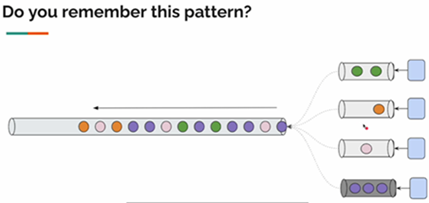
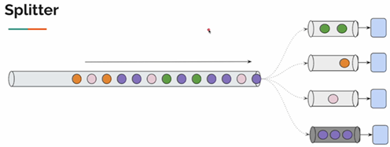

# 📚 Sección 6: Patrón Splitter: Enrutamiento de mensajes a múltiples servicios

---

## 🔀 Splitter Pattern: Introducción

### 🔄 Scatter-Gather Pattern

Observemos la siguiente imagen y recordemos el patrón que estudiamos anteriormente: `Scatter-Gather Pattern`.



En la imagen tenemos un flujo reactivo principal que recibe elementos provenientes de cuatro flujos independientes. Cada
uno de estos flujos emite elementos de un tipo determinado, representados mediante círculos de diferentes colores:

- Un flujo emite elementos verdes.
- Otro emite elementos naranjas.
- Otro emite elementos rosados.
- Otro emite elementos morados.

Todos estos elementos se combinan en un único flujo reactivo, que contiene los elementos emitidos por los cuatro
publishers. Esto se parece al funcionamiento del operador merge de Project Reactor, que permite combinar varios
publishers en un único flujo (`Flux`), emitiendo los elementos a medida que llegan, sin esperar a que todos los
publishers terminen.

Es importante tener en cuenta que el orden de emisión en el flujo resultante depende de cuándo cada publisher produce
sus elementos, no necesariamente del orden en que fueron definidos los flujos originales.

Este concepto nos recuerda al `Scatter-Gather Pattern`, que estudiamos en la sección
`03.scatter-gather-pattern-high-performance-service-composition.md`.

En ese patrón, una solicitud se distribuye entre varios servicios independientes (`Scatter`) y posteriormente se
combinan sus respuestas en un único resultado (`Gather`).

### ✂️ Splitter Pattern

El patrón que estudiaremos en esta sección tiene una idea similar, pero el flujo de los mensajes es diferente.
En lugar de combinar elementos provenientes de varios flujos en uno solo, partimos de un único flujo reactivo que
contiene elementos de distintos tipos y los dividimos en flujos independientes según algún criterio.

En la imagen tenemos un único Flux que contiene elementos de diferentes colores:

- Naranja
- Rosado
- Morado
- Verde

El `Splitter Pattern` se encarga de separar esos elementos y dirigirlos hacia diferentes flujos según su tipo:

- Todos los elementos verdes se envían a un flujo.
- Todos los elementos naranjas se envían a otro.
- Todos los elementos rosados se envían a otro.
- Todos los elementos morados se envían a otro.



> Debemos tener presente que el `Splitter Pattern` y el `Scatter-Gather Pattern` no son exactamente
> operaciones inversas. Cada uno resuelve una necesidad diferente: `Scatter-Gather` distribuye una solicitud y reúne
> respuestas, mientras que `Splitter` divide un mensaje o conjunto de elementos para procesarlos por separado.

### 🏨 Aplicación del Splitter Pattern

Consideremos una aplicación llamada Kayak, que permite a los usuarios realizar reservas de diferentes servicios, como
vuelos, coches y hoteles.


Imaginemos que un usuario selecciona un vuelo, un coche de alquiler y un hotel. El frontend recopila toda esa
información y la envía al backend mediante una única solicitud.

El backend recibe un mensaje que contiene los diferentes elementos que deben procesarse. A partir de esa información,
identifica el tipo de cada elemento y lo dirige al servicio correspondiente:

- Si el elemento representa un vuelo, se envía al servicio de vuelos.
- Si representa un coche de alquiler, se envía al servicio de coches.
- Si representa un hotel, se envía al servicio de hoteles.

De esta manera, una única solicitud recibida por el backend puede dividirse en varios mensajes o flujos independientes,
permitiendo que cada servicio procese la parte de la información que le corresponde.

Este escenario representa una aplicación práctica del Splitter Pattern, ya que el backend recibe información agrupada y
se encarga de separarla para distribuirla entre los diferentes servicios especializados.

## 🔌 Servicios externos

Para esta sección utilizaremos nuevamente el servicio externo `external-services-v2.jar`, que contiene los endpoints
necesarios para implementar y probar el `Splitter Pattern`.

Iniciamos el servicio desde la terminal:

````bash
D:\programming\spring\01.udemy\03.vinoth_selvaraj\spring-webflux-patterns-resilience (main -> origin)
$ java -jar .\external-services\external-services-v2.jar

  .   ____          _            __ _ _
 /\\ / ___'_ __ _ _(_)_ __  __ _ \ \ \ \
( ( )\___ | '_ | '_| | '_ \/ _` | \ \ \ \
 \\/  ___)| |_)| | | | | || (_| |  ) ) ) )
  '  |____| .__|_| |_|_| |_\__, | / / / /
 =========|_|==============|___/=/_/_/_/
 :: Spring Boot ::                (v2.6.4)

2026-11-19 12:21:20.561  INFO 13068 --- [           main] c.v.e.ExternalServicesApplication        : Starting ExternalServicesApplication v0.0.1-SNAPSHOT using Java 25.0.2 on SysEngJava with PID 13068 (D:\programming\spring\01.udemy\03.vinoth_selvaraj\spring-webflux-patterns-resilience\external-services\external-services-v2.jar started by magadiflo in D:\programming\spring\01.udemy\03.vinoth_selvaraj\spring-webflux-patterns-resilience)
2026-11-19 12:21:20.565  INFO 13068 --- [           main] c.v.e.ExternalServicesApplication        : No active profile set, falling back to 1 default profile: "default"
WARNING: A terminally deprecated method in sun.misc.Unsafe has been called
WARNING: sun.misc.Unsafe::objectFieldOffset has been called by io.netty.util.internal.PlatformDependent0$3 (jar:file:/D:/programming/spring/01.udemy/03.vinoth_selvaraj/spring-webflux-patterns-resilience/external-services/external-services-v2.jar!/BOOT-INF/lib/netty-common-4.1.74.Final.jar!/)
WARNING: Please consider reporting this to the maintainers of class io.netty.util.internal.PlatformDependent0$3
WARNING: sun.misc.Unsafe::objectFieldOffset will be removed in a future release
2026-11-19 12:21:23.021  INFO 13068 --- [           main] o.s.b.web.embedded.netty.NettyWebServer  : Netty started on port 7070
2026-11-19 12:21:23.397  INFO 13068 --- [           main] c.v.e.ExternalServicesApplication        : Started ExternalServicesApplication in 3.306 seconds (JVM running for 3.792)
````

### 📖 Swagger UI

Una vez iniciado, accedemos a [Swagger UI](http://localhost:7070/swagger-ui/) y buscamos el apartado
`sec05-splitter (Reservation Controller)` que contiene dos endpoints para realizar reservas de coches y habitaciones.

### 🚗 Car Reserve

Este endpoint permite reservar coches. Recibe una lista de solicitudes con información como la ciudad, las fechas de
recogida y devolución, y la categoría del vehículo.

````bash
$ curl -v -X POST -H "Content-Type: application/json" -d "[{\"category\": \"LUXURY\", \"city\": \"Chimbote\", \"drop\": \"2026-11-29\", \"pickup\": \"2026-11-19\"}]" http://localhost:7070/sec05/car/reserve | jq
>
< HTTP/1.1 200 OK
< transfer-encoding: chunked
< Content-Type: application/json
<
[
  {
    "reservationId": "163399bb-dcf8-4427-9ee0-02be877801c4",
    "city": "Chimbote",
    "pickup": "2026-11-19",
    "drop": "2026-11-29",
    "category": "LUXURY",
    "price": 520
  }
]
````

La respuesta contiene la información de la reserva realizada, incluyendo el identificador generado (`reservationId`) y
el precio correspondiente.

### 🏨 Room Reserve

Este endpoint permite reservar habitaciones. Recibe una lista de solicitudes con información como la ciudad,
las fechas de entrada y salida, y la categoría de la habitación.

````bash
$ curl -v -X POST -H "Content-Type: application/json" -d "[{\"category\": \"KING\", \"checkIn\": \"2026-11-19\", \"checkOut\": \"2026-11-29\", \"city\": \"Chimbote\"}]" http://localhost:7070/sec05/room/reserve | jq
>
< HTTP/1.1 200 OK
< transfer-encoding: chunked
< Content-Type: application/json
<
[
  {
    "reservationId": "509d8daa-d32b-43b3-8499-2d1bc35db82b",
    "city": "Chimbote",
    "checkIn": "2026-11-19",
    "checkOut": "2026-11-29",
    "category": "KING",
    "price": 400
  }
]
````

De manera similar al endpoint anterior, obtenemos la información de la reserva de habitación, incluyendo su
identificador y precio.

### 📌 Consideraciones

Los dos endpoints reciben **listas de solicitudes** y devuelven listas de respuestas, incluso cuando enviamos un solo
elemento en nuestras pruebas.

Esto será importante para la implementación del `Splitter Pattern`, ya que trabajaremos con una solicitud que puede
contener diferentes elementos de reserva y tendremos que separarlos para enviarlos al servicio correspondiente.

## 📦 Creando DTO - Parte 1

Creamos los DTO necesarios para representar las solicitudes y respuestas de las reservas de coches y habitaciones.

Cada tipo de reserva tendrá dos DTO:

- `Request`: representa la información que enviamos al servicio externo para solicitar una reserva.
- `Response`: representa la información que recibimos como resultado de la reserva.

### 🚗 DTO para reservas de coches

#### `CarReservationRequest`

````java
public record CarReservationRequest(String city,
                                    LocalDate pickup,
                                    LocalDate drop,
                                    String category) {
}
````

#### `CarReservationResponse`

````java
public record CarReservationResponse(UUID reservationId,
                                     String city,
                                     LocalDate pickup,
                                     LocalDate drop,
                                     String category,
                                     Integer price) {
}
````

### 🏨 DTO para reservas de habitaciones

#### `RoomReservationRequest`

````java
public record RoomReservationRequest(String city,
                                     LocalDate checkIn,
                                     LocalDate checkOut,
                                     String category) {
}
````

#### `RoomReservationResponse`

````java
public record RoomReservationResponse(UUID reservationId,
                                      String city,
                                      LocalDate checkIn,
                                      LocalDate checkOut,
                                      String category,
                                      Integer price) {
}
````

### 📌 Consideraciones

- `CarReservationRequest` y `RoomReservationRequest` contienen los datos necesarios para solicitar cada tipo de reserva.
- `CarReservationResponse` y `RoomReservationResponse` representan los resultados devueltos por los servicios externos.
  Incluyen el identificador de la reserva (`reservationId`) y el precio (`price`), además de los datos originales de la
  solicitud.
- Se utiliza `LocalDate` para representar las fechas, ya que únicamente necesitamos almacenar fechas sin información de
  hora ni zona horaria.

Estos DTO servirán para representar los diferentes elementos de reserva que posteriormente procesaremos mediante el
`Splitter Pattern`.

## 📦 Creando DTO - Parte 2

En esta parte creamos los DTO que permitirán representar una solicitud de reserva de manera unificada,
independientemente de si corresponde a un coche o a una habitación.

### 🔖 ReservationType

Primero, definimos un `enum` para identificar el tipo de reserva:

````java
public enum ReservationType {
    CAR,
    ROOM
}
````

Este enum permite distinguir entre los dos tipos de reserva que soporta nuestro sistema: `CAR` para coches y `ROOM`
para habitaciones.

### 📥 ReservationItemRequest

Representa un elemento individual de reserva dentro de la solicitud:

````java
public record ReservationItemRequest(ReservationType type,
                                     String category,
                                     String city,
                                     LocalDate from,
                                     LocalDate to) {
}
````

A diferencia de los DTO creados en la parte anterior, este objeto utiliza una estructura genérica para representar ambos
tipos de reserva. Por ejemplo:

- Para una reserva de coche, `from` y `to` representan las fechas de recogida y devolución.
- Para una reserva de habitación, representan las fechas de entrada (`checkIn`) y salida (`checkOut`).

El campo `type` permite identificar cómo debe interpretarse cada elemento.

### 📤 ReservationItemResponse

Representa el resultado de procesar un elemento individual de reserva:

````java
public record ReservationItemResponse(UUID itemId,
                                      ReservationType type,
                                      String category,
                                      String city,
                                      LocalDate from,
                                      LocalDate to,
                                      Integer price) {
}
````

Incluye `itemId` para identificar el elemento reservado, además de conservar su información principal e incorporar el
precio correspondiente.

### 📋 ReservationResponse

Finalmente, creamos el DTO que representa la respuesta completa de una solicitud de reserva:

````java
public record ReservationResponse(UUID reservationId,
                                  Integer price,
                                  List<ReservationItemResponse> items) {
}
````

Este objeto agrupa el resultado general de la reserva:

- `reservationId`: identificador de la reserva principal.
- `price`: precio total de la reserva.
- `items`: lista de elementos individuales procesados, que pueden corresponder a coches o habitaciones.

### 💡 Consideración importante

Con estos DTO tenemos dos niveles de representación:

- **Reserva individual:** `ReservationItemRequest` y `ReservationItemResponse` representan cada elemento que se desea
  reservar y su resultado.
- **Reserva completa:** `ReservationResponse` agrupa los elementos procesados y proporciona información general de la
  operación.

Esta estructura unificada será importante para aplicar el `Splitter Pattern`, ya que una solicitud puede contener
distintos tipos de elementos y necesitaremos identificarlos para dirigirlos al servicio correspondiente.

## 🔌 Servicio de Clientes

En esta parte creamos los clientes encargados de comunicarse con los servicios externos de reservas de coches y
habitaciones. Ambos clientes utilizan `Spring WebClient` para realizar peticiones HTTP de manera reactiva y procesar
las respuestas como flujos de datos (`Flux`).

### 🚗 CarClient

Este cliente se encarga de comunicarse con el servicio externo de reservas de coches.

````java
@Component
public class CarClient {

    private final WebClient webClient;

    public CarClient(@Value("${sec05.car.service}") String baseUrl) {
        this.webClient = WebClient.builder()
                .baseUrl(baseUrl)
                .build();
    }

    public Flux<CarReservationResponse> reserve(Flux<CarReservationRequest> requestFlux) {
        return this.webClient
                .post()
                .body(requestFlux, CarReservationRequest.class)
                .retrieve()
                .bodyToFlux(CarReservationResponse.class)
                .onErrorResume(throwable -> Mono.empty());
    }
}
````

Aspectos importantes:

- La URL base del servicio se obtiene desde la propiedad `sec05.car.service`.
- El método `reserve()` recibe un `Flux<CarReservationRequest>`, por lo que puede procesar un flujo de solicitudes de
  reserva.
- Se realiza una petición HTTP POST enviando el flujo en el cuerpo de la solicitud.
- La respuesta se convierte en un `Flux<CarReservationResponse>`.
- `onErrorResume(throwable -> Mono.empty())` permite recuperarse de un error devolviendo un publisher vacío, evitando
  que el error se propague por este flujo.

### 🏨 RoomClient

Este cliente cumple una función similar, pero se comunica con el servicio externo encargado de las reservas de
habitaciones.

````java
@Component
public class RoomClient {
    private final WebClient webClient;

    public RoomClient(@Value("${sec05.room.service}") String baseUrl) {
        this.webClient = WebClient.builder()
                .baseUrl(baseUrl)
                .build();
    }

    public Flux<RoomReservationResponse> reserve(Flux<RoomReservationRequest> requestFlux) {
        return this.webClient
                .post()
                .body(requestFlux, RoomReservationRequest.class)
                .retrieve()
                .bodyToFlux(RoomReservationResponse.class)
                .onErrorResume(throwable -> Mono.empty());
    }
}
````

Al igual que `CarClient`, obtiene su URL base desde la configuración, envía las solicitudes mediante POST y procesa las
respuestas como un Flux, utilizando los DTO correspondientes a las reservas de habitaciones.

### 💡 Consideraciones

Ambos clientes siguen la misma estructura y se diferencian principalmente en:

- La propiedad de configuración utilizada para obtener la URL del servicio.
- Los DTO de solicitud y respuesta.
- El servicio externo al que se dirigen.

Un detalle importante sobre el manejo de errores: `onErrorResume(throwable -> Mono.empty())` no reintenta la petición ni
devuelve una respuesta de error. Simplemente, reemplaza el flujo que falló por uno vacío. Por tanto, el consumidor
recibirá cero elementos si ocurre un error durante la comunicación.

Con estos clientes tenemos preparada la comunicación con ambos servicios externos. Posteriormente, los utilizaremos para
enviar las solicitudes que resulten de separar los distintos tipos de reserva mediante el `Splitter Pattern`.

