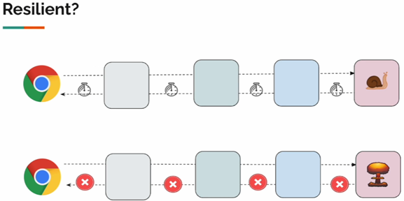
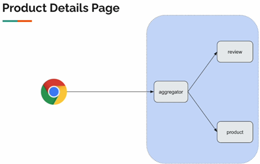

# 📚 Sección 7: Reactive Resilience: Timeout Pattern

---

## 🛡️ Resiliency Patterns: Introducción

Hasta la sección anterior nos hemos dedicado a aprender diferentes patrones de integración entre servicios. A partir de
esta sección cambiaremos de enfoque y comenzaremos a estudiar patrones de resiliencia, cuyo objetivo es construir
sistemas capaces de seguir respondiendo adecuadamente incluso cuando ocurren fallos en alguno de sus componentes o
dependencias.

### 🔎 ¿Qué es la resiliencia?

En el contexto de los sistemas reactivos, debemos recordar algunas de sus características fundamentales:

- **Responsive (responsivo):** el sistema debe responder oportunamente a las solicitudes, proporcionando respuestas
  dentro de un tiempo razonable.
- **Resilient (resiliente):** el sistema debe mantenerse funcional y responder adecuadamente ante situaciones de fallo.
  Esto implica evitar que los problemas de un componente se propaguen y afecten a todo el sistema.

Veamos la siguiente arquitectura de configuración:



En esta arquitectura tenemos un navegador que actúa como cliente y envía una solicitud al primer servicio. Este
servicio, a su vez, llama a otro y así sucesivamente, formando una cadena de dependencias entre servicios.

Ahora imaginemos que el último servicio de la cadena comienza a responder demasiado lento o deja de responder.

Como los servicios anteriores dependen de su respuesta para continuar el procesamiento, tendrán que esperar a que esa
operación termine. Esta situación puede provocar que la demora se propague a través de toda la cadena, haciendo que el
cliente tenga que esperar demasiado tiempo para recibir una respuesta. Incluso podría ocurrir que el navegador
permanezca esperando indefinidamente si no existe algún mecanismo que limite el tiempo de espera.

Existe otro escenario que también debemos considerar. Supongamos que el último servicio de la cadena devuelve un
error `HTTP 500 Internal Server Error`. Si los servicios intermedios no cuentan con mecanismos para gestionar ese fallo,
el error puede propagarse hacia los servicios anteriores hasta llegar al cliente. De esta manera, un problema localizado
en una dependencia termina afectando toda la solicitud.

Esto ocurre porque normalmente los desarrolladores implementamos primero el escenario exitoso (*happy path*): un
servicio llama a otro, recibe su respuesta y continúa con el procesamiento. Sin embargo, en un sistema distribuido
debemos contemplar también los escenarios de fallo.

### 🛡️ ¿Cómo funciona un sistema resiliente?

Veamos ahora la siguiente arquitectura:


En esta arquitectura tenemos un sistema resiliente. Observemos que un servicio realiza una llamada a otro, pero durante
esa comunicación ocurre un error `500 Internal Server Error`.

A diferencia del escenario anterior, el servicio que detecta el fallo cuenta con mecanismos para gestionarlo y puede
continuar proporcionando una respuesta al servicio que lo invocó, evitando que el error se propague necesariamente por
toda la cadena.

Pero aquí surge una pregunta: *¿cómo puede nuestro sistema seguir respondiendo si depende de un servicio que ha fallado
o no está disponible?*

Una alternativa consiste en evitar que el error se propague directamente y proporcionar una respuesta alternativa
(*fallback*). Por ejemplo, podemos utilizar valores predeterminados o información previamente almacenada en caché para
responder al cliente. De esta manera, aunque una dependencia externa presente problemas, nuestra aplicación puede
mantener cierta funcionalidad y continuar respondiendo a las solicitudes.

Es importante tener presente que estas respuestas alternativas dependen del contexto de negocio: no siempre será válido
utilizar información en caché o valores predeterminados. Lo importante es contar con mecanismos que permitan gestionar
los fallos de manera controlada.


> **Nota:** En esta introducción estamos estableciendo la diferencia entre un sistema que simplemente funciona cuando
> todo está bien y uno que también sabe gestionar situaciones inesperadas. En los siguientes apartados profundizaremos
> en los patrones que nos permiten conseguirlo, comenzando por el `Timeout Pattern`.

## ⏱️ Timeout Pattern

El `Timeout Pattern` es uno de los patrones de resiliencia más sencillos de implementar. Su propósito es establecer un
tiempo máximo de espera para una operación y considerarla fallida cuando la respuesta no se recibe dentro del límite
establecido.

En lugar de esperar indefinidamente a que un servicio externo responda, establecemos un tiempo límite (timeout). Si se
supera ese tiempo, podemos gestionar la situación mediante algún mecanismo alternativo, como proporcionar valores
predeterminados o información almacenada en caché (*fallback*).

### 🏗️ Escenario de implementación

Para implementar este patrón reutilizaremos el código desarrollado anteriormente para el `Gateway Aggregator Pattern` y
aplicaremos las configuraciones necesarias para incorporar el mecanismo de timeout.

Recordemos el funcionamiento de nuestra arquitectura:

1. El cliente (navegador) solicita información de un producto al servicio Aggregator.
2. El Aggregator realiza llamadas a dos servicios externos: Product y Review.
3. Combina la información recibida de ambos servicios.
4. Devuelve una respuesta consolidada al cliente.

En esta ocasión trabajaremos únicamente con esos dos servicios externos: `Product` y `Review`.



Imaginemos que trabajamos en una organización grande donde existen diferentes equipos de desarrollo, cada uno
responsable de un servicio específico. Por ejemplo:

- Un equipo encargado del servicio Product.
- Otro equipo encargado del servicio Review.
- Nuestro equipo encargado del servicio Aggregator.

Supongamos que tenemos un requisito de negocio que establece que el Aggregator debe responder a las solicitudes en un
máximo de medio segundo (500 ms).

Para cumplir este requisito, debemos tener en cuenta que las dependencias externas también influyen en el tiempo de
respuesta de nuestro servicio. Por ello, necesitamos establecer límites de espera para las llamadas que realizamos a
esos servicios (upstream services).

Consideremos el siguiente escenario:

- `Product`: responde correctamente y de manera rápida prácticamente todas las veces.
- `Review`: puede presentar demoras debido a la cantidad de reseñas que debe consultar o procesar. En ocasiones,
  incluso podría tardar demasiado en responder.

Si nuestro Aggregator espera indefinidamente la respuesta de Review, podría incumplir el tiempo de respuesta exigido
por el negocio.

Por esta razón, estableceremos un timeout para cada servicio externo. Así, si alguno supera el tiempo de espera
configurado, podremos considerar fallida esa operación y gestionar el resultado sin tener que esperar indefinidamente.

## 🔌 Servicios externos

Para esta sección utilizaremos nuevamente el servicio externo `external-services-v2.jar`, que contiene los endpoints
necesarios para implementar y probar el `Timeout Pattern`.

Iniciamos el servicio desde la terminal:

````bash
D:\programming\spring\01.udemy\03.vinoth_selvaraj\spring-webflux-patterns-resilience (main -> origin)
$ java -jar .\external-services\external-services-v2.jar

  .   ____          _            __ _ _
 /\\ / ___'_ __ _ _(_)_ __  __ _ \ \ \ \
( ( )\___ | '_ | '_| | '_ \/ _` | \ \ \ \
 \\/  ___)| |_)| | | | | || (_| |  ) ) ) )
  '  |____| .__|_| |_|_| |_\__, | / / / /
 =========|_|==============|___/=/_/_/_/
 :: Spring Boot ::                (v2.6.4)

2026-11-26 12:28:33.706  INFO 11784 --- [           main] c.v.e.ExternalServicesApplication        : Starting ExternalServicesApplication v0.0.1-SNAPSHOT using Java 25.0.2 on SysEngJava with PID 11784 (D:\programming\spring\01.udemy\03.vinoth_selvaraj\spring-webflux-patterns-resilience\external-services\external-services-v2.jar started by magadiflo in D:\programming\spring\01.udemy\03.vinoth_selvaraj\spring-webflux-patterns-resilience)
2026-11-26 12:28:33.710  INFO 11784 --- [           main] c.v.e.ExternalServicesApplication        : No active profile set, falling back to 1 default profile: "default"
WARNING: A terminally deprecated method in sun.misc.Unsafe has been called
WARNING: sun.misc.Unsafe::objectFieldOffset has been called by io.netty.util.internal.PlatformDependent0$3 (jar:file:/D:/programming/spring/01.udemy/03.vinoth_selvaraj/spring-webflux-patterns-resilience/external-services/external-services-v2.jar!/BOOT-INF/lib/netty-common-4.1.74.Final.jar!/)
WARNING: Please consider reporting this to the maintainers of class io.netty.util.internal.PlatformDependent0$3
WARNING: sun.misc.Unsafe::objectFieldOffset will be removed in a future release
2026-11-26 12:28:36.252  INFO 11784 --- [           main] o.s.b.web.embedded.netty.NettyWebServer  : Netty started on port 7070
2026-11-26 12:28:36.639  INFO 11784 --- [           main] c.v.e.ExternalServicesApplication        : Started ExternalServicesApplication in 3.384 seconds (JVM running for 3.86)
````

### 📖 Swagger UI

Una vez iniciado, accedemos a [Swagger UI](http://localhost:7070/swagger-ui/)
y buscamos el apartado `sec06-timeout (Timeout Controller)` que contiene dos endpoints para consultar la información del
producto y su review.

### 🛍️ Product

Probamos el endpoint encargado de obtener la información de un producto:

````bash
$ curl -v http://localhost:7070/sec06/product/1 | jq
>
< HTTP/1.1 200 OK
< Content-Type: application/json
< Content-Length: 86
<
100     86 100     86   0      0   1396      0                              0
{
  "id": 1,
  "category": "Industrial",
  "description": "Lightweight Plastic Gloves",
  "price": 45
}
````

El servicio responde correctamente con un HTTP 200 OK y devuelve los datos del producto solicitado.

### ⭐ Review

Ahora probamos el endpoint encargado de obtener las reseñas asociadas a un producto:

````bash
$ curl -v http://localhost:7070/sec06/review/1 | jq
>
< HTTP/1.1 200 OK
< Content-Type: application/json
< Content-Length: 82
<
100     82 100     82   0      0     82      0   00:01           00:01      0
[
  {
    "id": 1,
    "user": "Bud",
    "rating": 1,
    "comment": "Vel itaque rerum ad eveniet non at."
  }
]
````

También obtenemos un HTTP 200 OK. Sin embargo, podemos observar que esta solicitud tarda aproximadamente un segundo en
responder.

Además, según la descripción del endpoint en Swagger UI:

> Proporciona la lista de reseñas para el ID de producto indicado. La obtención de las reseñas puede tardar hasta
> `2500 milisegundos`.

Este comportamiento nos resultará útil para probar el `Timeout Pattern`, ya que el servicio Review puede tardar
considerablemente más que Product en responder.

## ⚙️ Configuración del proyecto

Creamos un nuevo paquete llamado `sec07` y copiamos dentro de él todo el contenido del paquete `sec02`. A partir de
esa base, realizaremos las modificaciones necesarias para adaptar la implementación a esta nueva sección.

A continuación, se muestra el código adaptado.

#### 📦 DTOs

````java
public record Product(Integer id,
                      String category,
                      String description,
                      Integer price) {
}
````

````java
public record Review(Integer id,
                     String user,
                     Integer rating,
                     String comment) {
}
````

````java
public record ProductAggregate(Integer id,
                               String category,
                               String description,
                               Integer price,
                               List<Review> reviews) {
}
````

#### 🔌 Clients

````java
@Slf4j
@Component
public class ProductClient {

    private final WebClient webClient;

    public ProductClient(@Value("${sec06.product.service}") String baseUrl) {
        this.webClient = WebClient.builder()
                .baseUrl(baseUrl)
                .build();
    }

    public Mono<Product> getProduct(Integer id) {
        return this.webClient
                .get()
                .uri("/{id}", id)
                .retrieve()
                .bodyToMono(Product.class)
                .onErrorResume(throwable -> {
                    log.warn("Error obteniendo producto con ID {}: {}", id, throwable.getMessage());
                    return Mono.empty();
                });
    }
}
````

````java
@Slf4j
@Component
public class ReviewClient {

    private final WebClient webClient;

    public ReviewClient(@Value("${sec06.review.service}") String baseUrl) {
        this.webClient = WebClient.builder()
                .baseUrl(baseUrl)
                .build();
    }

    public Mono<List<Review>> getReview(Integer id) {
        return this.webClient
                .get()
                .uri("/{id}", id)
                .retrieve()
                .bodyToFlux(Review.class)
                .collectList()
                .onErrorReturn(Collections.emptyList());
    }
}
````

#### ⚙️ Servicio

````java
@RequiredArgsConstructor
@Service
public class ProductAggregatorService {

    private final ProductClient productClient;
    private final ReviewClient reviewClient;

    public Mono<ProductAggregate> aggregate(Integer id) {
        return Mono.zip(
                        this.productClient.getProduct(id),
                        this.reviewClient.getReview(id)
                )
                .map(tuple ->
                        this.toProductAggregate(tuple.getT1(), tuple.getT2()));
    }

    private ProductAggregate toProductAggregate(Product product, List<Review> reviews) {
        return new ProductAggregate(
                product.id(),
                product.category(),
                product.description(),
                product.price(),
                reviews
        );
    }
}
````

#### 🌐 Controller

````java
@RequiredArgsConstructor
@RestController
@RequestMapping(path = "/api/{version}/sec06/products", version = "1")
public class ProductAggregateController {

    private final ProductAggregatorService service;

    @GetMapping(path = "/{id}")
    public Mono<ResponseEntity<ProductAggregate>> getProductAggregate(@PathVariable Integer id) {
        return this.service.aggregate(id)
                .map(ResponseEntity::ok)
                .defaultIfEmpty(ResponseEntity.notFound().build());
    }
}
````

#### 🔧 Configurando los servicios externos y el paquete de escaneo

````java
@SpringBootApplication(scanBasePackages = "dev.magadiflo.patterns.app.sec07")
public class WebfluxPatternsApplication {

    public static void main(String[] args) {
        SpringApplication.run(WebfluxPatternsApplication.class, args);
    }

}
````

````properties
sec06.product.service=http://localhost:7070/sec06/product
sec06.review.service=http://localhost:7070/sec06/review
````

### 🧪 Probando la aplicación con los cambios adaptados

Hasta este punto hemos limpiado y adaptado el código que copiamos de `sec02`. Ahora realizamos una prueba para
comprobar que la aplicación sigue funcionando correctamente.

Ejecutamos la siguiente petición:

````bash
$ curl -v http://localhost:8080/api/v1/sec06/products/1 | jq
>
< HTTP/1.1 200 OK
< Content-Type: application/json
< Content-Length: 179
<
100    179 100    179   0      0     81      0   00:02   00:02             82
{
  "id": 1,
  "category": "Industrial",
  "description": "Lightweight Plastic Gloves",
  "price": 45,
  "reviews": [
    {
      "id": 1,
      "user": "Bud",
      "rating": 1,
      "comment": "Vel itaque rerum ad eveniet non at."
    }
  ]
}
````

La aplicación responde correctamente con un HTTP 200 OK y devuelve la información del producto junto con sus reseñas.

Sin embargo, después de realizar varias pruebas, observamos que el tiempo de respuesta puede variar considerablemente.
Por ejemplo, **la petición anterior tardó aproximadamente dos segundos en completarse.**

Ahora que hemos comprobado que la aplicación funciona correctamente, llega el momento de implementar una solución que
nos permita controlar estos tiempos de espera mediante el `Timeout Pattern`.

## ⏱️ Implementación del Timeout Pattern

Para implementar este patrón, agregaremos el operador `timeout(Duration.ofMillis(500))` a los flujos reactivos de ambos
clientes.

Este operador establece un tiempo máximo de espera de `500 milisegundos`. Si el publisher no emite el resultado dentro
de ese tiempo, se produce un error de tipo `TimeoutException`.

### 🔌 ProductClient

````java
@Slf4j
@Component
public class ProductClient {

    private final WebClient webClient;

    public ProductClient(@Value("${sec06.product.service}") String baseUrl) {
        this.webClient = WebClient.builder()
                .baseUrl(baseUrl)
                .build();
    }

    public Mono<Product> getProduct(Integer id) {
        return this.webClient
                .get()
                .uri("/{id}", id)
                .retrieve()
                .bodyToMono(Product.class)
                .timeout(Duration.ofMillis(500))
                .onErrorResume(throwable -> {
                    log.warn("Error obteniendo producto con ID {}: {}", id, throwable.getMessage());
                    return Mono.empty();
                });
    }
}
````

### 🔌 ReviewClient

````java
@Slf4j
@Component
public class ReviewClient {

    private final WebClient webClient;

    public ReviewClient(@Value("${sec06.review.service}") String baseUrl) {
        this.webClient = WebClient.builder()
                .baseUrl(baseUrl)
                .build();
    }

    public Mono<List<Review>> getReview(Integer id) {
        return this.webClient
                .get()
                .uri("/{id}", id)
                .retrieve()
                .bodyToFlux(Review.class)
                .collectList()
                .timeout(Duration.ofMillis(500))
                .onErrorReturn(Collections.emptyList());
    }
}
````

### 📝 Consideraciones sobre el Timeout

- El operador `timeout()` genera un error si el flujo no emite el resultado dentro del tiempo configurado.
- En `ProductClient`, `onErrorResume()` captura ese error, registra un mensaje en el `log` y devuelve `Mono.empty()`.
- En `ReviewClient`, `onErrorReturn()` captura el error y devuelve una lista vacía (`Collections.emptyList()`).

> **Importante:** el operador `timeout()` también permite definir un flujo alternativo (*fallback*) que se ejecutará
> cuando se supere el tiempo establecido. Por ejemplo, podríamos utilizar una sobrecarga que reciba un segundo
> Publisher para recuperar información desde una caché o proporcionar un valor predeterminado.
>
> En nuestra implementación actual no utilizamos esta posibilidad. Simplemente, dejamos que `timeout()` genere el
> error y permitimos que los operadores `onErrorResume()` y `onErrorReturn()` se encarguen de gestionar esa situación.

Además, en este ejemplo el límite de `500ms` se aplica individualmente a cada cliente, no al tiempo total de ejecución
del `ProductAggregatorService`.
