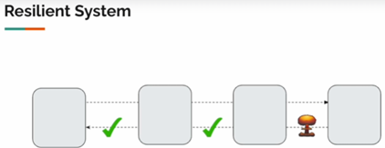

# 📚 Sección 7: Reactive Resilience: Timeout Pattern

---

## 🛡️ Resiliency Patterns: Introducción

Hasta la sección anterior nos hemos dedicado a aprender diferentes patrones de integración entre servicios. A partir de
esta sección cambiaremos de enfoque y comenzaremos a estudiar patrones de resiliencia, cuyo objetivo es construir
sistemas capaces de seguir respondiendo adecuadamente incluso cuando ocurren fallos en alguno de sus componentes o
dependencias.

### 🔎 ¿Qué es la resiliencia?

En el contexto de los sistemas reactivos, debemos recordar algunas de sus características fundamentales:

- **Responsive (responsivo):** el sistema debe responder oportunamente a las solicitudes, proporcionando respuestas
  dentro de un tiempo razonable.
- **Resilient (resiliente):** el sistema debe mantenerse funcional y responder adecuadamente ante situaciones de fallo.
  Esto implica evitar que los problemas de un componente se propaguen y afecten a todo el sistema.

Veamos la siguiente arquitectura de configuración:

En esta arquitectura tenemos un navegador que actúa como cliente y envía una solicitud al primer servicio. Este
servicio, a su vez, llama a otro y así sucesivamente, formando una cadena de dependencias entre servicios.

Ahora imaginemos que el último servicio de la cadena comienza a responder demasiado lento o deja de responder.

Como los servicios anteriores dependen de su respuesta para continuar el procesamiento, tendrán que esperar a que esa
operación termine. Esta situación puede provocar que la demora se propague a través de toda la cadena, haciendo que el
cliente tenga que esperar demasiado tiempo para recibir una respuesta. Incluso podría ocurrir que el navegador
permanezca esperando indefinidamente si no existe algún mecanismo que limite el tiempo de espera.

Existe otro escenario que también debemos considerar. Supongamos que el último servicio de la cadena devuelve un
error `HTTP 500 Internal Server Error`. Si los servicios intermedios no cuentan con mecanismos para gestionar ese fallo,
el error puede propagarse hacia los servicios anteriores hasta llegar al cliente. De esta manera, un problema localizado
en una dependencia termina afectando toda la solicitud.

Esto ocurre porque normalmente los desarrolladores implementamos primero el escenario exitoso (*happy path*): un
servicio llama a otro, recibe su respuesta y continúa con el procesamiento. Sin embargo, en un sistema distribuido
debemos contemplar también los escenarios de fallo.

### 🛡️ ¿Cómo funciona un sistema resiliente?

Veamos ahora la siguiente arquitectura:

En esta arquitectura tenemos un sistema resiliente. Observemos que un servicio realiza una llamada a otro, pero durante
esa comunicación ocurre un error `500 Internal Server Error`.

A diferencia del escenario anterior, el servicio que detecta el fallo cuenta con mecanismos para gestionarlo y puede
continuar proporcionando una respuesta al servicio que lo invocó, evitando que el error se propague necesariamente por
toda la cadena.

Pero aquí surge una pregunta: *¿cómo puede nuestro sistema seguir respondiendo si depende de un servicio que ha fallado
o no está disponible?*

Una alternativa consiste en evitar que el error se propague directamente y proporcionar una respuesta alternativa
(*fallback*). Por ejemplo, podemos utilizar valores predeterminados o información previamente almacenada en caché para
responder al cliente. De esta manera, aunque una dependencia externa presente problemas, nuestra aplicación puede
mantener cierta funcionalidad y continuar respondiendo a las solicitudes.

Es importante tener presente que estas respuestas alternativas dependen del contexto de negocio: no siempre será válido
utilizar información en caché o valores predeterminados. Lo importante es contar con mecanismos que permitan gestionar
los fallos de manera controlada.

> **Nota:** En esta introducción estamos estableciendo la diferencia entre un sistema que simplemente funciona cuando
> todo está bien y uno que también sabe gestionar situaciones inesperadas. En los siguientes apartados profundizaremos
> en los patrones que nos permiten conseguirlo, comenzando por el `Timeout Pattern`.

