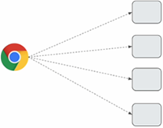
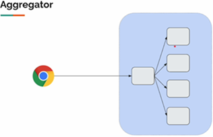
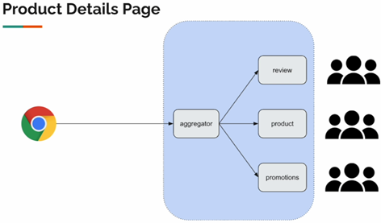
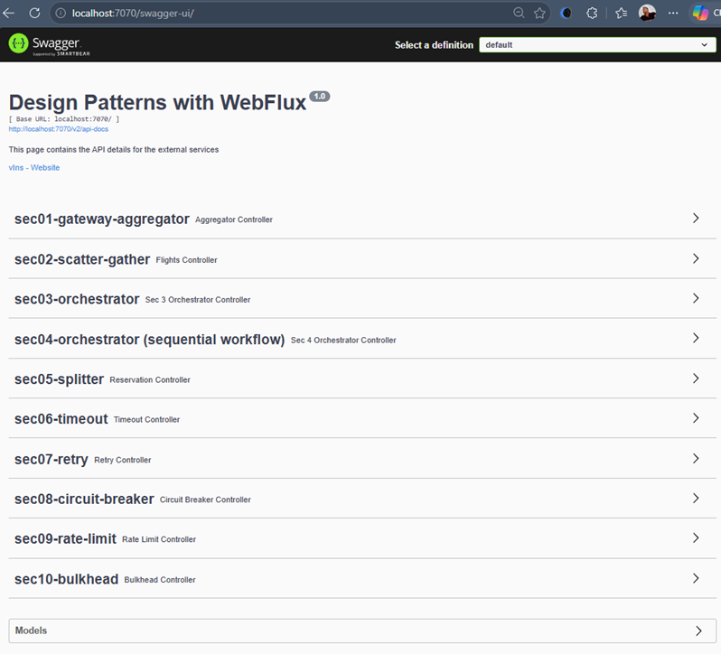
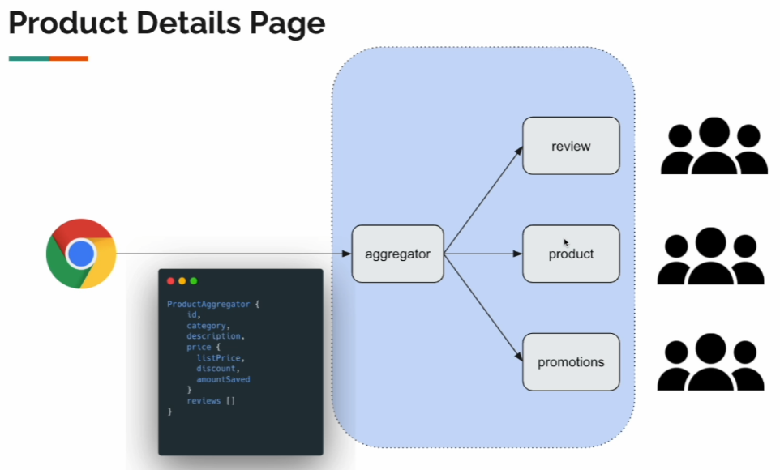
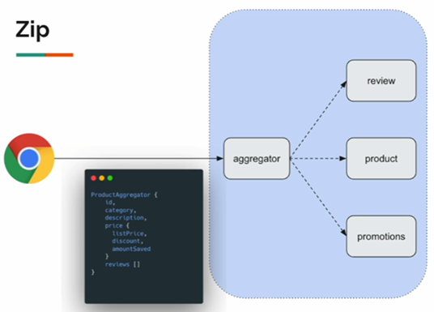

# [Spring WebFlux: Microservices Patterns & Advanced Resilience](https://www.udemy.com/course/spring-webflux-patterns/)

# 📚 Sección 2: API Composition: Gateway Aggregator Pattern

## 🔎 Gateway Aggregator Pattern - Intro

El **Gateway Aggregator Pattern** es un patrón de integración que permite al cliente obtener información de varios
microservicios mediante una única solicitud. Un servicio agregador consulta los servicios necesarios, combina sus
respuestas y devuelve un resultado unificado al cliente.

#### 💡 Diferencia entre API Gateway y Gateway Aggregator

Aunque ambos actúan como intermediarios entre el cliente y los microservicios, tienen responsabilidades diferentes:

- **API Gateway:** funciona como punto de entrada y enruta las solicitudes hacia los microservicios correspondientes.
- **Gateway Aggregator:** consulta varios microservicios, combina sus respuestas y devuelve un único resultado al
  cliente.

Ambos patrones pueden convivir en una misma arquitectura. Por ejemplo, el API Gateway puede enrutar una solicitud al
agregador, y este último consultar los microservicios necesarios.

Este patrón también se relaciona con el **Backend for Frontend (BFF)**, que adapta las respuestas a las necesidades de
un cliente específico. Sin embargo, no son equivalentes: el Gateway Aggregator se centra en combinar información de
varios servicios, mientras que el BFF se centra en ofrecer un backend adaptado a un tipo de cliente.

### ⚠️ Planteamiento del problema

Consideremos una aplicación en la que el navegador necesita obtener información de cuatro microservicios diferentes.



En este escenario, el cliente realiza una solicitud independiente a cada microservicio para obtener toda la información
necesaria para construir la página.

Este enfoque presenta varios problemas:

- **Múltiples llamadas de red:** el cliente debe realizar varias solicitudes para obtener toda la información necesaria.
- **Límite de solicitudes simultáneas:** los navegadores pueden limitar la cantidad de conexiones concurrentes hacia un
  mismo origen. Si se alcanza ese límite, algunas solicitudes deberán esperar a que se liberen conexiones.
- **Mayor latencia:** si el cliente está en Europa y los servidores en Estados Unidos, las múltiples solicitudes pueden
  aumentar el tiempo necesario para reunir toda la información.
- **Mayor complejidad en el cliente:** si se incorpora un nuevo microservicio, el cliente podría necesitar
  modificaciones para consultar y procesar sus datos.

### ⚙️ Solución: Gateway Aggregator Pattern

Aquí es donde entra en juego el **Gateway Aggregator Pattern**.



El agregador es un servicio backend que recibe una solicitud del cliente y consulta los microservicios necesarios para
obtener la información requerida. Después, combina las respuestas y devuelve un único resultado al cliente.

De esta manera, el agregador **oculta la complejidad de la comunicación con los distintos microservicios**, permitiendo
que el cliente se concentre principalmente en la lógica de presentación.

Además, si se incorpora un nuevo microservicio, la lógica necesaria para obtener e integrar su información puede
centralizarse en el agregador, evitando que el cliente tenga que gestionar directamente esa nueva dependencia.

### 🛒 Ejemplo práctico: página de detalles de un producto

Consideremos una página de detalles de un producto en Amazon. En ella podemos encontrar información como:

- Datos del producto.
- Calificaciones y reseñas.
- Promociones y ofertas de precios.

Esta información puede provenir de diferentes microservicios:

- **Product Service:** proporciona la información del producto.
- **Review Service:** proporciona las reseñas y calificaciones.
- **Promotion Service:** proporciona las promociones disponibles.

Aunque la página presenta toda esta información de manera unificada, los datos pueden provenir de servicios
independientes.

El `Gateway Aggregator` permite reunir esa información y devolverla al cliente en una única respuesta.

### 🏗️ Objetivo de la implementación

Consideremos una organización en la que diferentes equipos desarrollan y mantienen estos microservicios.



Cada equipo es responsable de su propio servicio: uno gestiona los productos, otro las reseñas y otro las promociones.
Nuestra tarea consiste en desarrollar el agregador que se comunicará con estos servicios y reunirá la información que
necesita el cliente.

**El objetivo de esta sección es implementar el Gateway Aggregator Pattern utilizando Spring WebFlux.**

## 🔌 External Services

Para desarrollar el **Gateway Aggregator**, utilizaremos una aplicación externa proporcionada por el instructor.
Esta aplicación simula los microservicios con los que nuestro agregador deberá comunicarse.

### 📥 Descarga y ejecución

Descargamos el archivo JAR desde el siguiente enlace:
[Descargar external-services-v2.jar](https://vins-udemy.s3.amazonaws.com/webflux-design-patterns/external-services-v2.jar)

Guardamos el archivo en un directorio de nuestro proyecto para tenerlo disponible durante el desarrollo. Una vez
descargado, ejecutamos la aplicación con el siguiente comando:

````bash
D:\programming\spring\01.udemy\03.vinoth_selvaraj\spring-webflux-patterns-resilience\external-services (main -> origin)
$ java -jar external-services-v2.jar

  .   ____          _            __ _ _
 /\\ / ___'_ __ _ _(_)_ __  __ _ \ \ \ \
( ( )\___ | '_ | '_| | '_ \/ _` | \ \ \ \
 \\/  ___)| |_)| | | | | || (_| |  ) ) ) )
  '  |____| .__|_| |_|_| |_\__, | / / / /
 =========|_|==============|___/=/_/_/_/
 :: Spring Boot ::                (v2.6.4)

2026-10-19 12:21:07.849  INFO 6600 --- [           main] c.v.e.ExternalServicesApplication        : Starting ExternalServicesApplication v0.0.1-SNAPSHOT using Java 25.0.2 on SysEngJava with PID 6600 (D:\programming\spring\01.udemy\03.vinoth_selvaraj\spring-webflux-patterns-resilience\external-services\external-services-v2.jar started by magadiflo in D:\programming\spring\01.udemy\03.vinoth_selvaraj\spring-webflux-patterns-resilience\external-services)
2026-10-19 12:21:07.852  INFO 6600 --- [           main] c.v.e.ExternalServicesApplication        : No active profile set, falling back to 1 default profile: "default"
WARNING: A terminally deprecated method in sun.misc.Unsafe has been called
WARNING: sun.misc.Unsafe::objectFieldOffset has been called by io.netty.util.internal.PlatformDependent0$3 (jar:file:/D:/programming/spring/01.udemy/03.vinoth_selvaraj/spring-webflux-patterns-resilience/external-services/external-services-v2.jar!/BOOT-INF/lib/netty-common-4.1.74.Final.jar!/)
WARNING: Please consider reporting this to the maintainers of class io.netty.util.internal.PlatformDependent0$3
WARNING: sun.misc.Unsafe::objectFieldOffset will be removed in a future release
2026-10-19 12:21:10.021  INFO 6600 --- [           main] o.s.b.web.embedded.netty.NettyWebServer  : Netty started on port 7070
2026-10-19 12:21:10.400  INFO 6600 --- [           main] c.v.e.ExternalServicesApplication        : Started ExternalServicesApplication in 2.946 seconds (JVM running for 3.404) 
````

La aplicación inicia correctamente, vemos en los registros que la aplicación se ha iniciado correctamente y está
escuchando en el puerto `7070`.

**⚙️ Cambiar el puerto del servidor**

Si necesitamos utilizar otro puerto, podemos indicarlo como argumento al ejecutar el JAR:

````bash
java -jar external-services-v2.jar --server.port=6060 
````

En este curso utilizaremos el puerto predeterminado `7070`.

### 📖 Explorar los servicios disponibles

Con la aplicación en ejecución, accedemos desde el navegador a la siguiente dirección:
[http://localhost:7070/swagger-ui/](http://localhost:7070/swagger-ui/)



Esta interfaz de Swagger permite consultar los endpoints disponibles y conocer cómo interactuar con los servicios
externos que utilizaremos durante el curso.

En esta sección trabajaremos principalmente con tres servicios:

- **Product Service:** proporciona información de los productos.
- **Review Service:** proporciona las reseñas y calificaciones de los productos.
- **Promotion Service:** proporciona información sobre las promociones disponibles.

**💡 ¿Por qué los tres servicios están en un solo JAR?**

En una arquitectura real de microservicios, cada servicio podría ejecutarse como una aplicación independiente, con su
propio proceso y puerto.

Sin embargo, para simplificar el curso, el instructor ha reunido los tres servicios en un único archivo JAR. Aunque se
ejecutan dentro de la misma aplicación, debemos tratarlos conceptualmente como servicios independientes, ya que cada uno
representa una responsabilidad diferente y dispone de sus propios endpoints.

### 🏗️ Desarrollo del Gateway Aggregator

Nuestro objetivo es desarrollar un nuevo microservicio llamado **Aggregator Service**, que se comunicará con los tres
servicios anteriores para reunir la información de un producto.



Por ejemplo, cuando el cliente solicite la información del producto con identificador `81`, el agregador consultará los
servicios necesarios para obtener los datos del producto, sus reseñas y sus promociones.

Posteriormente, reunirá las respuestas en una estructura unificada, representada por el objeto `ProductAggregator`, y
devolverá el resultado al cliente.

De esta manera, el cliente recibirá toda la información necesaria mediante una única solicitud, sin tener que
comunicarse directamente con cada servicio ni encargarse de combinar sus respuestas. Así, podrá concentrarse en la
lógica de presentación.

## ⚙️ Configuración del Proyecto

Desde [Spring Initializer](https://start.spring.io/#!type=maven-project&language=java&platformVersion=4.1.1&packaging=jar&configurationFileFormat=yaml&jvmVersion=25&groupId=dev.magadiflo&artifactId=webflux-patterns&packageName=dev.magadiflo.patterns.app&dependencies=webflux,lombok),
creamos el proyecto con las siguientes dependencias iniciales:

````xml
<!--Spring Boot 4.1.1-->
<!--Java 25-->
<dependencies>
    <dependency>
        <groupId>org.springframework.boot</groupId>
        <artifactId>spring-boot-starter-webflux</artifactId>
    </dependency>

    <dependency>
        <groupId>org.projectlombok</groupId>
        <artifactId>lombok</artifactId>
        <optional>true</optional>
    </dependency>
</dependencies>
````

- `Spring WebFlux`: permite crear aplicaciones web reactivas y gestionar operaciones de entrada y salida de manera no
  bloqueante.
- `Lombok`: reduce el código repetitivo, por ejemplo, mediante la generación de getters, setters y constructores.

### ⚙️ Configurando propiedades iniciales

En el archivo `application.yml` definimos algunas propiedades iniciales de la aplicación, incluyendo su nombre, la
información de los errores y la configuración del versionado de la API.

````yml
spring:
  application:
    name: webflux-patterns
  web:
    error:
      include-message: always
  # API Versioning (Spring Boot 4)
  webflux:
    api-version:
      required: true
      supported: 1,2
      use:
        path-segment: 1
````

Descripción de las propiedades:

- **spring.application.name:** establece el nombre de la aplicación, en este caso `webflux-patterns`.
- **spring.web.error.include-message: always:** incluye el mensaje del error en la respuesta de error HTTP. Es útil
  durante el desarrollo y la depuración, pero conviene evaluar su uso en producción para no exponer información interna.
- **spring.webflux.api-version.required: true:** exige que las solicitudes incluyan una versión de API.
- **spring.webflux.api-version.supported: 1,2:** declara las versiones de API admitidas: 1 y 2.
- **spring.webflux.api-version.use.path-segment: 1:** indica que la versión se obtiene del primer segmento de la ruta de
  la solicitud.

Por ejemplo, una ruta como `/api/v1/products` utiliza la **versión 1**, mientras que `/api/v2/products` utiliza la
**versión 2.**

Con esta configuración, la aplicación identifica la versión de la API a partir de la ruta y puede gestionar las
solicitudes según la versión indicada.

### 📂 Organización del proyecto por secciones

Para desarrollar el curso, utilizaremos un único proyecto y organizaremos el código de cada sección en paquetes
independientes. De esta manera, no será necesario crear un proyecto nuevo cada vez que comencemos un tema.

Actualmente, estamos en la `Sección 02`, ya que la `Sección 01` fue una breve introducción. Por ello, dentro del
paquete `dev.magadiflo.patterns.app`, crearemos el paquete `sec02` con la siguiente estructura:

````text
dev.magadiflo.patterns.app
└───sec02
    ├───client
    ├───controller
    ├───dto
    └───service 
````

Cada paquete tendrá una responsabilidad específica:

- `client`: contiene los componentes encargados de comunicarse con los servicios externos.
- `controller`: expone los endpoints que recibirán las solicitudes del cliente.
- `dto`: contiene los objetos utilizados para transportar datos entre los componentes.
- `service`: contiene la lógica de negocio y la composición de las respuestas del agregador.

Cuando avancemos a las siguientes secciones, crearemos los paquetes correspondientes dentro del mismo proyecto,
manteniendo el código organizado y separado por tema.

## 🧱 Creando DTOs

Los **DTOs (Data Transfer Objects)** son objetos que utilizamos para transportar datos entre componentes o servicios.
En esta sección, los definiremos mediante `record`, una característica de Java que permite crear clases destinadas
principalmente a almacenar datos de forma concisa.

### 📦 DTOs de los servicios externos

Primero, creamos los siguientes `record` para representar las respuestas de los servicios externos.

#### `ProductResponse`

Representa la información básica de un producto.

````java
public record ProductResponse(Integer id,
                              String category,
                              String description,
                              Integer price) {
}
````

#### `PromotionResponse`

Representa la información de una promoción, incluyendo su identificador, tipo, descuento y fecha de finalización.

````java
public record PromotionResponse(Integer id,
                                String type,
                                Double discount,
                                LocalDate endDate) {
    public static PromotionResponse noPromotion() {
        return new PromotionResponse(-1, "no promotion", 0.0, LocalDate.now(ZoneId.of("America/Lima")));
    }
}
````

El método estático `noPromotion()` crea una instancia que representa la ausencia de una promoción, evitando tener que
construir este objeto manualmente cada vez que se necesite.

- `id = -1`: identifica el caso especial en el que no existe una promoción.
- `type = "no promotion"`: indica que no hay una promoción disponible.
- `discount = 0.0`: establece que no se aplica ningún descuento.
- `endDate`: utiliza la fecha actual de la zona horaria `America/Lima`.

**💡 ¿Por qué utilizar este método?**

Permite representar la ausencia de una promoción mediante un objeto con valores predefinidos, facilitando su manejo
dentro de la lógica del agregador.

> **Nota:** `noPromotion()` es un método de fábrica estático: crea y devuelve una instancia de `PromotionResponse` sin
> necesidad de invocar directamente su constructor desde el código que lo utiliza.

#### `Review`

Representa una reseña realizada por un usuario sobre un producto.

````java
public record Review(Integer id,
                     String user,
                     Integer rating,
                     String comment) {
}
````

> 💡 Recuerda que los nombres de los campos deben coincidir con los datos que devuelve cada servicio externo.

### 💰 Creando el record Price

Antes de crear el DTO que reunirá toda la información del producto, definimos el `record Price`, que representará los
datos económicos calculados por nuestro agregador.

````java
public record Price(Integer listPrice,
                    Double discount,
                    Double discountedPrice,
                    Double amountSaved,
                    LocalDate endDate) {
}
````

**¿Por qué crear `Price` si `ProductResponse` ya contiene el precio?**

Porque el precio original no es suficiente. Nuestro agregador también calculará información como el precio con descuento
(`discountedPrice`) y el importe ahorrado (`amountSaved`).

Al agrupar estos datos en `Price`, el backend entrega la información calculada y el cliente se concentra en presentarla,
sin tener que realizar esos cálculos.

### 🛍️ Creando el record ProductAggregate

Finalmente, creamos `ProductAggregate`, que representa la respuesta completa que recibirá el cliente.

````java
public record ProductAggregate(Integer id,
                               String category,
                               String description,
                               Price price,
                               List<Review> reviews) {
}
````

Este DTO reúne la información del producto, sus datos de precio y la lista de reseñas obtenidas de los servicios
externos.

> **En resumen:** `ProductResponse`, `PromotionResponse` y `Review` representan datos procedentes de los servicios
> externos; `Price` contiene la información económica preparada por nuestro backend; y `ProductAggregate` reúne los
> datos necesarios para construir la respuesta final del agregador.

## 🔌 Creando clientes de servicios externos

Los clientes encapsulan las llamadas HTTP a los servicios externos mediante `WebClient`. Cada cliente consulta un
servicio y transforma la respuesta en el DTO correspondiente.

### 📦 ProductClient

Consulta el servicio de productos y devuelve un `Mono<ProductResponse>`. Si ocurre un error, devuelve un `Mono.empty()`,
es decir, completa sin emitir ningún producto.

````java

@Slf4j
@Component
public class ProductClient {

    private final WebClient webClient;

    public ProductClient(@Value("${sec01.product.service}") String baseUrl) {
        this.webClient = WebClient.builder()
                .baseUrl(baseUrl)
                .build();
    }

    public Mono<ProductResponse> getProduct(Integer id) {
        return this.webClient
                .get()
                .uri("/{id}", id)
                .retrieve()
                .bodyToMono(ProductResponse.class)
                .onErrorResume(throwable -> {
                    log.warn("Error obteniendo producto con ID {}: {}", id, throwable.getMessage());
                    return Mono.empty();
                });
    }
}
````

### 🏷️ PromotionClient

Consulta el servicio de promociones. Si ocurre un error, devuelve la promoción predeterminada obtenida mediante
`PromotionResponse.noPromotion()`.

````java

@Slf4j
@Component
public class PromotionClient {

    private final PromotionResponse noPromotion = PromotionResponse.noPromotion();
    private final WebClient webClient;

    public PromotionClient(@Value("${sec01.promotion.service}") String baseUrl) {
        this.webClient = WebClient.builder()
                .baseUrl(baseUrl)
                .build();
    }

    public Mono<PromotionResponse> getPromotion(Integer id) {
        return this.webClient
                .get()
                .uri("/{id}", id)
                .retrieve()
                .bodyToMono(PromotionResponse.class)
                .onErrorReturn(this.noPromotion);
    }
}
````

### ⭐ ReviewClient

Consulta el servicio de reseñas. Como la respuesta contiene varios objetos `Review`, utiliza `bodyToFlux(Review.class)`
para procesar cada elemento y `collectList()` para reunirlos en una lista.

Si ocurre un error, devuelve una lista vacía.

````java

@Slf4j
@Component
public class ReviewClient {

    private final WebClient webClient;

    public ReviewClient(@Value("${sec01.review.service}") String baseUrl) {
        this.webClient = WebClient.builder()
                .baseUrl(baseUrl)
                .build();
    }

    public Mono<List<Review>> getReview(Integer id) {
        return this.webClient
                .get()
                .uri("/{id}", id)
                .retrieve()
                .bodyToFlux(Review.class)
                .collectList()
                .onErrorReturn(Collections.emptyList());
    }
}
````

### 📝 Consideraciones

- `@Value` obtiene la URL base de cada servicio desde la configuración de Spring.
- `retrieve()` ejecuta la solicitud y permite procesar la respuesta HTTP.
- `bodyToMono()` convierte la respuesta en un único objeto.
- `bodyToFlux()` permite procesar varios elementos.
- `onErrorResume()` y `onErrorReturn()` definen valores alternativos cuando ocurre un error. En estos ejemplos, los
  errores se manejan como respuestas vacías o valores predeterminados, evitando que se propaguen al flujo de agregación.

## ⚙️ Aggregator Service

El **Aggregator Service** se encarga de reunir la información necesaria para mostrar los detalles de un producto. Para
ello, sabe qué servicios externos debe consultar y qué tipo de respuesta devuelve cada uno, gracias a los DTO que
definimos anteriormente.

Para construir la respuesta que recibirá el cliente, el agregador consulta los siguientes servicios:

- **Product Service:** proporciona los datos del producto.
- **Promotion Service:** proporciona la información de la promoción.
- **Review Service:** proporciona las reseñas del producto.

### 🔗 Combinando respuestas con `Mono.zip()`

Para combinar las respuestas de los tres servicios utilizaremos el operador `Mono.zip()`, que permite combinar varios
publishers y obtener sus resultados juntos en una tupla (`Tuple3` en este caso).



Podemos imaginar que estamos construyendo un coche. Necesitamos un bastidor, un motor, asientos y neumáticos, que pueden
ser proporcionados por distintos proveedores. Para construir el coche, reunimos todas las piezas y las ensamblamos.

De manera similar, el Aggregator Service reúne los datos del producto, su promoción y sus reseñas, y los combina para
construir un único objeto que devolverá al cliente.

### ⚡ Realizando las llamadas en paralelo

Las llamadas a los servicios externos no necesitan ejecutarse secuencialmente. Si consultáramos primero las reseñas,
después el producto y finalmente las promociones, el tiempo total podría aumentar.

En su lugar, utilizaremos `Mono.zip()` para **suscribir y combinar las llamadas de forma concurrente**, sin bloquear el
hilo mientras se esperan las respuestas. La agregación podrá continuar cuando todos los publishers hayan emitido sus
resultados.

### 💻 Implementación de `ProductAggregatorService`

````java

@RequiredArgsConstructor
@Service
public class ProductAggregatorService {

    private final ProductClient productClient;
    private final PromotionClient promotionClient;
    private final ReviewClient reviewClient;

    public Mono<ProductAggregate> aggregate(Integer id) {
        return Mono.zip(
                        this.productClient.getProduct(id),
                        this.promotionClient.getPromotion(id),
                        this.reviewClient.getReview(id)
                )
                .map(tuple ->
                        this.toProductAggregate(tuple.getT1(), tuple.getT2(), tuple.getT3()));
    }

    private ProductAggregate toProductAggregate(ProductResponse product, PromotionResponse promotion, List<Review> reviews) {
        Price price = this.createPrice(product, promotion);
        return new ProductAggregate(
                product.id(),
                product.category(),
                product.description(),
                price,
                reviews
        );
    }

    private Price createPrice(ProductResponse product, PromotionResponse promotion) {
        double amountSaved = product.price() * promotion.discount() / 100;
        double discountedPrice = product.price() - amountSaved;
        return new Price(
                product.price(),
                promotion.discount(),
                discountedPrice,
                amountSaved,
                promotion.endDate()
        );
    }
}
````

### 🧩 ¿Cómo funciona el código?

1. **`aggregate(Integer id)`:** llama a los tres clientes y combina sus resultados mediante `Mono.zip()`. El resultado
   contiene un `ProductResponse`, un `PromotionResponse` y una lista de `Review`.
2. **`tuple.getT1()`, `tuple.getT2()` y `tuple.getT3()`:** permiten acceder a los resultados en el mismo orden en que se
   proporcionaron los publishers a `Mono.zip()`.
3. **`toProductAggregate()`:** recibe los datos obtenidos y construye el objeto `ProductAggregate` que se devolverá al
   cliente.
4. **`createPrice()`:** calcula el importe ahorrado y el precio final aplicando el porcentaje de descuento de la
   promoción.

> **Importante:** `Mono.zip()` necesita que todos los publishers emitan un valor para producir la `tupla`. Si alguno
> completa vacío, como puede ocurrir con `ProductClient` cuando utiliza `Mono.empty()`, el resultado combinado puede
> completarse sin emitir un `ProductAggregate`. En cambio, `PromotionClient` y `ReviewClient` proporcionan valores
> alternativos ante errores, por lo que sus publishers pueden emitir un resultado incluso cuando falla una llamada
> externa.

## 🎮 Aggregator Controller

El `ProductAggregateController` expone un endpoint HTTP para que el cliente pueda solicitar toda la información agregada
de un producto. Para ello, delega el trabajo en `ProductAggregatorService`, que consulta los servicios externos y
construye la respuesta.

````java

@RequiredArgsConstructor
@RestController
@RequestMapping(path = "/api/{version}/sec01/products", version = "1")
public class ProductAggregateController {

    private final ProductAggregatorService service;

    @GetMapping(path = "/{id}")
    public Mono<ResponseEntity<ProductAggregate>> getProductAggregate(@PathVariable Integer id) {
        return this.service.aggregate(id)
                .map(ResponseEntity::ok)
                .defaultIfEmpty(ResponseEntity.notFound().build());
    }
}
````

#### 🔎 ¿Cómo funciona?

- **`@RestController`:** indica que la clase gestiona solicitudes HTTP y que sus respuestas se escriben en el cuerpo de
  la respuesta.
- **`@RequestMapping`:** define la ruta base `/api/{version}/sec01/products` y asigna el controlador a la versión `1` de
  la API.
- **`@GetMapping("/{id}")`:** expone el endpoint para consultar un producto por su identificador.
- **`service.aggregate(id)`:** invoca el servicio agregador para obtener la información del producto.
- **`map(ResponseEntity::ok)`:** si se obtiene un `ProductAggregate`, devuelve una respuesta HTTP `200 OK` con el objeto
  en el cuerpo.
- **`defaultIfEmpty(ResponseEntity.notFound().build())`:** si el `Mono` termina sin emitir un valor, devuelve
  `404 Not Found`.

> **Importante:** el `404 Not Found` se devuelve cuando el flujo termina vacío. Esto puede ocurrir si `ProductClient`
> devuelve `Mono.empty()` ante un error y, por tanto, `Mono.zip()` no consigue construir el resultado agregado. No
> significa necesariamente que el producto no exista; también podría haberse producido un error al consultar un servicio
> externo.

### ⚙️ Configurando las URL de los servicios externos

En el directorio `src/main/resources` ya tenemos el archivo `application.yml`, donde definimos algunas configuraciones
de la aplicación. Spring Boot permite utilizar tanto `application.yml` como `application.properties` en un mismo
proyecto.

En este caso, agregaremos `application.properties` para definir las URL de los servicios externos en una sola línea por
propiedad, lo que facilita su lectura y mantenimiento a medida que avancemos por las distintas secciones del curso.

````properties
sec01.product.service=http://localhost:7070/sec01/product
sec01.promotion.service=http://localhost:7070/sec01/promotion
sec01.review.service=http://localhost:7070/sec01/review
````

Estas propiedades se inyectan en los constructores de `ProductClient`, `PromotionClient` y `ReviewClient` mediante
`@Value`. Así, cada cliente obtiene su URL base desde la configuración, en lugar de tenerla escrita directamente en el
código.

### 📦 Configurando el escaneo de componentes

En la clase principal de Spring Boot, configuraremos `@SpringBootApplication` para indicar el paquete desde el que se
deben detectar los componentes de esta sección.

````java

@SpringBootApplication(scanBasePackages = "dev.magadiflo.patterns.app.sec02")
public class WebfluxPatternsApplication {

    public static void main(String[] args) {
        SpringApplication.run(WebfluxPatternsApplication.class, args);
    }

}
````

Actualmente, el proyecto contiene el paquete `sec02`, por lo que esta configuración no sería estrictamente necesaria si
todos los componentes estuvieran dentro del paquete que Spring Boot escanea por defecto. Sin embargo, el curso utilizará
el mismo proyecto para desarrollar las distintas secciones (`sec02`, `sec03`, `sec04`, etc.).

Al especificar `scanBasePackages`, limitamos el escaneo de componentes al paquete indicado, evitando que Spring registre
accidentalmente componentes de otras secciones.

Por ejemplo, si en `sec02` y `sec03` definimos controladores que exponen la misma ruta y el mismo método HTTP, al
escanear ambos paquetes podríamos tener rutas duplicadas y provocar un conflicto al iniciar la aplicación. De forma
similar, registrar beans con el mismo nombre puede ocasionar errores de definición duplicada, dependiendo de cómo estén
configurados.

> **Nota:** limitar el escaneo no garantiza que no existan todos los conflictos posibles; evita registrar los
> componentes de los paquetes excluidos mediante este mecanismo de escaneo. Los componentes necesarios de otras partes
> de la aplicación tendrían que configurarse o importarse explícitamente si se necesitan.

## 🧪 Probando el Gateway Aggregator Pattern

Como primer paso, levantamos el servicio externo que proporciona los datos de productos, promociones y reseñas.

````bash
D:\programming\spring\01.udemy\03.vinoth_selvaraj\spring-webflux-patterns-resilience (main -> origin)
$ java -jar .\external-services\external-services-v2.jar

  .   ____          _            __ _ _
 /\\ / ___'_ __ _ _(_)_ __  __ _ \ \ \ \
( ( )\___ | '_ | '_| | '_ \/ _` | \ \ \ \
 \\/  ___)| |_)| | | | | || (_| |  ) ) ) )
  '  |____| .__|_| |_|_| |_\__, | / / / /
 =========|_|==============|___/=/_/_/_/
 :: Spring Boot ::                (v2.6.4)

2026-10-22 10:33:19.317  INFO 14008 --- [           main] c.v.e.ExternalServicesApplication        : Starting ExternalServicesApplication v0.0.1-SNAPSHOT using Java 25.0.2 on SysEngJava with PID 14008 (D:\programming\spring\01.udemy\03.vinoth_selvaraj\spring-webflux-patterns-resilience\external-services\external-services-v2.jar started by magadiflo in D:\programming\spring\01.udemy\03.vinoth_selvaraj\spring-webflux-patterns-resilience)
2026-10-22 10:33:19.321  INFO 14008 --- [           main] c.v.e.ExternalServicesApplication        : No active profile set, falling back to 1 default profile: "default"
WARNING: A terminally deprecated method in sun.misc.Unsafe has been called
WARNING: sun.misc.Unsafe::objectFieldOffset has been called by io.netty.util.internal.PlatformDependent0$3 (jar:file:/D:/programming/spring/01.udemy/03.vinoth_selvaraj/spring-webflux-patterns-resilience/external-services/external-services-v2.jar!/BOOT-INF/lib/netty-common-4.1.74.Final.jar!/)
WARNING: Please consider reporting this to the maintainers of class io.netty.util.internal.PlatformDependent0$3
WARNING: sun.misc.Unsafe::objectFieldOffset will be removed in a future release
2026-10-22 10:33:21.520  INFO 14008 --- [           main] o.s.b.web.embedded.netty.NettyWebServer  : Netty started on port 7070
2026-10-22 10:33:21.927  INFO 14008 --- [           main] c.v.e.ExternalServicesApplication        : Started ExternalServicesApplication in 2.982 seconds (JVM running for 3.378)
````

A continuación, levantamos nuestro proyecto `webflux-patterns` para realizar las siguientes pruebas.

### 🔎 Consultando los detalles de un producto existente

Realizamos una petición HTTP GET para consultar el producto con ID 2. La respuesta devuelve el código HTTP 200 OK y un
objeto JSON con los datos agregados del producto:

````bash
$ curl -v http://localhost:8080/api/v1/sec01/products/2 | jq
>
< HTTP/1.1 200 OK
< Content-Type: application/json
< Content-Length: 479
<
{
  "id": 2,
  "category": "Garden",
  "description": "Practical Concrete Lamp",
  "price": {
    "listPrice": 21,
    "discount": 5.41,
    "discountedPrice": 19.8639,
    "amountSaved": 1.1360999999999999,
    "endDate": "2026-10-29"
  },
  "reviews": [
    {
      "id": 1,
      "user": "Johnson",
      "rating": 3,
      "comment": "Quidem sunt accusamus dolorem asperiores recusandae."
    },
    {
      "id": 2,
      "user": "Juliette",
      "rating": 5,
      "comment": "Fugit voluptatum est."
    },
    {
      "id": 3,
      "user": "Hai",
      "rating": 4,
      "comment": "Fugiat corrupti ut corrupti quibusdam aliquid sunt quam."
    }
  ]
}
````

Como podemos observar, el Aggregator Service reúne la información de distintos servicios y la devuelve en una sola
respuesta:

- **Producto:** identificador, categoría y descripción.
- **Precio:** precio original, porcentaje de descuento, precio final, importe ahorrado y fecha de finalización de la
  promoción.
- **Reseñas:** lista de opiniones de los usuarios.

Esta prueba demuestra cómo el patrón **Gateway Aggregator** simplifica el acceso del cliente: basta con una única
petición para obtener la información combinada.

### ❌ Consultando los detalles de un producto inexistente

Ahora realizamos otra petición, esta vez para consultar el producto con ID 51. Recordemos que, según lo indicado en el
curso, el servicio de productos proporciona detalles únicamente para los identificadores hasta el 50.

````bash
$ curl -v http://localhost:8080/api/v1/sec01/products/51 | jq
>
< HTTP/1.1 404 Not Found
< content-length: 0
< 
````

El endpoint devuelve `404 Not Found` porque el flujo de agregación termina sin emitir un `ProductAggregate`.

Si revisamos la consola del IDE, veremos el mensaje de advertencia registrado por `ProductClient` al producirse el error
`404 Not Found` al consultar el servicio externo:

````bash
2026-10-22T10:37:05.835-05:00  WARN 10864 --- [webflux-patterns] [ctor-http-nio-2] d.m.p.app.sec02.client.ProductClient     : Error obteniendo producto con ID 51: 404 Not Found from GET http://localhost:7070/sec01/product/51
````

Esto ocurre porque `ProductClient` maneja el error mediante `onErrorResume(...)` y devuelve `Mono.empty()`.
Como `Mono.zip()` necesita que todos sus publishers emitan un valor para construir la tupla, si uno de ellos completa
vacío, la agregación también puede completarse sin emitir un resultado. Finalmente, el controlador transforma ese
resultado vacío en una respuesta `HTTP 404 Not Found` mediante `defaultIfEmpty(...)`.

> **Conclusión:** estas pruebas permiten comprobar tanto el caso exitoso, en el que el agregador combina la información
> de los servicios, como el caso en el que no puede construir la respuesta porque falla la consulta del producto.

